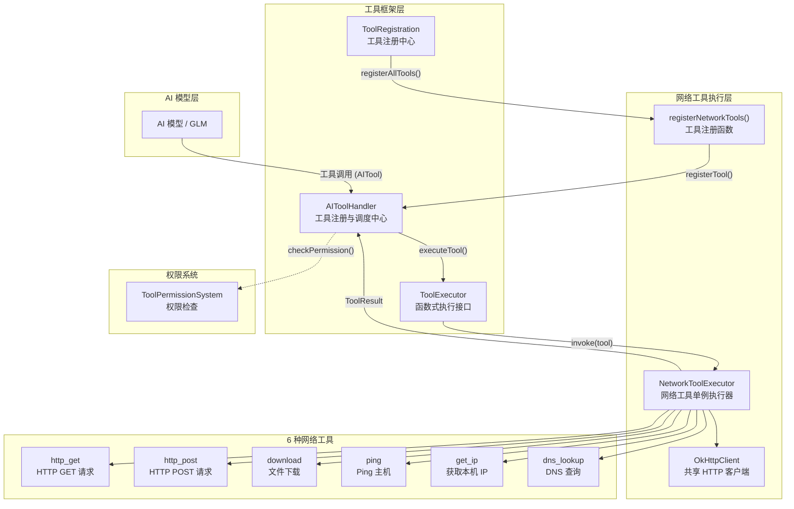
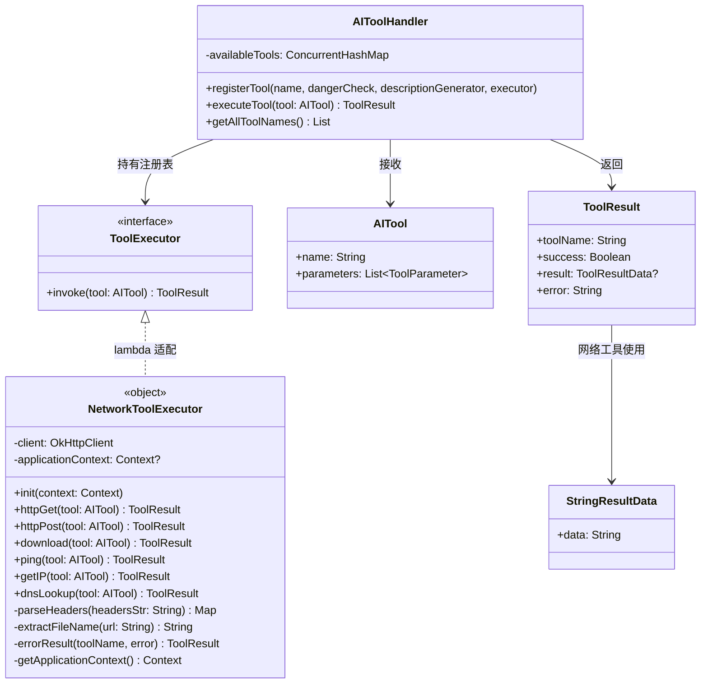
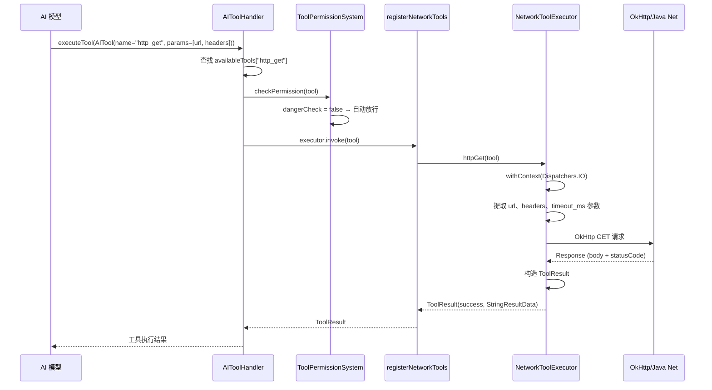
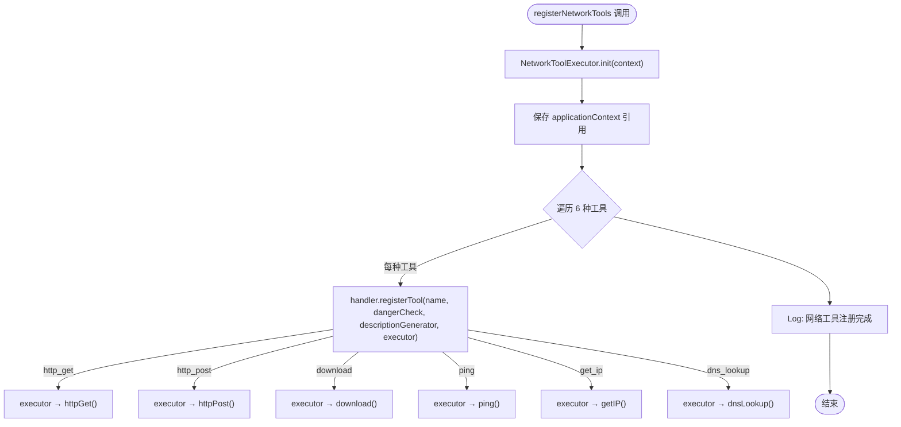
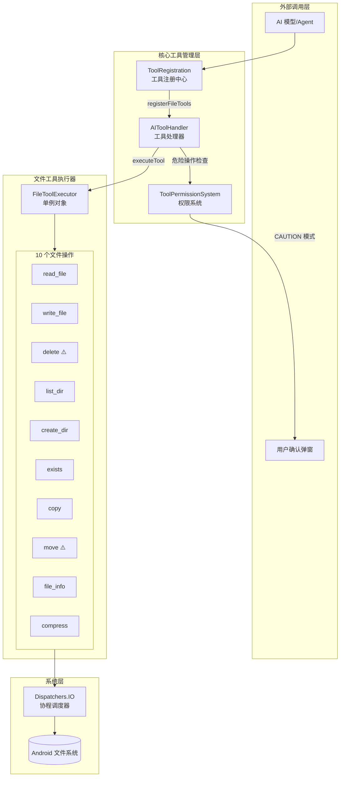
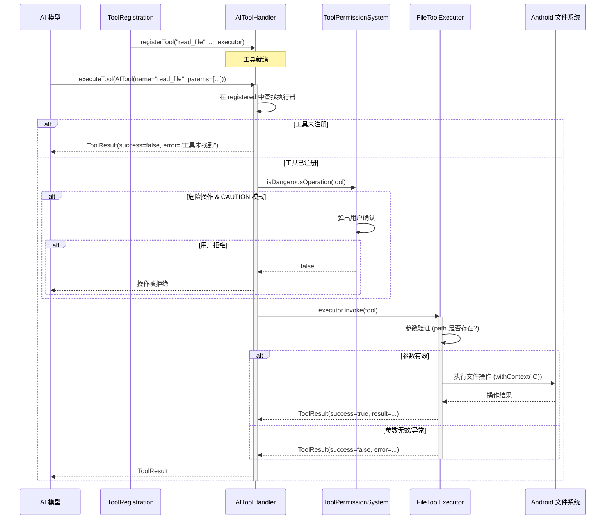
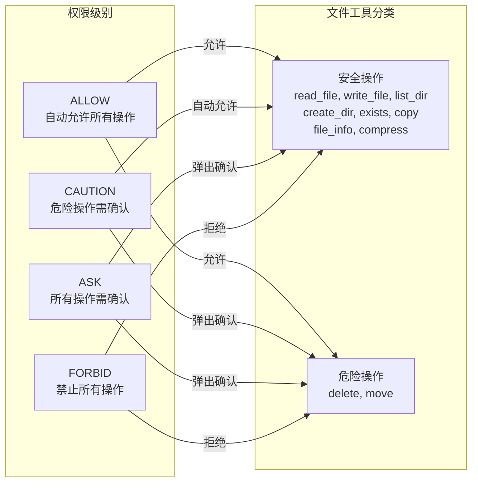

# 网络与文件工具

本页汇总 6 个网络工具和 10 个文件工具的参数、执行流程、安全防护与 API。

为 Aries AI 代理提供 HTTP 请求、文件下载、Ping、DNS 查询及本机 IP 获取等网络功能，使 AI 模型能够通过工具调用与网络进行交互。

## 概述

`NetworkToolExecutor` 是 Aries AI 框架中负责网络操作的核心执行器。它是一个 Kotlin 单例对象（`object`），封装了基于 OkHttp 的 HTTP 客户端和 Java 标准库的网络工具，为 AI 代理提供了 6 种网络工具能力。所有网络操作均在 `Dispatchers.IO` 上执行，确保不阻塞 Android 主线程。

**设计意图：** 在智能代理执行任务时，可能需要查询在线 API、下载资源文件、检测网络连通性或解析域名。`NetworkToolExecutor` 将这些常见网络操作统一封装为标准化的 `ToolExecutor` 接口，使得 AI 模型（如 GLM）可以通过流式工具调用（SSE tool-call stream）无缝发起网络请求。

### 核心特性

- **6 种网络工具**：HTTP GET/POST、文件下载、Ping 主机、获取本机 IP、DNS 查询
- **统一接口**：所有工具均实现 `ToolExecutor` 函数式接口（`suspend fun invoke(AITool): ToolResult`）
- **IO 线程调度**：所有网络操作通过 `withContext(Dispatchers.IO)` 在 IO 协程上下文中执行
- **共享 HTTP 客户端**：使用单例 `OkHttpClient` 实例，配置 30 秒连接/读写超时
- **参数化设计**：每个工具通过 `AITool.parameters` 接收参数，支持自定义请求头、超时、内容类型等
- **无危险标记**：所有网络工具 `dangerCheck` 均为 `{ false }`，被权限系统视为安全操作

## 架构



**架构说明：**

1. **AI 模型层**：AI 模型通过 SSE 流式协议发起工具调用，包含工具名称和参数列表
2. **工具框架层**：`AIToolHandler` 作为中央调度器管理工具注册表，`ToolRegistration` 在启动时调用 `registerNetworkTools()` 批量注册所有网络工具
3. **网络工具执行层**：`NetworkToolExecutor` 是实际执行网络操作的单例，持有共享的 `OkHttpClient` 实例
4. **权限系统**：`ToolPermissionSystem` 在工具执行前检查权限级别，网络工具因 `dangerCheck = { false }` 在 CAUTION 模式下自动放行

### 类关系图



## 工具清单与核心流程

### 注册的 6 种网络工具

| 工具名称 | 功能描述 | 关键参数 | 执行方法 |
|---------|---------|---------|---------|
| `http_get` | HTTP GET 请求 | `url`（必填）, `headers`, `timeout_ms` | `httpGet()` |
| `http_post` | HTTP POST 请求 | `url`（必填）, `body`, `content_type` | `httpPost()` |
| `download` | 下载文件到缓存目录 | `url`（必填）, `save_path` | `download()` |
| `ping` | Ping 主机检测可达性 | `host`（必填）, `count`, `timeout_ms` | `ping()` |
| `get_ip` | 获取本机 IPv4 地址 | 无 | `getIP()` |
| `dns_lookup` | DNS 域名解析 | `domain`（必填） | `dnsLookup()` |

### 工具执行流程



### 初始化流程

`NetworkToolExecutor` 采用延迟初始化策略。在 `registerNetworkTools()` 被调用时，首先通过 `init(context)` 保存 `ApplicationContext` 引用。后续的 `download` 操作需要使用 Context 来访问应用缓存目录。



## 核心实现详解

### HTTP GET 请求

`httpGet` 方法通过 OkHttp 发送 GET 请求，支持自定义请求头和超时参数。响应体超过 200 字符会被截断展示，避免对 AI 模型产生过大的 token 消耗。

```kotlin
suspend fun httpGet(tool: AITool): ToolResult = withContext(Dispatchers.IO) {
    val url = tool.parameters.find { it.name == "url" }?.value
        ?: return@withContext errorResult(tool.name, "缺少 url 参数")

    val headersStr = tool.parameters.find { it.name == "headers" }?.value
    val timeout = tool.parameters.find { it.name == "timeout_ms" }?.value?.toLongOrNull() ?: 10000L

    try {
        val requestBuilder = Request.Builder()
            .url(url)
            .get()

        headersStr?.let { headers ->
            parseHeaders(headers).forEach { (key, value) ->
                requestBuilder.addHeader(key, value)
            }
        }

        val response = client.newCall(requestBuilder.build()).execute()
        val body = response.body?.string() ?: ""
        val statusCode = response.code

        val success = response.isSuccessful
        val resultMessage = if (success) {
            "HTTP GET 成功 (${statusCode}): ${body.take(200)}"
        } else {
            "HTTP GET 失败 (${statusCode}): $body"
        }

        ToolResult(
            toolName = tool.name,
            success = success,
            result = StringResultData(resultMessage),
            error = if (success) "" else "HTTP Error: $statusCode"
        )
    } catch (e: Exception) {
        errorResult(tool.name, "HTTP GET 失败: ${e.message}")
    }
}
```
> Source: [NetworkToolExecutor.kt](https://github.com/ZG0704666/Aries-AI/blob/main/app/src/main/java/com/ai/phoneagent/core/tools/network/NetworkToolExecutor.kt#L53-L93)

**设计要点：**
- 响应体使用 `.take(200)` 截断，避免大量文本消耗 AI 上下文窗口
- 自定义请求头通过 `parseHeaders()` 解析，支持 `key: value` 格式（每行一个头）

### HTTP POST 请求

`httpPost` 方法发送 POST 请求，默认 `Content-Type` 为 `application/json`。请求体通过 OkHttp 的 `toRequestBody` 构建。

```kotlin
suspend fun httpPost(tool: AITool): ToolResult = withContext(Dispatchers.IO) {
    val url = tool.parameters.find { it.name == "url" }?.value
        ?: return@withContext errorResult(tool.name, "缺少 url 参数")

    val body = tool.parameters.find { it.name == "body" }?.value ?: ""
    val contentType = tool.parameters.find { it.name == "content_type" }?.value ?: "application/json"

    try {
        val requestBody = body.toRequestBody(contentType.toMediaType())
        val request = Request.Builder()
            .url(url)
            .post(requestBody)
            .addHeader("Content-Type", contentType)
            .build()

        val response = client.newCall(request).execute()
        // ... 构造 ToolResult（与 GET 类似）
    } catch (e: Exception) {
        errorResult(tool.name, "HTTP POST 失败: ${e.message}")
    }
}
```
> Source: [NetworkToolExecutor.kt](https://github.com/ZG0704666/Aries-AI/blob/main/app/src/main/java/com/ai/phoneagent/core/tools/network/NetworkToolExecutor.kt#L98-L134)

### 文件下载

`download` 方法将远程文件下载到应用缓存目录，自动从 URL 提取文件名或使用自定义保存路径。

```kotlin
suspend fun download(tool: AITool): ToolResult = withContext(Dispatchers.IO) {
    val url = tool.parameters.find { it.name == "url" }?.value
        ?: return@withContext errorResult(tool.name, "缺少 url 参数")

    val savePath = tool.parameters.find { it.name == "save_path" }?.value

    try {
        val request = Request.Builder().url(url).get().build()
        val response = client.newCall(request).execute()

        if (!response.isSuccessful) {
            return@withContext errorResult(tool.name, "下载失败: ${response.code}")
        }

        val bytes = response.body?.bytes()
            ?: return@withContext errorResult(tool.name, "下载失败: 空响应")

        val fileName = if (savePath.isNullOrBlank()) {
            extractFileName(url)
        } else {
            savePath
        }

        val context = getApplicationContext()
        val file = java.io.File(context.cacheDir, fileName)
        file.writeBytes(bytes)
        // ... 返回结果
    }
}
```
> Source: [NetworkToolExecutor.kt](https://github.com/ZG0704666/Aries-AI/blob/main/app/src/main/java/com/ai/phoneagent/core/tools/network/NetworkToolExecutor.kt#L139-L187)

**安全设计：** 文件保存在应用私有缓存目录（`context.cacheDir`），无需存储权限，也避免了访问外部存储的安全问题。

### Ping 与 DNS 查询

Ping 通过 Java 标准库的 `InetAddress.isReachable()` 检测主机可达性。DNS 查询通过 `InetAddress.getAllByName()` 解析域名的所有 IP 地址。

```kotlin
// Ping 主机
suspend fun ping(tool: AITool): ToolResult = withContext(Dispatchers.IO) {
    val host = tool.parameters.find { it.name == "host" }?.value
        ?: return@withContext errorResult(tool.name, "缺少 host 参数")
    val timeout = tool.parameters.find { it.name == "timeout_ms" }?.value?.toIntOrNull() ?: 5000

    val reachable = InetAddress.getByName(host).isReachable(timeout)
    // ... 构造结果
}

// DNS 查询
suspend fun dnsLookup(tool: AITool): ToolResult = withContext(Dispatchers.IO) {
    val domain = tool.parameters.find { it.name == "domain" }?.value
        ?: return@withContext errorResult(tool.name, "缺少 domain 参数")

    val addresses = InetAddress.getAllByName(domain)
    val ips = addresses.map { it.hostAddress }.filterNotNull().joinToString(", ")
    // ... 构造结果
}
```
> Source: [NetworkToolExecutor.kt](https://github.com/ZG0704666/Aries-AI/blob/main/app/src/main/java/com/ai/phoneagent/core/tools/network/NetworkToolExecutor.kt#L192-L284)

### 获取本机 IP

`getIP` 方法遍历所有网络接口，返回第一个非回环且包含点分格式的 IPv4 地址。

```kotlin
suspend fun getIP(tool: AITool): ToolResult = withContext(Dispatchers.IO) {
    val interfaces = java.net.NetworkInterface.getNetworkInterfaces()
    var ipAddress = ""

    while (interfaces.hasMoreElements()) {
        val networkInterface = interfaces.nextElement()
        val addresses = networkInterface.inetAddresses
        while (addresses.hasMoreElements()) {
            val address = addresses.nextElement()
            if (!address.isLoopbackAddress && address.hostAddress?.contains('.') == true) {
                ipAddress = address.hostAddress ?: ""
                break
            }
        }
        if (ipAddress.isNotEmpty()) break
    }
    // ... 构造结果
}
```
> Source: [NetworkToolExecutor.kt](https://github.com/ZG0704666/Aries-AI/blob/main/app/src/main/java/com/ai/phoneagent/core/tools/network/NetworkToolExecutor.kt#L221-L255)

**设计意图：** 使用 `contains('.')` 过滤 IPv4 地址，排除 IPv6 格式；跳过回环地址（127.0.0.1）以确保获取的是真实网络 IP。

### 工具注册机制

所有网络工具通过顶层函数 `registerNetworkTools()` 批量注册到 `AIToolHandler`。每个工具注册时提供三个组件：

```kotlin
fun registerNetworkTools(handler: AIToolHandler, context: Context) {
    NetworkToolExecutor.init(context)

    handler.registerTool(
        name = "http_get",
        dangerCheck = { false },              // 非危险操作
        descriptionGenerator = { tool ->       // 操作描述（用于权限确认对话框）
            val url = tool.parameters.find { it.name == "url" }?.value ?: ""
            "HTTP GET: $url"
        },
        executor = { tool ->                   // 执行器（lambda 适配 ToolExecutor 接口）
            NetworkToolExecutor.httpGet(tool)
        }
    )
    // ... 其余 5 个工具类推
}
```
> Source: [NetworkToolExecutor.kt](https://github.com/ZG0704666/Aries-AI/blob/main/app/src/main/java/com/ai/phoneagent/core/tools/network/NetworkToolExecutor.kt#L332-L411)

工具注册的入口在 `ToolRegistration.registerAllTools()` 中调用：

```kotlin
fun registerAllTools(handler: AIToolHandler, context: Context) {
    registerUITools(handler, context)
    registerAppTools(handler, context)
    registerSystemTools(handler, context)
    // 注册网络工具
    registerNetworkTools(handler, context)
    // 注册文件系统工具
    registerFileTools(handler, context)
}
```
> Source: [ToolRegistration.kt](https://github.com/ZG0704666/Aries-AI/blob/main/app/src/main/java/com/ai/phoneagent/core/tools/ToolRegistration.kt#L46-L65)

## 辅助函数

### parseHeaders — 请求头解析

将字符串格式的自定义请求头解析为 Map。支持 `key: value` 格式，每行一个头。

```kotlin
private fun parseHeaders(headersStr: String): Map<String, String> {
    return headersStr.split("\n")
        .map { it.trim() }
        .filter { it.contains(":") }
        .associate {
            val parts = it.split(":", limit = 2)
            parts[0].trim() to parts.getOrElse(1) { "" }.trim()
        }
}
```
> Source: [NetworkToolExecutor.kt](https://github.com/ZG0704666/Aries-AI/blob/main/app/src/main/java/com/ai/phoneagent/core/tools/network/NetworkToolExecutor.kt#L288-L296)

### extractFileName — URL 文件名提取

从 URL 路径中提取文件名，URL 解析失败时生成带时间戳的默认文件名。

```kotlin
private fun extractFileName(url: String): String {
    return try {
        val path = URL(url).path
        val fileName = path.substringAfterLast("/")
        if (fileName.isNotEmpty()) fileName else "download_${System.currentTimeMillis()}"
    } catch (e: Exception) {
        "download_${System.currentTimeMillis()}"
    }
}
```
> Source: [NetworkToolExecutor.kt](https://github.com/ZG0704666/Aries-AI/blob/main/app/src/main/java/com/ai/phoneagent/core/tools/network/NetworkToolExecutor.kt#L298-L306)

### errorResult — 统一错误结果构建

所有工具的异常处理统一通过 `errorResult` 构建失败的 `ToolResult`，确保错误格式一致。

```kotlin
private fun errorResult(toolName: String, error: String): ToolResult {
    return ToolResult(
        toolName = toolName,
        success = false,
        result = StringResultData(""),
        error = error
    )
}
```
> Source: [NetworkToolExecutor.kt](https://github.com/ZG0704666/Aries-AI/blob/main/app/src/main/java/com/ai/phoneagent/core/tools/network/NetworkToolExecutor.kt#L319-L326)

## 权限与安全

所有网络工具的 `dangerCheck` 均设置为 `{ false }`，表示网络操作不被视为危险操作。在 `ToolPermissionSystem` 的 CAUTION（谨慎）模式下，非危险操作会自动放行，无需用户确认。

```kotlin
// 权限检查的核心逻辑
if (toolLevel == PermissionLevel.CAUTION) {
    val isDangerous = toolHandler.isDangerousOperation(tool)
    if (!isDangerous) {
        return true  // 非危险操作，自动允许
    }
}
```
> Source: [ToolPermissionSystem.kt](https://github.com/ZG0704666/Aries-AI/blob/main/app/src/main/java/com/ai/phoneagent/permissions/ToolPermissionSystem.kt#L110-L116)

**设计意图：** 网络请求（GET/POST）和诊断工具（Ping/DNS）在当前安全模型中被视为低风险操作。如果未来需要限制特定网络行为（如敏感 API 调用），可以通过修改 `dangerCheck` 回调或通过 `ToolPermissionsRepository` 设置工具级别的权限覆盖来实现。

### SSRF 防护（InetAddressGuard）与 DNS 固定

虽然 `dangerCheck` 为 `{ false }`，网络工具在代码层面仍有独立的 SSRF（服务端请求伪造）防护：

- **`InetAddressGuard.requirePublic()`**：对目标主机解析出的 IP 做公网校验，拦截回环（`127.0.0.0/8`、`::1/128`）、链路本地（`fe80::/10`）、站点本地 ULA（`fc00::/7`）、组播（`ff00::/8`）以及 IPv4-mapped IPv6 中的受限 IPv4 地址等内网/私有/受限地址，命中时抛出 `SecurityException` 拒绝请求
- **DNS 固定（PinnedPublicDns）**：每次请求会基于原 client `newBuilder()` 换上一次性的 `PinnedPublicDns`（内部继承 `Dns`）：首次解析时经 `InetAddressGuard.requirePublic()` 校验并按主机名缓存（小写键），同一次请求内的后续连接复用固定地址，避免「校验时与连接时解析结果不一致」的 DNS rebinding 攻击面
- **重定向逐跳校验**：HTTP 客户端禁用 OkHttp 自动重定向（`followRedirects(false)`），由 `executeWithRedirects()` 手动跟随，每跳都重新执行 `validateUrl()`：仅允许 http/https scheme、校验主机与端口，并对新主机再次做公网 IP 固定校验
- **`download` 路径防护**：保存路径无论来自 `save_path` 参数还是 URL 提取的文件名，都会先经 `PathGuard.canonicalizeWithin(listOf(appContext.cacheDir), ...)` 两次校验，确保最终写入位置落在应用缓存目录内

> Sources:
> - [InetAddressGuard.kt](https://github.com/ZG0704666/Aries-AI/blob/main/app/src/main/java/com/ai/phoneagent/core/security/InetAddressGuard.kt#L35-L46)
> - [NetworkToolExecutor.kt](https://github.com/ZG0704666/Aries-AI/blob/main/app/src/main/java/com/ai/phoneagent/core/tools/network/NetworkToolExecutor.kt#L141-L147) | [NetworkToolExecutor.kt（DNS 固定）](https://github.com/ZG0704666/Aries-AI/blob/main/app/src/main/java/com/ai/phoneagent/core/tools/network/NetworkToolExecutor.kt#L453-L459)

## 使用示例

### HTTP GET 请求示例

AI 模型通过工具调用发起 HTTP GET 请求：

```kotlin
// AI 模型生成的工具调用
val tool = AITool(
    name = "http_get",
    parameters = listOf(
        ToolParameter("url", "https://api.example.com/data"),
        ToolParameter("headers", "Authorization: Bearer token123\nAccept: application/json"),
        ToolParameter("timeout_ms", "5000")
    )
)

// AIToolHandler 执行工具
val result = handler.executeTool(tool)
// result.success = true
// result.result = StringResultData("HTTP GET 成功 (200): {...}")
```
> Source: 基于 [AITool](https://github.com/ZG0704666/Aries-AI/blob/main/app/src/main/java/com/ai/phoneagent/data/model/AITool.kt#L6-L9) 和 [NetworkToolExecutor.kt](https://github.com/ZG0704666/Aries-AI/blob/main/app/src/main/java/com/ai/phoneagent/core/tools/network/NetworkToolExecutor.kt#L53-L93) 构造

### DNS 查询示例

```kotlin
val tool = AITool(
    name = "dns_lookup",
    parameters = listOf(
        ToolParameter("domain", "github.com")
    )
)

val result = NetworkToolExecutor.dnsLookup(tool)
// result.success = true
// result.result = StringResultData("github.com -> 140.82.121.3")
```
> Source: 基于 [NetworkToolExecutor.kt](https://github.com/ZG0704666/Aries-AI/blob/main/app/src/main/java/com/ai/phoneagent/core/tools/network/NetworkToolExecutor.kt#L260-L284) 构造

## 配置选项

### OkHttpClient 超时配置

| 参数 | 类型 | 默认值 | 说明 |
|------|------|--------|------|
| `connectTimeout` | Long | 30 秒 | 连接超时时间 |
| `readTimeout` | Long | 30 秒 | 读取超时时间 |
| `writeTimeout` | Long | 30 秒 | 写入超时时间 |

> Source: [NetworkToolExecutor.kt](https://github.com/ZG0704666/Aries-AI/blob/main/app/src/main/java/com/ai/phoneagent/core/tools/network/NetworkToolExecutor.kt#L44-L48)

### 工具参数选项

**http_get 参数：**

| 参数 | 类型 | 必填 | 默认值 | 说明 |
|------|------|------|--------|------|
| `url` | String | 是 | — | 请求 URL |
| `headers` | String | 否 | — | 自定义请求头（每行 `key: value` 格式） |
| `timeout_ms` | Long | 否 | 10000 | 请求超时（毫秒） |

**http_post 参数：**

| 参数 | 类型 | 必填 | 默认值 | 说明 |
|------|------|------|--------|------|
| `url` | String | 是 | — | 请求 URL |
| `body` | String | 否 | `""` | 请求体内容 |
| `content_type` | String | 否 | `"application/json"` | Content-Type 头值 |

**download 参数：**

| 参数 | 类型 | 必填 | 默认值 | 说明 |
|------|------|------|--------|------|
| `url` | String | 是 | — | 下载 URL |
| `save_path` | String | 否 | URL 文件名 | 保存路径（相对于缓存目录） |

**ping 参数：**

| 参数 | 类型 | 必填 | 默认值 | 说明 |
|------|------|------|--------|------|
| `host` | String | 是 | — | 目标主机名或 IP |
| `count` | Int | 否 | 4 | Ping 次数（预留，当前实现使用 `isReachable`） |
| `timeout_ms` | Int | 否 | 5000 | 超时时间（毫秒） |

**dns_lookup 参数：**

| 参数 | 类型 | 必填 | 默认值 | 说明 |
|------|------|------|--------|------|
| `domain` | String | 是 | — | 要解析的域名 |

**get_ip 参数：** 无需参数。

## API 参考

### `NetworkToolExecutor`

Kotlin 单例对象，提供所有网络工具的执行方法。使用前必须调用 `init(context)`。

#### `init(context: Context)`

初始化执行器，保存 ApplicationContext 引用。

**参数：**
- `context` (Context)：Android Context，内部转为 `applicationContext`

**抛出：**
- 无显式抛出。但若未调用 `init()` 而直接使用 `download`，会抛出 `IllegalStateException`

---

#### `suspend fun httpGet(tool: AITool): ToolResult`

执行 HTTP GET 请求。

**参数：**
- `tool` (AITool)：包含 `url`（必填）、`headers`（可选）、`timeout_ms`（可选）参数

**返回：** `ToolResult`，成功时 `result` 为 `StringResultData`，内容截断至 200 字符

**调度：** `Dispatchers.IO`

---

#### `suspend fun httpPost(tool: AITool): ToolResult`

执行 HTTP POST 请求。

**参数：**
- `tool` (AITool)：包含 `url`（必填）、`body`（可选，默认空字符串）、`content_type`（可选，默认 `"application/json"`）参数

**返回：** `ToolResult`，成功时 `result` 为 `StringResultData`

**调度：** `Dispatchers.IO`

---

#### `suspend fun download(tool: AITool): ToolResult`

下载文件到应用缓存目录。

**参数：**
- `tool` (AITool)：包含 `url`（必填）、`save_path`（可选）参数

**返回：** `ToolResult`，成功时 `result.data` 包含文件绝对路径和字节数

**调度：** `Dispatchers.IO`

---

#### `suspend fun ping(tool: AITool): ToolResult`

通过 `InetAddress.isReachable()` 检测主机可达性。

**参数：**
- `tool` (AITool)：包含 `host`（必填）、`count`（可选，默认 4）、`timeout_ms`（可选，默认 5000）参数

**返回：** `ToolResult`，`success` 表示主机是否可达

**调度：** `Dispatchers.IO`

---

#### `suspend fun getIP(tool: AITool): ToolResult`

获取本机首个非回环 IPv4 地址。

**参数：**
- `tool` (AITool)：无需特定参数

**返回：** `ToolResult`，`success` 表示是否成功获取 IP

**调度：** `Dispatchers.IO`

---

#### `suspend fun dnsLookup(tool: AITool): ToolResult`

对指定域名执行 DNS 解析。

**参数：**
- `tool` (AITool)：包含 `domain`（必填）参数

**返回：** `ToolResult`，成功时 `result.data` 格式为 `"域名 -> IP1, IP2"`

**调度：** `Dispatchers.IO`

---

### `registerNetworkTools(handler: AIToolHandler, context: Context)`

顶层函数，将 6 种网络工具批量注册到 AIToolHandler。

**参数：**
- `handler` (AIToolHandler)：工具注册处理器
- `context` (Context)：Android Context，用于初始化 NetworkToolExecutor

**注册的工具：** `http_get`、`http_post`、`download`、`ping`、`get_ip`、`dns_lookup`

> Source: [NetworkToolExecutor.kt](https://github.com/ZG0704666/Aries-AI/blob/main/app/src/main/java/com/ai/phoneagent/core/tools/network/NetworkToolExecutor.kt#L332-L411)

## 与 DI 模块的关系

`NetworkToolExecutor` 持有自己独立的 `OkHttpClient` 实例（30 秒超时），与 `NetworkModule` 中通过 Koin DI 管理的全局 `OkHttpClient`（60-360 秒超时）是**两个独立实例**。这种设计允许网络工具使用更短的超时配置，因为 AI 代理发起的工具调用通常期望快速响应，而全局 HTTP 客户端（用于 AutoGlmClient 等）需要更宽松的超时来处理长时间 AI 推理请求。

```kotlin
// NetworkModule.kt 中的全局 OkHttpClient 配置
val networkModule = module {
    single<OkHttpClient> {
        OkHttpClient.Builder()
            .connectTimeout(60, TimeUnit.SECONDS)    // 60s vs NetworkToolExecutor 的 30s
            .readTimeout(300, TimeUnit.SECONDS)       // 300s vs 30s
            .writeTimeout(120, TimeUnit.SECONDS)      // 120s vs 30s
            .callTimeout(360, TimeUnit.SECONDS)
            .connectionPool(ConnectionPool(10, 5, TimeUnit.MINUTES))
            .protocols(listOf(Protocol.HTTP_2, Protocol.HTTP_1_1))
            .build()
    }
}
```
> Source: [NetworkModule.kt](https://github.com/ZG0704666/Aries-AI/blob/main/app/src/main/java/com/ai/phoneagent/di/NetworkModule.kt#L47-L71)

---

## 文件工具执行器

为 AI 代理提供文件系统操作能力，包括文件读写、目录管理、文件信息查询和压缩等功能。

### 概述

`FileToolExecutor` 是 Aries-AI 自动化框架中的核心工具模块之一，负责向 AI 模型暴露一组文件系统操作接口。它采用 Kotlin `object` 单例模式实现，所有文件 I/O 操作均在 `Dispatchers.IO` 协程调度器上异步执行，保证 UI 线程不被阻塞。

该模块的设计初衷是让 AI 代理能够像人类用户一样与设备的文件系统进行交互——读取配置文件、写入日志、创建目录结构、打包文件等。通过将文件操作封装为标准化工具接口（`ToolExecutor`），AI 模型可以以统一的方式调用这些能力，而无需关心底层实现细节。

文件工具执行器共注册了 **10 个工具**，按照安全等级分为普通操作和危险操作两类。危险操作（`delete`、`move`）需要通过 `ToolPermissionSystem` 的用户确认机制才能执行，以防止意外的数据丢失。

### 架构



**架构说明：**

- **ToolRegistration**：在应用启动时通过 `registerAllTools()` 调用 `registerFileTools()`，将 10 个文件工具批量注册到 `AIToolHandler` 中
- **AIToolHandler**：作为工具注册表和执行调度器，维护 `ConcurrentHashMap` 存储工具名→执行器的映射，负责查找、危险检查、描述生成和执行
- **ToolPermissionSystem**：基于四级权限模型（ALLOW/CAUTION/ASK/FORBID），对标记为危险操作的工具（`delete`、`move`）进行用户确认拦截
- **FileToolExecutor**：所有工具的实际执行逻辑集中在此单例对象中，通过 `Dispatchers.IO` 调度到后台线程执行文件 I/O

### 工具清单

`FileToolExecutor` 提供以下 10 个文件系统工具：

| 工具名称 | 功能 | 危险操作 | 核心参数 |
|----------|------|----------|----------|
| `read_file` | 读取文件内容 | 否 | `path`, `max_size` |
| `write_file` | 写入文件内容 | 否 | `path`, `content`, `append` |
| `delete` | 删除文件或目录 | ⚠️ 是 | `path` |
| `list_dir` | 列出目录内容 | 否 | `path` |
| `create_dir` | 创建目录 | 否 | `path` |
| `exists` | 判断文件/目录是否存在 | 否 | `path` |
| `copy` | 复制文件 | 否 | `source`, `destination` |
| `move` | 移动/重命名文件 | ⚠️ 是 | `source`, `destination` |
| `file_info` | 获取文件详细信息 | 否 | `path` |
| `compress` | 创建 ZIP 压缩包 | 否 | `source`, `destination` |

> 危险操作（⚠️）在 `ToolPermissionSystem` 处于 `CAUTION` 级别时，会触发用户确认弹窗。

### 设计意图

#### 单例模式

`FileToolExecutor` 使用 Kotlin `object` 关键字声明，确保全局只有一个实例。这种设计选择基于以下考虑：

- 文件工具执行器本身是无状态的（仅持有 `applicationContext` 引用），无需多实例
- 避免了不必要的对象创建开销
- 简化了工具注册流程——所有工具的执行器 lambda 直接引用 `FileToolExecutor` 的方法

> Source: [FileToolExecutor.kt](https://github.com/ZG0704666/Aries-AI/blob/main/app/src/main/java/com/ai/phoneagent/core/tools/file/FileToolExecutor.kt#L38)

#### 上下文初始化模式

```kotlin
private var applicationContext: Context? = null

fun init(context: Context) {
    applicationContext = context.applicationContext
}

private fun getContext(): Context {
    return applicationContext
        ?: throw IllegalStateException("FileToolExecutor 未初始化")
}
```

> Source: [FileToolExecutor.kt](https://github.com/ZG0704666/Aries-AI/blob/main/app/src/main/java/com/ai/phoneagent/core/tools/file/FileToolExecutor.kt#L41-L50)

该设计避免了在 `object` 中持有 Activity Context 导致的内存泄漏——始终保存 `applicationContext`。

#### 协程异步执行

所有工具方法均为 `suspend` 函数，并在内部使用 `withContext(Dispatchers.IO)` 将文件 I/O 操作切换到 IO 线程池：

```kotlin
suspend fun readFile(tool: AITool): ToolResult = withContext(Dispatchers.IO) {
    // 文件读取操作...
}
```

> Source: [FileToolExecutor.kt](https://github.com/ZG0704666/Aries-AI/blob/main/app/src/main/java/com/ai/phoneagent/core/tools/file/FileToolExecutor.kt#L55-L80)

这种设计确保即使处理大文件或长时间 I/O 操作，也不会阻塞 Android 主线程。

#### 统一结果模型

所有工具使用私有的 `success()` 和 `error()` 辅助函数构建一致的 `ToolResult`：

```kotlin
private fun success(toolName: String, message: String): ToolResult {
    return ToolResult(
        toolName = toolName,
        success = true,
        result = StringResultData(message),
        error = ""
    )
}

private fun error(toolName: String, error: String): ToolResult {
    return ToolResult(
        toolName = toolName,
        success = false,
        result = StringResultData(""),
        error = error
    )
}
```

> Source: [FileToolExecutor.kt](https://github.com/ZG0704666/Aries-AI/blob/main/app/src/main/java/com/ai/phoneagent/core/tools/file/FileToolExecutor.kt#L359-L375)

这种设计避免了重复的 `ToolResult` 构造代码，确保所有工具返回格式一致的结果，便于 AI 模型统一解析。

#### 危险操作标记

在工具注册时，`delete` 和 `move` 被标记为危险操作：

```kotlin
// Delete
handler.registerTool(
    name = "delete",
    dangerCheck = { true }, // 危险操作
    ...
)

// Move
handler.registerTool(
    name = "move",
    dangerCheck = { true }, // 危险操作
    ...
)
```

> Source: [FileToolExecutor.kt](https://github.com/ZG0704666/Aries-AI/blob/main/app/src/main/java/com/ai/phoneagent/core/tools/file/FileToolExecutor.kt#L411-L421)

当 `ToolPermissionSystem` 处于 `CAUTION` 模式时，这些工具会触发用户确认，防止 AI 误操作删除或移动重要文件。

### 核心流程



**流程说明：**

1. **工具注册阶段**：`registerFileTools()` 在应用初始化时将所有 10 个文件工具注册到 `AIToolHandler`
2. **AI 调用阶段**：AI 模型构造 `AITool` 对象（包含工具名和参数列表），通过 `AIToolHandler.executeTool()` 执行
3. **权限检查阶段**：`ToolPermissionSystem` 检查是否为危险操作，必要时弹出用户确认弹窗
4. **执行阶段**：`FileToolExecutor` 验证参数后在 `Dispatchers.IO` 上执行实际文件操作
5. **结果返回**：统一格式的 `ToolResult` 返回给 AI 模型进行下一步决策

### 工具注册

`registerFileTools()` 函数负责将所有文件工具注册到 `AIToolHandler`：

```kotlin
fun registerFileTools(handler: AIToolHandler, context: Context) {
    FileToolExecutor.init(context)

    // Read File
    handler.registerTool(
        name = "read_file",
        dangerCheck = { false },
        descriptionGenerator = { tool ->
            val path = tool.parameters.find { it.name == "path" }?.value ?: ""
            "读取文件: $path"
        },
        executor = { tool ->
            FileToolExecutor.readFile(tool)
        }
    )
    // ... 其余 9 个工具的注册
}
```

> Source: [FileToolExecutor.kt](https://github.com/ZG0704666/Aries-AI/blob/main/app/src/main/java/com/ai/phoneagent/core/tools/file/FileToolExecutor.kt#L381-L514)

每个工具注册时提供三个关键函数：

- **`dangerCheck`**：判断是否为危险操作，用于权限系统拦截
- **`descriptionGenerator`**：生成人类可读的操作描述，用于用户确认弹窗
- **`executor`**：实际执行逻辑，遵循 `ToolExecutor` 函数式接口

该函数在 `ToolRegistration.registerAllTools()` 中被调用：

```kotlin
fun registerAllTools(handler: AIToolHandler, context: Context) {
    registerUITools(handler, context)
    registerAppTools(handler, context)
    registerSystemTools(handler, context)
    registerNetworkTools(handler, context)

    // 注册文件系统工具
    registerFileTools(handler, context)
}
```

> Source: [ToolRegistration.kt](https://github.com/ZG0704666/Aries-AI/blob/main/app/src/main/java/com/ai/phoneagent/core/tools/ToolRegistration.kt#L46-L56)

### API 参考

所有工具方法遵循相同的模式：接收 `AITool` 参数，返回 `ToolResult`。

#### `readFile(tool: AITool): ToolResult`

读取文件内容。如果文件超过 `max_size`（默认 1MB），则只读取前 100 行。

**参数（通过 `tool.parameters` 传递）：**
- `path` (String, 必需)：文件路径
- `max_size` (Long, 可选)：最大读取字节数，默认 `1048576`（1MB）

**返回值：**
- 成功：`ToolResult(success=true, result=StringResultData(文件内容前200字符预览))`
- 失败：`ToolResult(success=false, error="文件不存在" / "路径是目录不是文件" / "读取失败: ...")`

> Source: [FileToolExecutor.kt](https://github.com/ZG0704666/Aries-AI/blob/main/app/src/main/java/com/ai/phoneagent/core/tools/file/FileToolExecutor.kt#L55-L80)

---

#### `writeFile(tool: AITool): ToolResult`

写入内容到文件，支持追加模式，自动创建父目录。

**参数：**
- `path` (String, 必需)：目标文件路径
- `content` (String, 可选)：要写入的内容，默认 `""`
- `append` (Boolean, 可选)：是否追加模式，默认 `false`

**返回值：**
- 成功：`ToolResult(success=true, result=StringResultData("写入成功: <path> (<N> chars)"))`
- 失败：`ToolResult(success=false, error="写入失败: ...")`

> Source: [FileToolExecutor.kt](https://github.com/ZG0704666/Aries-AI/blob/main/app/src/main/java/com/ai/phoneagent/core/tools/file/FileToolExecutor.kt#L85-L108)

---

#### `delete(tool: AITool): ToolResult` ⚠️ 危险操作

删除文件或递归删除目录。

**参数：**
- `path` (String, 必需)：要删除的文件或目录路径

**返回值：**
- 成功：`ToolResult(success=true, result=StringResultData("删除成功: <path>"))`
- 失败：`ToolResult(success=false, error="文件不存在" / "删除失败: ...")`

> Source: [FileToolExecutor.kt](https://github.com/ZG0704666/Aries-AI/blob/main/app/src/main/java/com/ai/phoneagent/core/tools/file/FileToolExecutor.kt#L113-L137)

---

#### `listDir(tool: AITool): ToolResult`

列出目录内容，显示每个条目的类型（DIR/FILE）和文件大小。

**参数：**
- `path` (String, 必需)：目录路径

**返回值：**
- 成功：`ToolResult(success=true, result=StringResultData("目录内容 (<path>):\nDIR dir1\nFILE file1.txt (1024 bytes)\n..."))`
- 失败：`ToolResult(success=false, error="目录不存在" / "路径不是目录" / ...)`

> Source: [FileToolExecutor.kt](https://github.com/ZG0704666/Aries-AI/blob/main/app/src/main/java/com/ai/phoneagent/core/tools/file/FileToolExecutor.kt#L142-L172)

---

#### `createDir(tool: AITool): ToolResult`

递归创建目录（等效于 `mkdir -p`）。目录已存在时视为成功。

**参数：**
- `path` (String, 必需)：要创建的目录路径

**返回值：**
- 成功：`ToolResult(success=true, result=StringResultData("创建目录成功: <path>" / "目录已存在: <path>"))`
- 失败：`ToolResult(success=false, error="创建目录失败: ...")`

> Source: [FileToolExecutor.kt](https://github.com/ZG0704666/Aries-AI/blob/main/app/src/main/java/com/ai/phoneagent/core/tools/file/FileToolExecutor.kt#L177-L197)

---

#### `exists(tool: AITool): ToolResult`

判断文件或目录是否存在，并返回其类型。

**参数：**
- `path` (String, 必需)：要检查的路径

**返回值：**
- 成功：`ToolResult(success=true, result=StringResultData("<path> (文件|目录|不存在)"))`

> Source: [FileToolExecutor.kt](https://github.com/ZG0704666/Aries-AI/blob/main/app/src/main/java/com/ai/phoneagent/core/tools/file/FileToolExecutor.kt#L202-L219)

---

#### `copy(tool: AITool): ToolResult`

复制文件到目标位置，自动创建目标父目录，覆盖已存在的目标文件。**不支持目录复制。**

**参数：**
- `source` (String, 必需)：源文件路径
- `destination` (String, 必需)：目标文件路径

**返回值：**
- 成功：`ToolResult(success=true, result=StringResultData("复制成功: <source> -> <dest>"))`
- 失败：`ToolResult(success=false, error="源文件不存在" / "不支持复制目录" / ...)`

> Source: [FileToolExecutor.kt](https://github.com/ZG0704666/Aries-AI/blob/main/app/src/main/java/com/ai/phoneagent/core/tools/file/FileToolExecutor.kt#L224-L250)

---

#### `move(tool: AITool): ToolResult` ⚠️ 危险操作

移动或重命名文件。使用 Java `File.renameTo()`，在同一文件系统内为原子操作。

**参数：**
- `source` (String, 必需)：源文件路径
- `destination` (String, 必需)：目标路径

**返回值：**
- 成功：`ToolResult(success=true, result=StringResultData("移动成功: <source> -> <dest>"))`
- 失败：`ToolResult(success=false, error="源文件不存在" / "移动失败: ...")`

> Source: [FileToolExecutor.kt](https://github.com/ZG0704666/Aries-AI/blob/main/app/src/main/java/com/ai/phoneagent/core/tools/file/FileToolExecutor.kt#L255-L281)

---

#### `fileInfo(tool: AITool): ToolResult`

获取文件的详细元数据信息。

**参数：**
- `path` (String, 必需)：文件路径

**返回值：**
包含以下字段的格式化字符串：
- 文件名、绝对路径、大小（bytes）
- 可读/可写/可执行权限
- 是目录/是文件标识
- 最后修改时间（`yyyy-MM-dd HH:mm:ss` 格式）

> Source: [FileToolExecutor.kt](https://github.com/ZG0704666/Aries-AI/blob/main/app/src/main/java/com/ai/phoneagent/core/tools/file/FileToolExecutor.kt#L286-L312)

---

#### `compress(tool: AITool): ToolResult`

创建 ZIP 压缩文件。支持压缩单个文件或整个目录（递归遍历 `walkTopDown`）。

**参数：**
- `source` (String, 必需)：要压缩的源文件或目录路径
- `destination` (String, 必需)：输出 ZIP 文件路径

**返回值：**
- 成功：`ToolResult(success=true, result=StringResultData("压缩成功: <source> -> <dest>"))`
- 失败：`ToolResult(success=false, error="源文件不存在" / "压缩失败: ...")`

> Source: [FileToolExecutor.kt](https://github.com/ZG0704666/Aries-AI/blob/main/app/src/main/java/com/ai/phoneagent/core/tools/file/FileToolExecutor.kt#L317-L355)

### 权限模型

文件工具执行器遵循 `ToolPermissionSystem` 定义的四级权限模型：



**默认级别**：系统默认使用 `CAUTION` 模式。在此模式下，`delete` 和 `move` 操作会触发用户确认弹窗，弹窗中会显示由 `descriptionGenerator` 生成的操作描述（如"删除: /sdcard/Downloads/temp.txt"）。

### 路径安全防护（PathGuard）

所有 10 个文件工具在触碰真实文件系统前，都会先经过 `PathGuard.canonicalizeWithin()` 做路径规范化与越界校验（通过各工具内部的 `resolvePath()` 辅助函数统一调用）：

- **允许根目录**：仅允许应用私有目录 `filesDir`、`cacheDir` 与 `getExternalFilesDir(null)` 作为访问根
- **拒绝 `..` 穿越**：路径中任一段为 `..` 直接抛出 `SecurityException`
- **符号链接与规范化**：通过 `File.toPath().toRealPath()` 解析符号链接，并从最近的已存在祖先目录开始解析，防止通过不存在的中间目录绕过校验
- **前缀边界匹配**：要求规范化后的路径以某个 allowedRoot 的 realPath 为前缀，且严格按 `File.separator` 边界匹配，避免 `/data/data/com.foo` 误匹配 `/data/data/com.foobar` 这类前缀冲突
- **相对路径**：相对于第一个 allowedRoot 解析

路径越界时工具不会执行任何文件操作，而是返回 `ToolResult(success=false, error="路径越界被拒绝: ...")`（或经 `resolvePath` 返回 `pathError`）。

> Source: [PathGuard.kt](https://github.com/ZG0704666/Aries-AI/blob/main/app/src/main/java/com/ai/phoneagent/core/security/PathGuard.kt#L36-L108) | [FileToolExecutor.kt](https://github.com/ZG0704666/Aries-AI/blob/main/app/src/main/java/com/ai/phoneagent/core/tools/file/FileToolExecutor.kt#L472-L480)
