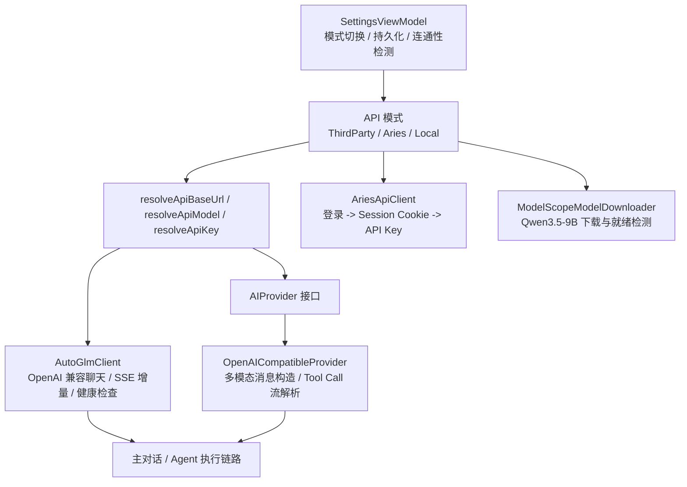
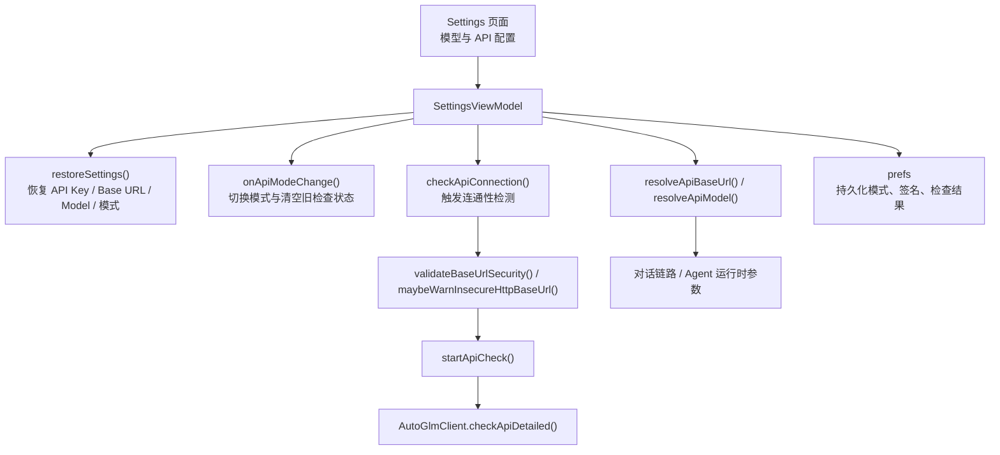
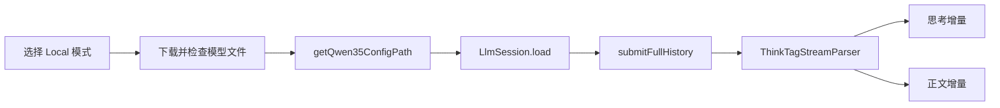

# 多模型接入与本地推理

Aries AI 支持第三方 OpenAI 兼容 API、Aries API 和本地 MNN 三种模型接入模式。本页说明三种模式的配置链路、运行时解析规则和本地推理实现。

---

## 概述

Aries AI 并不是把“模型”硬编码在某一个网络客户端中，而是拆成了四层职责：

1. **模式选择层**：由 `SettingsViewModel` 管理第三方 API、Aries API、本地模型三种模式的切换与恢复。
2. **Provider 抽象层**：由 `AIProvider` 定义统一的流式发送、多模态内容构造、Tool Call 解析接口。
3. **网络客户端层**：由 `AutoGlmClient` 与 `OpenAICompatibleProvider` 负责 OpenAI 兼容请求、SSE 增量解析与连接复用。
4. **凭据与资源层**：由 `AriesApiClient` 负责 Aries 账号换取 API Key，由 `ModelScopeModelDownloader` 负责本地模型下载与就绪检测。

这种拆分让 Aries AI 可以在不改动 Agent 主循环的前提下，切换不同模型来源，并复用同一套消息、附件和自动化执行链路。

## 架构总览

## 三种模型接入模式

| 模式 | 入口 | Base URL / Model 来源 | 认证方式 | 典型代码锚点 |
|------|------|------------------------|----------|--------------|
| 第三方 API | 设置页手动输入 | `apiBaseUrlText` / `apiModelText` | 用户输入 API Key | `SettingsViewModel.resolveRemoteApiBaseUrl()`、`AutoGlmClient` |
| Aries API | Aries 账号登录后启用 | `AriesApiClient.ARIES_API_V1_BASE_URL` 与 Aries 预置模型 | 先登录，再换取 `sk-...` API Key | `AriesApiClient.loginAndGetApiKey()` |
| 本地模型 | 设置页切换到 Local | `ModelScopeModelDownloader.QWEN35_MODEL_NAME` | 无远端认证，依赖本地文件完整性 | `ModelScopeModelDownloader.isQwen35ModelReady()` |

### 第三方 OpenAI 兼容 API

第三方模式是当前最通用的接入方式。代码侧的关键点有：

- `AutoGlmClient.DEFAULT_BASE_URL` 和 `DEFAULT_MODEL` 提供默认兜底值。
- `SettingsViewModel` 在第三方模式下通过 `resolveRemoteApiBaseUrl()` 与 `resolveRemoteApiModel()` 解析最终请求参数。
- `startApiCheck()` 会在发起检查前调用 `validateBaseUrlSecurity()` 与 `maybeWarnInsecureHttpBaseUrl()`，避免错误 URL 或公网 HTTP 明文连接。
- `AutoGlmClient` 统一构造 `chat/completions` 请求，支持长连接、流式增量和快速超时两套 OkHttp 配置。

### Aries API

Aries API 模式的目标，是把“账号体系”和“OpenAI 兼容调用”拆开：

- `AriesApiClient` 先通过登录接口建立 Session Cookie。
- 随后调用 token 接口获取 Aries 专用 API Key。
- 获取到的 Key 最终仍然可以走 OpenAI 兼容协议，供对话或自动化链路复用。
- 模型名由 Aries 侧统一约束，如 `星环`、`星环 Pro`、`GUI` 等。

这种设计让 Aries 平台既能保留自有会员与账号系统，又不会打破现有请求协议。

### 本地模型

本地模式当前围绕 Qwen3.5-9B MNN 包展开，核心职责集中在 `ModelScopeModelDownloader`：

- 通过 ModelScope API 查询仓库文件列表，模型仓库 ID 为 `MNN/Qwen3.5-9B-MNN`，本地目录名为 `Qwen3.5-9B`（`QWEN35_MODEL_ID` / `QWEN35_MODEL_NAME`）。
- 过滤出运行所需文件，例如 `config.json`、`configuration.json`、`llm.mnn`、`llm.mnn.json`、`llm.mnn.weight`、`llm_config.json`、`tokenizer.txt`、`visual.mnn`、`visual.mnn.weight`；该模型还额外要求 `embeddings_bf16.bin`（`extraRequiredExactNamesByModelId`）。
- 借助 `DownloadManager` 进行后台下载（`enqueueQwen35Downloads()`）。
- 通过 `isQwen35ModelReady()` 检查本地目录是否完整可用（逐文件校验存在与长度）。

这条链路不直接发起远端 API 检查，而是通过“文件是否齐全”来判断模型是否可用。

本地推理的执行由 `LocalMnnInferenceEngine` 完成：它通过 JNI 调 `com.alibaba.mnnllm.android.llm.LlmSession`（`keepHistory = false`，由应用层管理历史），内部用 `initMutex` / `requestMutex` 防止并发初始化与并发请求，并用 `ThinkTagStreamParser` 分离 `think` 标签内的思考内容与正文。同时有一个 `GenerationGuard` 保护环检测：单次生成最多 640 个新 token、75 秒、3600 字符输出，且连续重复块达到阈值（22 次）时中断，避免本地小模型陷入复读循环。

## Provider 抽象与多模态消息

`AIProvider` 定义了 Aries AI 面向不同模型供应商的最小公共接口，至少包括：

- `providerName` / `modelName`
- `supportsVision` / `supportsAudio` / `supportsVideo`
- `enableToolCall`（是否启用 Tool Call API）
- `sendMessageStream()`
- `buildContentWithAttachments()`
- `parseXmlToolCalls()` / `parseXmlToolResults()`

其中 `OpenAICompatibleProvider` 负责较完整的多模态输入与 Tool Call 处理：

- 当消息带有附件时，会把文本与媒体内容统一编码进 OpenAI 兼容消息体。
- 当流式返回包含 `tool_calls` 增量时，会用 `StreamingJsonXmlConverter` 持续拼接为可消费的 XML 片段。
- 普通文本增量与 Tool Call 增量可以在同一条流中交错出现，并被拆分回 UI 或工具执行链路。

这意味着 Aries AI 在“多模型支持”上，并不只停留在 Base URL 可配置，而是连多模态与工具调用的协议差异也做了适配。

## 网络客户端与流式响应策略

`AutoGlmClient` 是当前最关键的 OpenAI 兼容客户端之一，承担以下职责：

- 共享 `OkHttpClient` 与连接池（`ConnectionPool(10, 5, TimeUnit.MINUTES)`），并优先使用 HTTP/2，减少重复建连成本。
- 提供标准超时与快速超时两套实例（`SharedHttpClient.instance`：连接 60s / 读 300s / 写 120s / 调用 360s；`SharedHttpClient.fastInstance`：连接 10s / 读 25s / 写 25s / 调用 30s），分别适配普通对话与自动化场景；fast 实例的注释明确说明“更短超时不会让模型更快，只是让慢/异常连接更快失败并触发重试或降级”。
- 在流式模式下解析 SSE 数据块，SSE 增量同时识别 `reasoning_content` 与 `reasoning` 两个字段名，拆出 reasoning 与 content 增量。
- 默认端点与模型常量为 `DEFAULT_BASE_URL = "https://open.bigmodel.cn/api/paas/v4/"`、`DEFAULT_MODEL = "glm-4.6v-flash"`，自动化专用模型为 `PHONE_MODEL = "autoglm-phone"`。
- 使用 `activeStreamCall`（`AtomicReference<Call?>`）保存当前请求，`cancelActiveStream()` 可在任务中途取消流式响应。

自动化场景之所以能维持较低等待时间，很大程度上依赖这里的连接复用和超时分层，而不是简单地缩短服务端生成时间。

## 运行时解析规则

在设置页之外，运行时最终只关心三个结果：

1. 当前使用哪种 API 模式。
2. 这一模式对应的 Base URL / Model 是什么。
3. 可用凭据是否已就绪。

`SettingsViewModel` 提供的 `resolveApiBaseUrl()` 与 `resolveApiModel()` 正是这层收敛点：

- Aries 模式走 Aries 固定地址和模型。
- Local 模式走本地模型常量。
- ThirdParty 模式走用户输入并经校验后的值。

这样上层调用方就不需要关心“是第三方、Aries，还是本地模型”，只消费解析后的统一参数即可。

## 设计收益

这套实现带来的直接收益包括：

- **模式切换成本低**：UI 和 Agent 主流程不必针对每个供应商写分支。
- **协议复用高**：第三方 API 和 Aries API 共用 OpenAI 兼容请求路径。
- **多模态能力可扩展**：图片、音频、视频与 Tool Call 都挂在统一的 Provider 抽象上。
- **本地与远端并存**：离线与在线能力可以共存于同一设置入口。
- **安全边界更清晰**：URL 校验、HTTP 警告、API 检测与 Key 持久化都集中在设置层处理。

## 相关文档

- [快速开始 / API Key 与模型配置](../快速开始/API%20Key%20与模型配置.md)
- [技术架构 / 整体架构设计](../技术架构/整体架构设计.md)
- [自动化引擎 / 自动化 Agent 主循环](../自动化引擎/自动化%20Agent%20主循环.md)

---

## 模式切换与配置链路

模型接入在运行时看似只是三个输入项：API Key、Base URL、Model。但在代码中，这三项配置要同时满足以下约束：

- 模式切换后 UI 状态要立即更新。
- 重启应用后配置要能恢复。
- API 检查结果要与当前配置签名绑定，避免误用旧检测结果。
- 非安全 URL 要在真正请求前被拦截或告警。
- Local / Aries / ThirdParty 三种模式要输出统一的运行时参数。

当前这条链路的主要收敛点在 `SettingsViewModel`。

### 配置链路总览

### 启动恢复：`restoreSettings()`

应用进入设置页时，`restoreSettings()` 会把上一轮配置恢复到 ViewModel 状态中，包含：

- API Key 的掩码展示与原始 tag 值
- ThirdParty / Local / Aries 模式选择状态
- 第三方 Base URL 与模型名
- Aries 登录用户与已选模型
- 上次 API 检测结果与其对应签名

这里最关键的不是“把字符串读回来”，而是避免把旧的检测结果错配到新的配置上。因此代码中会把：

- 当前 API Key
- 当前 Base URL
- 当前 Model
- 当前是否启用第三方模式

组合成 `apiConfigSignature()`，只有签名一致时才复用上次的检测状态。

### 模式切换：`onApiModeChange()`

切换模式时，`SettingsViewModel` 做的不是单一布尔值切换，而是一次完整的状态刷新：

1. 忽略重复切换与不允许的模式。
2. 更新当前模式状态。
3. 增加 `apiCheckSeq`，使旧的异步检查结果失效。
4. 清空 `remoteApiOk`、`lastCheckedApiKey` 等检查缓存。
5. 触发持久化并更新状态文案。

这样做的目的，是确保用户从“第三方 API”切到“本地模型”时，不会继续展示上一轮远端检测结果。

### 三种模式的最终解析规则

#### ThirdParty

ThirdParty 模式下，最终请求参数来自用户输入：

- Base URL: `resolveRemoteApiBaseUrl()`
- Model: `resolveRemoteApiModel()`
- Key: `resolveApiKeyFromInput()`

如果用户没有填写，系统会回退到 `AutoGlmClient.DEFAULT_BASE_URL` 与 `DEFAULT_MODEL`。

#### Aries

Aries 模式下，不再使用用户输入的第三方地址，而是切换到固定值：

- Base URL: `AriesApiClient.ARIES_API_V1_BASE_URL`
- Model: Aries 预置聊天模型
- Key: 从 Aries 账号体系获取的有效 token / API Key

因此 Aries 模式本质上是“托管配置模式”，而不是“开放输入模式”。

#### Local

Local 模式下，不再依赖远端连通性检测：

- Base URL 由 ViewModel 返回默认值占位
- Model 固定为 `ModelScopeModelDownloader.QWEN35_MODEL_NAME`（`"Qwen3.5-9B"`，对应 ModelScope 仓库 `MNN/Qwen3.5-9B-MNN`）
- 是否可用取决于本地模型目录是否完整（`isQwen35ModelReady()` 逐文件校验所需文件，包括该模型额外要求的 `embeddings_bf16.bin`）

UI 里看到的“可用/不可用”，对应的是模型文件准备状态，而非网络健康状态。

### 连通性检测：`checkApiConnection()` 与 `startApiCheck()`

#### Local 模式

Local 模式下不会真正发起网络请求，而是：

- 调用 `ModelScopeModelDownloader.isQwen35ModelReady()`
- 更新下载按钮文案与本地模型状态
- 如果模型未就绪，直接提示用户下载

#### Aries 模式

Aries 模式会先检查当前账号是否已拥有可用 API Key：

- 若没有登录结果，直接提示登录
- 若已有 Key，则使用 Aries 固定 Base URL 和模型发起检查

#### ThirdParty 模式

ThirdParty 模式会：

1. 取出输入中的 API Key
2. 校验 Base URL 的 scheme 与 host
3. 对公网 HTTP 地址弹出明文连接警告
4. 调用 `AutoGlmClient.checkApiDetailed()` 发起真实检查
5. 用最新签名写回检查结果

这一层实际上承担了“请求前安全网关”的职责。

### 安全校验与错误隔离

模型配置并不是“只要能连就行”。当前实现至少做了两层保护：

#### URL 结构校验

`validateBaseUrlSecurity()` 会检查：

- URL 是否可以被正常解析
- scheme 是否是 `http` 或 `https`
- host 是否存在

非法 URL 会在发请求前直接被拦下。

#### HTTP 明文告警

`maybeWarnInsecureHttpBaseUrl()` 允许本地开发场景继续使用 `http://localhost` 等地址，但对公网 HTTP 连接会主动提示风险。

这避免了用户把 API Key 直接发送到不安全的公网明文地址。

### 持久化与“旧结果失效”机制

模型配置链路的一个细节，是它并不信任“上一次检查成功”这个状态本身，而是只信任“当前配置是否与上一次完全一致”。

因此 `apiConfigSignature()` 会把以下信息组成签名：

- 当前是否启用第三方模式
- API Key
- Base URL
- Model

只要其中任意一项变化，之前的检测结果就会被视为过期，从而避免 UI 误报“API 可用”。

### 对运行时的输出

设置层最终向上层提供的是两个统一出口：

- `resolveApiBaseUrl()`
- `resolveApiModel()`

这让主对话链路和 Agent 调度层不必关心复杂的模式选择逻辑，只消费已经归一化后的结果。

换句话说，Settings 页负责处理差异，运行时只拿到统一配置。

### 配置链路的设计收益

当前这套配置链路的价值主要体现在：

- **避免旧状态污染新模式**：切换模式时立刻使旧检查结果失效。
- **把风险拦在请求前**：非法 URL 和公网 HTTP 在请求前就能被发现。
- **把复杂性限制在设置层**：运行时不需要知道用户在设置页做过哪些选择。
- **对三类模式一视同仁**：无论远端还是本地，最终都能输出统一的“是否可用”和“用什么参数调用”。

---

## 本地推理 (MNN)

本页整理 DeepWiki 的 Local On-Device Inference (MNN)，并对照 `LocalMnnInferenceEngine`、`ModelScopeModelDownloader` 核对当前实现（2026-10-14）。

### 下载与就绪检测

当前预置模型为 `MNN/Qwen3.5-9B-MNN`，本地名称为 `Qwen3.5-9B`。`ModelScopeModelDownloader` 查询文件列表，使用 Android `DownloadManager` 下载运行所需文件。配置、权重、分词器、视觉模型和额外的 `embeddings_bf16.bin` 必须满足就绪检查。

`isQwen35ModelReady()` 表示文件存在且长度满足检查，不保证设备内存、驱动和推理性能一定足够。首次下载需要网络；本地生成使用已下载模型文件。

### 会话与请求

`LocalMnnInferenceEngine` 在 IO 调度器上运行，使用 `initMutex` 保护初始化、`requestMutex` 串行化生成。配置路径未变时复用已有 `LlmSession`；变化时释放旧会话并重新加载。会话创建时设定 `keepHistory = false`，每次由应用构造完整历史，避免引擎重复累积对话。

流式入口 `sendChatStreamResult()` 分别回调 reasoning 和 content；非流式入口 `sendChatResult()` 汇总结果。`ThinkTagStreamParser` 处理跨块的思考标签，调用方不必把标签直接显示给用户。

多模态内容中的文本保留为文本，能够解析的图片转为本地路径并以 `路径</img>` 形式进入提示。不能把 OpenAI 远端图片 URL 支持范围直接套用于本地引擎。

### 中止与资源

当前生成保护包括 640 个新 token、75 秒、3600 字符以及重复块阈值 22。`GenerationGuard` 在生成回调中检查限制，`shouldStop` 允许调用方请求中止；因此 75 秒不是独立线程上的硬超时保证。命中保护且已有输出时，会追加自动截断提示。

`releaseSession()` 释放模型会话并清空配置路径。文件下载成功、模型加载成功、收到有效输出应分别判断；空提示和空模型响应都有失败路径。

### 排查顺序

1. 确认 Local 模式和目标模型，检查下载是否完成。
2. 检查配置路径及所需文件，而非只检查模型目录存在。
3. 查看模型加载异常、设备可用内存及 native 库加载情况。
4. 区分用户取消、生成保护截断和空响应，不用远端 API Key 测试判断本地模型状态。

源码：[LocalMnnInferenceEngine.kt](https://github.com/ZG0704666/Aries-AI/blob/main/app/src/main/java/com/ai/phoneagent/net/LocalMnnInferenceEngine.kt)、[ModelScopeModelDownloader.kt](https://github.com/ZG0704666/Aries-AI/blob/main/app/src/main/java/com/ai/phoneagent/net/ModelScopeModelDownloader.kt)。

相关阅读：[多模型接入总览](./多模型接入总览.md)、[模型模式切换与配置链路](./多模型接入总览.md)。来源：[DeepWiki](https://deepwiki.com/ZG0704666/Aries-AI)。
