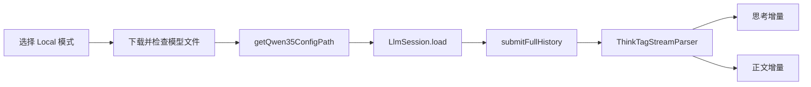

# 本地推理 (MNN)

本页整理 DeepWiki 的 Local On-Device Inference (MNN)，并对照 `LocalMnnInferenceEngine`、`ModelScopeModelDownloader` 核对当前实现（2026-10-14）。

## 下载与就绪检测

当前预置模型为 `MNN/Qwen3.5-9B-MNN`，本地名称为 `Qwen3.5-9B`。`ModelScopeModelDownloader` 查询文件列表，使用 Android `DownloadManager` 下载运行所需文件。配置、权重、分词器、视觉模型和额外的 `embeddings_bf16.bin` 必须满足就绪检查。

`isQwen35ModelReady()` 表示文件存在且长度满足检查，不保证设备内存、驱动和推理性能一定足够。首次下载需要网络；本地生成使用已下载模型文件。

## 会话与请求

`LocalMnnInferenceEngine` 在 IO 调度器上运行，使用 `initMutex` 保护初始化、`requestMutex` 串行化生成。配置路径未变时复用已有 `LlmSession`；变化时释放旧会话并重新加载。会话创建时设定 `keepHistory = false`，每次由应用构造完整历史，避免引擎重复累积对话。

流式入口 `sendChatStreamResult()` 分别回调 reasoning 和 content；非流式入口 `sendChatResult()` 汇总结果。`ThinkTagStreamParser` 处理跨块的思考标签，调用方不必把标签直接显示给用户。

多模态内容中的文本保留为文本，能够解析的图片转为本地路径并以 `路径</img>` 形式进入提示。不能把 OpenAI 远端图片 URL 支持范围直接套用于本地引擎。

## 中止与资源

当前生成保护包括 640 个新 token、75 秒、3600 字符以及重复块阈值 22。`GenerationGuard` 在生成回调中检查限制，`shouldStop` 允许调用方请求中止；因此 75 秒不是独立线程上的硬超时保证。命中保护且已有输出时，会追加自动截断提示。

`releaseSession()` 释放模型会话并清空配置路径。文件下载成功、模型加载成功、收到有效输出应分别判断；空提示和空模型响应都有失败路径。

## 排查顺序

1. 确认 Local 模式和目标模型，检查下载是否完成。
2. 检查配置路径及所需文件，而非只检查模型目录存在。
3. 查看模型加载异常、设备可用内存及 native 库加载情况。
4. 区分用户取消、生成保护截断和空响应，不用远端 API Key 测试判断本地模型状态。

源码：[LocalMnnInferenceEngine.kt](https://github.com/ZG0704666/Aries-AI/blob/main/app/src/main/java/com/ai/phoneagent/net/LocalMnnInferenceEngine.kt)、[ModelScopeModelDownloader.kt](https://github.com/ZG0704666/Aries-AI/blob/main/app/src/main/java/com/ai/phoneagent/net/ModelScopeModelDownloader.kt)。

相关阅读：[多模型接入总览](./多模型接入总览.md)、[模型模式切换与配置链路](./模型模式切换与配置链路.md)。来源：[DeepWiki](https://deepwiki.com/ZG0704666/Aries-AI)。
