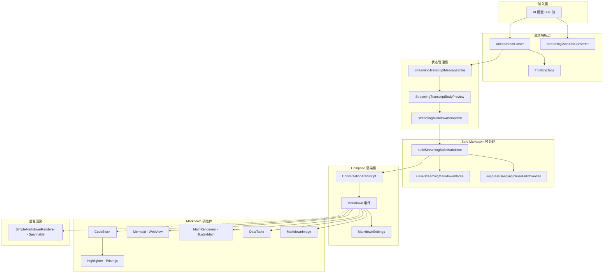
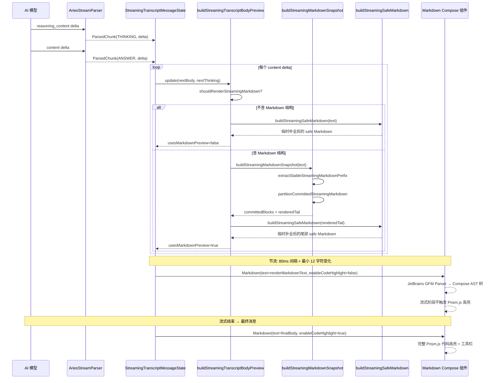
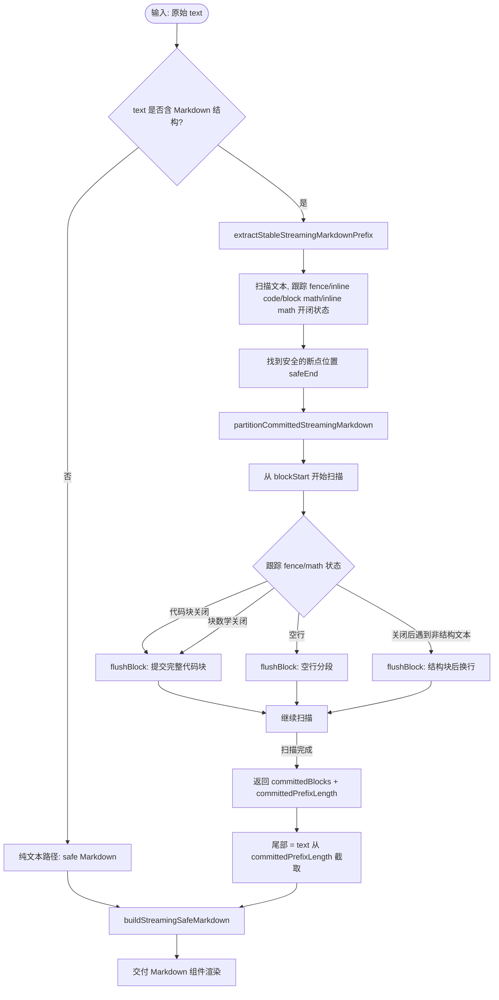
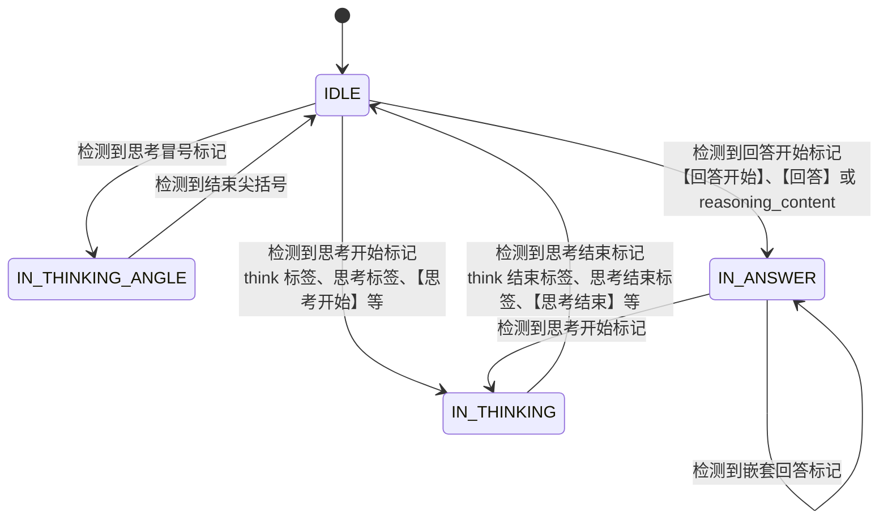
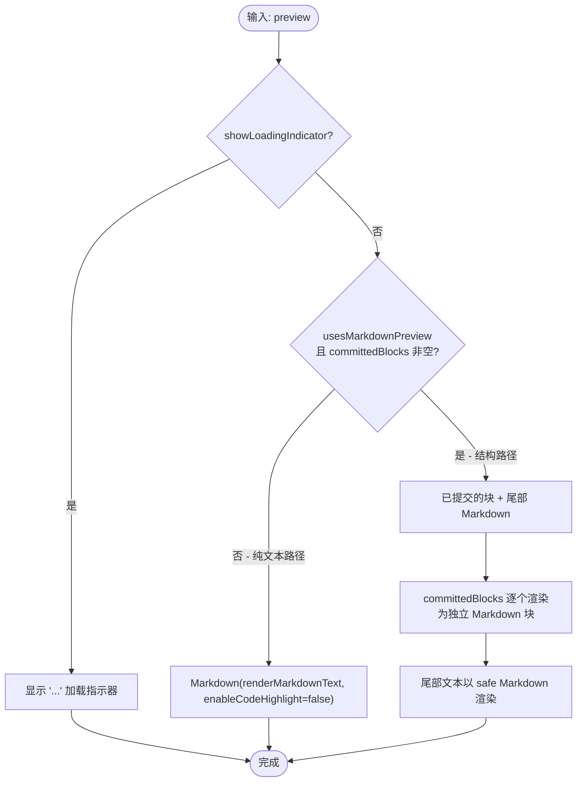

# Markdown 渲染体系

Aries AI 的 Markdown 渲染体系同时服务于流式输出和最终消息：先解析模型增量文本，再对未闭合结构做安全补全，最后交给 Compose 组件渲染。

Aries-AI 对话系统中的流式 Markdown 渲染子系统，负责将 AI 模型实时输出的增量文本以格式化的 Markdown 形态渲染到 Compose UI 中，同时支持代码高亮、LaTeX 数学公式、Mermaid 图表和 HTML 预览等丰富内容类型。

## 概述

流式 Markdown 渲染是 Aries-AI 对话体验的核心组件之一。当 AI 模型通过 SSE（Server-Sent Events）实时返回回答文本时，该子系统需要：

1. **解析流式输出**：从 AI 模型的增量输出中正确分离思考过程（`<think>` 标签）和回答正文
2. **实时渲染 Markdown**：将不完整的、逐步增长的 Markdown 文本尽可能以格式化形态展示，而非裸 Markdown 源码
3. **保持布局稳定**：避免逐 token 重组导致的视觉抖动，通过节流和缓冲区策略控制 UI 更新频率
4. **临时补全**：对未闭合的代码块、数学公式等 Markdown 结构进行临时补全，确保流式阶段也保持合理的视觉形态
5. **最终渲染**：流式结束后启用完整的代码高亮、行号、工具栏等增强功能

### 设计理念

**三层文本模型** 是整个流式 Markdown 渲染的核心设计：

| 层级 | 说明 | 是否可持久化 |
|------|------|------------|
| raw buffer | 保存模型原始增量输出 | 是 |
| render preview | 按节流节拍推进 UI 可见内容 | 否 |
| safe Markdown | 对未闭合 Markdown 做临时补全后交给 Compose 渲染 | 否 |

关键原则：
- 流式阶段从一开始就渲染 Markdown，不先展示裸 Markdown 原文
- 最终消息与流式消息使用同一套 Markdown / CodeBlock 组件，避免结束后样式回退
- `copyText` 和持久化内容必须保留模型原文，不被临时补全污染
- 流式阶段禁用代码高亮异步重算，最终消息再启用完整高亮和工具栏

## 架构

### 系统架构图



### 架构说明

1. **输入层**：AI 模型通过 `AutoGlmClient` 发送 SSE 流，增量文本到达流式解析层
2. **流式解析层**：`AriesStreamParser` 负责从增量输出中分离思考内容和回答正文，支持 `<think>`、`<思考>`、`【思考开始】` 等多种标记格式。网络层（`AutoGlmClient` 的 `SseDelta`）会同时识别 SSE 增量中的 `reasoning_content` 与 `reasoning` 两个字段名；思考标签常量集中在 `ThinkingTags`，并为流式截断场景维护「潜在标签前缀」缓冲判断
3. **状态管理层**：`StreamingTranscriptMessageState` 持有流式消息的完整状态，`StreamingTranscriptBodyPreview` 封装渲染预览数据，`StreamingMarkdownSnapshot` 记录已提交的 Markdown 块和尾部未完成文本
4. **Safe Markdown 预处理**：在将文本交给 Compose `Markdown` 组件之前，对未闭合的代码块（fence）和数学公式（`$$`）进行临时补全，同时抑制悬空的加粗、斜体、行内代码等标记
5. **Compose 渲染层**：`ConversationTranscript` 是消息列表的主要 UI 容器，根据消息是流式还是最终状态选择不同的渲染路径
6. **Markdown 子组件**：基于 JetBrains GFM Parser 的完整 Markdown 渲染管线，支持代码高亮（Prism.js + QuickJS）、Mermaid 图表（WebView）、LaTeX 数学（JLatexMath）等

## 核心流程

### 流式 Markdown 渲染全流程



### 流式 Markdown 快照分区算法



### 临时补全策略

流式阶段最关键的挑战是 Markdown 结构可能尚未闭合（如代码块的 \`\`\` 只写了开头）。`buildStreamingSafeMarkdown` 函数执行以下处理：

1. **抑制悬空块标记**：如果最后一行是 `#`、`-`、`*`、`1.` 等块标记但后续没有内容，则抑制该行，避免渲染为孤立的标题/列表标记
2. **抑制悬空行内标记**：检测未闭合的 \`code\`、`**bold**`、`*italic*`、`[link](...)`，如果尾部距离起始位置在阈值内则截断
3. **关闭未闭合代码块**：如果代码 fence 开闭次数为奇数（有打开没关闭），追加 \`\`\`
4. **关闭未闭合块数学**：如果 `$$` 出现奇数次，追加 `$$`

> 关键源码：
> - [ConversationTranscript.kt](https://github.com/ZG0704666/Aries-AI/blob/main/app/src/main/java/com/ai/phoneagent/ui/messages/ConversationTranscript.kt#L1304-L1351)

## 流式解析器

### AriesStreamParser

`AriesStreamParser` 负责解析 AI 模型的流式输出，正确分离思考过程和回答内容：

```kotlin
class AriesStreamParser {
    enum class ChunkType { THINKING, ANSWER, CONTROL }
    enum class ParseState { IDLE, IN_THINKING, IN_THINKING_ANGLE, IN_ANSWER }

    fun processReasoningDelta(delta: String): List<ParsedChunk>
    fun processContentDelta(delta: String): List<ParsedChunk>
    fun flush(): List<ParsedChunk>
}
```

> Source: [AriesStreamParser.kt](https://github.com/ZG0704666/Aries-AI/blob/main/app/src/main/java/com/ai/phoneagent/helper/AriesStreamParser.kt#L16-L77)

**状态机设计**：



**支持的标记格式**：

| 类别 | 标记 |
|------|------|
| 思考开始 | `<think>`, `<思考>`, `<思考：>`, `<思考:>`, `【思考开始】`, `【思考】` |
| 思考结束 | `</think>`, `</思考>`, `【思考结束】`, `【回答】`, `【回答开始】` |
| 回答开始 | `【回答开始】`, `【回答】` |
| 回答结束 | `【回答结束】` |

**潜在标记前缀检测**：在流式解析中，文本可能以不完整的标记结尾（如 `...<thi` 可能是 `<think>` 的前缀）。解析器使用 `ThinkingTags` 中的前缀列表判断是否应该缓冲等待后续 token。

> Source: [ThinkingTags.kt](https://github.com/ZG0704666/Aries-AI/blob/main/app/src/main/java/com/ai/phoneagent/core/utils/ThinkingTags.kt)

## 流式消息状态管理

### StreamingTranscriptMessageState

```kotlin
@Stable
class StreamingTranscriptMessageState(
    val conversationId: Long,
    val messageIndex: Int,
    val id: String,
    val author: String,
    val retryText: String?,
    initialBody: String,
    initialThinking: String?,
    initialCopyText: String,
    initialBodyPreview: StreamingTranscriptBodyPreview,
)
```

> Source: [ConversationTranscript.kt](https://github.com/ZG0704666/Aries-AI/blob/main/app/src/main/java/com/ai/phoneagent/ui/messages/ConversationTranscript.kt#L175-L237)

`StreamingTranscriptMessageState` 使用 Compose `mutableStateOf` 管理响应式状态：
- `bodyPreview`：UI 渲染快照，通过 `selectStreamingBodyPreview` 选择是否推进
- `thinking`：思考内容
- `copyText`：保留原始输出用于复制

### StreamingTranscriptBodyPreview

```kotlin
@Immutable
data class StreamingTranscriptBodyPreview(
    val usesMarkdownPreview: Boolean,
    val committedBlocks: ImmutableList<String>,
    val committedPrefixLength: Int,
    val tailText: String,
    val renderMarkdownText: String,
    val showLoadingIndicator: Boolean,
    val fullTextLength: Int,
    val layoutVersion: Int,
)
```

> Source: [ConversationTranscript.kt](https://github.com/ZG0704666/Aries-AI/blob/main/app/src/main/java/com/ai/phoneagent/ui/messages/ConversationTranscript.kt#L163-L173)

**渲染预览的选择策略** (`selectStreamingBodyPreview`)：

1. 如果正在加载中，保持 loading 直到有足够内容
2. 如果 committedBlocks 数量变化 → 推进
3. 如果 usesMarkdownPreview 标记变化 → 推进
4. 如果新内容不以旧内容开头（内容结构变化） → 推进
5. 如果新内容包含渲染边界（换行、标点、Markdown 结构） → 推进
6. 否则，检查可见增量是否达到 `STREAMING_MARKDOWN_MIN_CHUNK_DELTA`（12 字符）

```kotlin
// 渲染边界检测
private fun hasStreamingRenderBoundary(text: String): Boolean {
    val last = text.lastOrNull() ?: return false
    if (last == '\n' || last == '\r') return true
    if (last in listOf('.', '!', '?', ':', ';')) return true
    if (last in listOf('。', '！', '？', '：', '；', '，', ',')) return true
    // 检测 Markdown 结构边界
    return text.endsWith("```") || text.endsWith("$$") ||
        STREAMING_MARKDOWN_STRUCTURE_RE.containsMatchIn(recentTail)
}
```

> Source: [ConversationTranscript.kt](https://github.com/ZG0704666/Aries-AI/blob/main/app/src/main/java/com/ai/phoneagent/ui/messages/ConversationTranscript.kt#L1285-L1294)

## 渲染路径选择

### 流式消息的三条渲染路径

`StreamingAssistantBodyPreview` 根据 `StreamingTranscriptBodyPreview` 的状态选择渲染方式：



> Source: [ConversationTranscript.kt](https://github.com/ZG0704666/Aries-AI/blob/main/app/src/main/java/com/ai/phoneagent/ui/messages/ConversationTranscript.kt#L904-L962)

**三条路径的区别**：

| 路径 | 触发条件 | 渲染方式 |
|------|---------|---------|
| Loading | `showLoadingIndicator=true` | 显示 `...` |
| 纯文本 | 不含 Markdown 结构 | 单一 `Markdown` 组件 + `enableCodeHighlight=false` |
| 结构路径 | 含代码块/数学等结构 | 已提交块分别渲染 + 尾部 safe Markdown |

## 使用示例

### 流式消息渲染

以下是 `ConversationTranscript.kt` 中流式消息的主体渲染链路：

```kotlin
@Composable
private fun StreamingAssistantBodySection(
    itemState: StreamingTranscriptMessageState,
) {
    val spacingMd = dimensionResource(R.dimen.m3t_spacing_md)
    val bodyPreview = itemState.bodyPreview
    val showLoadingIndicator =
        bodyPreview.showLoadingIndicator && itemState.thinking.isNullOrBlank()
    if (bodyPreview.fullTextLength == 0 && !showLoadingIndicator) return

    StreamingAssistantBodyPreview(
        preview = bodyPreview,
        showLoadingIndicator = showLoadingIndicator,
        spacingMd = spacingMd,
    )
}
```

> Source: [ConversationTranscript.kt](https://github.com/ZG0704666/Aries-AI/blob/main/app/src/main/java/com/ai/phoneagent/ui/messages/ConversationTranscript.kt#L887-L902)

### 构建流式正文预览

```kotlin
fun buildStreamingTranscriptBodyPreview(text: String): StreamingTranscriptBodyPreview {
    if (text.isBlank()) {
        return StreamingTranscriptBodyPreview(
            usesMarkdownPreview = false,
            committedBlocks = emptyList<String>().toImmutableList(),
            committedPrefixLength = 0,
            tailText = "",
            renderMarkdownText = "",
            showLoadingIndicator = true,
            fullTextLength = 0,
            layoutVersion = 1,
        )
    }

    if (!shouldRenderStreamingMarkdown(text)) {
        val renderText = buildStreamingSafeMarkdown(text)
        return StreamingTranscriptBodyPreview(
            usesMarkdownPreview = false,
            // ...
            renderMarkdownText = renderText,
            showLoadingIndicator = false,
        )
    }

    val snapshot = buildStreamingMarkdownSnapshot(text)
    // ... 处理已提交块和尾部 ...
}
```

> Source: [ConversationTranscript.kt](https://github.com/ZG0704666/Aries-AI/blob/main/app/src/main/java/com/ai/phoneagent/ui/messages/ConversationTranscript.kt#L1204-L1260)

### 流式阶段 vs 最终消息的 Markdown 设置

```kotlin
// 流式阶段：禁用代码高亮
Markdown(
    text = preview.renderMarkdownText,
    modifier = Modifier.fillMaxWidth().padding(horizontal = spacingMd, vertical = spacingMd),
    settings = LocalMarkdownSettings.current.copy(enableCodeHighlight = false),
)

// 最终消息：完整功能
Markdown(
    text = body,
    modifier = Modifier.fillMaxWidth(),
    // settings 使用默认值（含 enableCodeHighlight=true）
)
```

> Sources:
> - [ConversationTranscript.kt](https://github.com/ZG0704666/Aries-AI/blob/main/app/src/main/java/com/ai/phoneagent/ui/messages/ConversationTranscript.kt#L926-L933)
> - [ConversationTranscript.kt](https://github.com/ZG0704666/Aries-AI/blob/main/app/src/main/java/com/ai/phoneagent/ui/messages/ConversationTranscript.kt#L1050-L1066)

## 配置选项

### 流式渲染常量

| 常量 | 值 | 说明 |
|------|-----|------|
| `STREAMING_MARKDOWN_RENDER_INTERVAL_MS` | 80ms | Markdown 快照更新节流间隔 |
| `STREAMING_MARKDOWN_MIN_CHUNK_DELTA` | 12 | 推进渲染快照的最小字符变化量 |
| `STREAMING_PENDING_INLINE_TAIL_LIMIT` | 32 | 悬空行内标记检测的尾部长度限制 |
| `CODE_BLOCK_COLLAPSE_LINE_THRESHOLD` | 10 | 代码块自动折叠的行数阈值 |

> Source: [ConversationTranscript.kt](https://github.com/ZG0704666/Aries-AI/blob/main/app/src/main/java/com/ai/phoneagent/ui/messages/ConversationTranscript.kt#L105-L115)

### MarkdownSettings 配置项

| 选项 | 类型 | 默认值 | 说明 |
|------|------|--------|------|
| `autoWrap` | Boolean | `true` | 自动换行长代码行 |
| `lineNumbers` | Boolean | `true` | 在代码块中显示行号 |
| `autoCollapse` | Boolean | `false` | 自动折叠超过 10 行的代码块 |
| `enableCodeHighlight` | Boolean | `true` | 通过 Prism.js 进行语法高亮，流式阶段应设为 `false` |
| `enableLatex` | Boolean | `true` | 使用 JLatexMath 渲染 LaTeX 公式，关闭时回退为等宽字体 |

> Source: [Markdown.kt](https://github.com/ZG0704666/Aries-AI/blob/main/app/src/main/java/com/ai/phoneagent/ui/components/markdown/Markdown.kt#L79-L91)

### CodeBlockPrefs 配置项

```kotlin
@Immutable
data class CodeBlockPrefs(
    val autoWrap: Boolean = true,
    val lineNumbers: Boolean = false,
    val autoCollapse: Boolean = false,
)
```

> Source: [ConversationTranscript.kt](https://github.com/ZG0704666/Aries-AI/blob/main/app/src/main/java/com/ai/phoneagent/ui/messages/ConversationTranscript.kt#L118-L123)

## API 参考

### Markdown 组件

#### `Markdown(text, modifier, settings)`

Compose 端的 Markdown 渲染入口。在 `Dispatchers.Default` 上解析文本，在解析期间显示原始文本作为 fallback。

**参数:**
- `text` (String): Markdown 源文本
- `modifier` (Modifier): Compose 修饰符
- `settings` (MarkdownSettings): 渲染设置，默认为 `LocalMarkdownSettings.current`

#### `MarkdownNode(node, source, depth, isBoldContext)`

递归 AST 节点分发器，将 JetBrains GFM 解析器的 AST 节点映射到对应的 Compose 渲染组件。

> Source: [Markdown.kt](https://github.com/ZG0704666/Aries-AI/blob/main/app/src/main/java/com/ai/phoneagent/ui/components/markdown/Markdown.kt#L558-L564)

### AriesStreamParser

#### `processReasoningDelta(delta: String): List<ParsedChunk>`

处理来自 `reasoning_content` 字段的增量（流式 API 返回的思考内容独立字段）。

**参数:**
- `delta` (String): 增量文本

**返回:** 解析后的 ParsedChunk 列表

#### `processContentDelta(delta: String): List<ParsedChunk>`

处理来自 `content` 字段的增量（回答正文带思考标签）。

**参数:**
- `delta` (String): 增量文本

**返回:** 解析后的 ParsedChunk 列表

#### `flush(): List<ParsedChunk>`

刷新缓冲区中未完成的文本。

#### `isInThinkingPhase(): Boolean`

检查当前是否处于思考阶段。

> Source: [AriesStreamParser.kt](https://github.com/ZG0704666/Aries-AI/blob/main/app/src/main/java/com/ai/phoneagent/helper/AriesStreamParser.kt#L74-L370)

### Highlighter

#### `init(context: Context)`

初始化高亮器，加载 Prism.js。应在 `Application.onCreate()` 中调用一次。

#### `highlight(code: String, language: String): List<HighlightToken>`

对代码进行语法高亮。在 `Dispatchers.IO` 上通过 QuickJS 执行 Prism.tokenize()。

**参数:**
- `code` (String): 源代码文本
- `language` (String): 语言标识符（如 `"kotlin"`, `"python"`）

**返回:** `HighlightToken` 列表，如果 Prism 未就绪或语言未知则返回 `HighlightToken.Plain`

> Source: [Highlighter.kt](https://github.com/ZG0704666/Aries-AI/blob/main/app/src/main/java/com/ai/phoneagent/ui/components/markdown/Highlighter.kt#L55-L107)

## 依赖库

| 库 | 版本 | 用途 |
|-----|------|------|
| JetBrains Markdown | 0.7.3 | GFM Markdown AST 解析 |
| QuickJS-KT | - | 嵌入式 JS 运行时，用于 Prism.js |
| Prism.js | - | 代码语法高亮（assets/highlight/prism.js） |
| JLatexMath | - | LaTeX 数学公式渲染 |
| Mermaid.js | v11 (CDN) | 图表渲染 |
| Coil 2 / Coil 3 | - | Markdown 图片异步加载 |

---

## 组件与预处理

### 预处理管线

`preProcess()` 是渲染管道的第一步，在 GFM 解析前完成文本标准化：

> Source: [Markdown.kt](https://github.com/ZG0704666/Aries-AI/blob/main/app/src/main/java/com/ai/phoneagent/ui/components/markdown/Markdown.kt#L146-L199)

```kotlin
fun preProcess(text: String): String {
    val codeRanges = buildList {
        addAll(FENCED_CODE_RE.findAll(text).map { it.range })
        addAll(INLINE_CODE_RE.findAll(text).map { it.range })
    }.sortedBy { it.first }

    fun inCodeRange(index: Int): Boolean { /* ... */ }

    val sb = StringBuilder(text.length)
    var i  = 0
    while (i < text.length) {
        if (inCodeRange(i)) { sb.append(text[i++]); continue }
        // \$...\$ → $...$ (转义美元符 → 行内公式)
        if (text.startsWith("\\$", i)) { /* 检测 LaTeX 内容后转换 */ }
        // \[...\] → $$...$$
        if (text.startsWith("\\[", i)) { /* 转换并跳过 */ }
        // \(...\) → $...$
        if (text.startsWith("\\(", i)) { /* 转换并跳过 */ }
        sb.append(text[i++])
    }
    return normalizeBareInlineMath(deindentMathBlocks(sb.toString()))
}
```

预处理步骤依次为：

1. **定位代码范围**：识别围栏代码块（` ``` `）和行内代码（`` ` ``），后续步骤跳过这些区域
2. **转义美元符转换**：`\$...\$` → `$...$`（仅当内容看起来像 LaTeX 公式时）
3. **方括号定界符转换**：`\[...\]` → `$$...$$`、`\(...\)` → `$...$`
4. **裸数学公式识别**：检测 `y = mx + b` 等未包裹的表达式并自动添加 `$...$`
5. **块公式去缩进**：防止缩进的 `$$` 块被 GFM 解析为 4 空格代码块


### 组件详解

#### Markdown — 主入口

> Source: [Markdown.kt](https://github.com/ZG0704666/Aries-AI/blob/main/app/src/main/java/com/ai/phoneagent/ui/components/markdown/Markdown.kt#L324-L332)

```kotlin
@Composable
fun Markdown(
    text: String,
    modifier: Modifier = Modifier,
    settings: MarkdownSettings = LocalMarkdownSettings.current,
) {
    CompositionLocalProvider(LocalMarkdownSettings provides settings) {
        MarkdownContent(text = text, modifier = modifier)
    }
}
```

内部通过 `snapshotFlow` + `mapLatest` 在 `Dispatchers.Default` 上异步解析，解析期间显示原文作为 fallback。结果分两路：AST 路径（标准 Markdown 元素分发）和 HTML 路径（含特定 HTML 标签时走 HtmlGenerator）。

#### MarkdownNode — AST 递归分发器

> Source: [Markdown.kt](https://github.com/ZG0704666/Aries-AI/blob/main/app/src/main/java/com/ai/phoneagent/ui/components/markdown/Markdown.kt#L558-L736)

`MarkdownNode()` 是核心分发器，根据节点类型路由到对应渲染器：

| AST 类型 | 渲染目标 | 说明 |
|----------|----------|------|
| `MARKDOWN_FILE` | 递归子节点 | 文档根节点 |
| `PARAGRAPH` | MathBlock / ParagraphNode / MathMixedText | 根据内容判断纯公式/混合/普通段落 |
| `ATX_1` ~ `ATX_6`, `SETEXT_1~2` | HeadingNode | 六级标题映射到 Material 3 排版 |
| `CODE_FENCE` | CodeBlock / MathBlock / LatexDocBlock | 含 Mermaid 短路、LaTeX 检测 |
| `CODE_BLOCK` | CodeBlock | 4 空格缩进代码块 |
| `HTML_BLOCK` | HtmlBlock | 原始 HTML 块 |
| `TABLE` (GFM) | DataTable | GFM 表解析 |
| `UNORDERED_LIST` / `ORDERED_LIST` | ListNode | 有序/无序列表 |
| `BLOCK_QUOTE` | 引用块 | 左侧色条 + 缩进 |
| `HORIZONTAL_RULE` | HorizontalDivider | 水平分割线 |
| 行内元素 | RenderInlineNodes | 粗体/斜体/删除线/行内代码/链接/图片 |

#### CodeBlock — 代码块组件

> Source: [CodeBlock.kt](https://github.com/ZG0704666/Aries-AI/blob/main/app/src/main/java/com/ai/phoneagent/ui/components/markdown/CodeBlock.kt#L77-L242)

代码块渲染是整个体系中最复杂的组件之一，功能包括：

- **Mermaid 短路**：当语言标记为 `mermaid` 时直接委托给 `Mermaid()`
- **异步语法高亮**：通过 `Highlighter.highlight()` 调用 Prism.js via QuickJS
- **工具栏**：语言标签、行号切换、软换行切换、保存到下载、一键复制
- **折叠/展开**：超过 10 行的代码块自动折叠（由 `autoCollapse` 设置控制）
- **HTML/SVG 预览**：HTML、SVG、XML 语言提供 WebView 预览对话框

```kotlin
// 高亮仅在 enableCodeHighlight=true 时执行
LaunchedEffect(code, language, settings.enableCodeHighlight) {
    tokens = if (settings.enableCodeHighlight) {
        Highlighter.highlight(code, language)
    } else {
        listOf(HighlightToken.Plain(code))
    }
}
```

#### Highlighter — 代码高亮引擎

> Source: [Highlighter.kt](https://github.com/ZG0704666/Aries-AI/blob/main/app/src/main/java/com/ai/phoneagent/ui/components/markdown/Highlighter.kt#L38-L107)

基于 QuickJS 嵌入式 JS 引擎运行 Prism.js（全语言包），协程安全的单例设计：

- **初始化**：`Highlighter.init(context)` 在 Application 启动时调用一次，加载 `assets/highlight/prism.js`
- **异步高亮**：`Highlighter.highlight(code, lang)` 是 suspend 函数，在 QuickJS 中执行 `Prism.tokenize()`
- **退避策略**：QuickJS 不可用时返回 `HighlightToken.Plain(code)` 纯文本
- **互斥锁**：`Mutex` 确保 QuickJS evaluate 调用串行化

#### Mermaid — 图表渲染

> Source: [Mermaid.kt](https://github.com/ZG0704666/Aries-AI/blob/main/app/src/main/java/com/ai/phoneagent/ui/components/markdown/Mermaid.kt#L75-L168)

利用 WebView 加载 CDN 上的 Mermaid.js 11，通过 `JavascriptInterface` 回调与 Compose 通信：

- **高度自适应**：WebView 渲染完成后通过 `AndroidInterface.updateHeight(px)` 回传高度
- **高度缓存**：`mermaidHeightCache` HashMap 缓存每个图的高度，避免 WebView 重用时跳变
- **SVG 导出**：通过 `AndroidInterface.exportImage(svgData)` 获取渲染后的 SVG，支持保存到 Downloads
- **预览底部面板**：`ModalBottomSheet` 提供全宽预览
- **主题变量注入**：从 Material 3 ColorScheme 动态提取颜色注入 Mermaid 主题变量

#### MathRenderers — LaTeX 数学渲染

> Source: [MathRenderers.kt](https://github.com/ZG0704666/Aries-AI/blob/main/app/src/main/java/com/ai/phoneagent/ui/components/markdown/MathRenderers.kt)

基于 JLatexMath-Android 的公式渲染系统，支持块级和行内两种模式：

- **`MathBlock`**：居中展示的块级公式，带水平滚动，后台渲染为 Bitmap
- **`MathInlineText`**：行内公式，通过 `InlineTextContent` 将 Bitmap 嵌入文本流
- **`processLatex()`**：多步骤公式预处理：剥离定界符 → 提取文档体 → 移除文档级命令 → 提取数学环境
- **LRU 缓存**：`latexBitmapCache`（96 条目）缓存渲染后的 Bitmap，避免重复渲染
- **尺寸预估**：`assumeLatexSize()` 在 Bitmap 准备好前提供占位尺寸

#### 其他组件

| 组件 | 文件 | 职责 |
|------|------|------|
| `DataTable` | DataTable.kt | 解析 GFM TABLE AST 节点，渲染为 Material 3 风格表格（表头高亮、斑马条纹） |
| `HtmlBlock` | HtmlBlock.kt | 使用 Jsoup 解析 HTML 片段，支持丰富的块级和行内标签子集 |
| `HighlightText` | HighlightText.kt | 将 `List<HighlightToken>` 渲染为着色文本，支持行号和软换行 |
| `ZoomableAsyncImage` | MarkdownImage.kt | 基于 Coil 3 的异步图片加载，支持 Shimmer 占位、手势缩放、全屏预览 |
| `MarkdownSettings` | Markdown.kt | 不可变配置数据类，通过 CompositionLocal 传递 |
