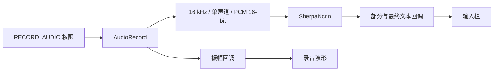

# 离线语音识别 (Sherpa-ncnn)

本页将 DeepWiki 的 Speech Recognition (Sherpa-ncnn) 与当前 `SherpaSpeechRecognizer` 实现对应，核对日期为 2026-10-14。

## 识别链路

语音输入使用本地 Sherpa-ncnn，核心组件为 `SherpaSpeechRecognizer`、Kotlin JNI 包装 `SherpaNcnn` 和 `sherpa-ncnn-jni` native 库。语音识别把音频转成输入文本，后续对话是否联网取决于用户选择的模型模式。

## 模型初始化

`initialize()` 使用共享初始化互斥锁，准备模型文件并创建识别器。资源查找兼容 `sherpa-models/<modelDirName>/`、旧嵌套目录 `sherpa-models/models/<modelDirName>/` 及平铺目录 `sherpa-models/`。私有缓存目录不完整时重新复制资源，不能仅依据目录存在就跳过检查。

Android 构建通过 `app/src/main/cpp/CMakeLists.txt` 集成 Sherpa-ncnn。仓库需递归初始化 native 子模块；CI 还会检查 APK 中的 `lib/arm64-v8a/libsherpa-ncnn-jni.so` 存在且非空。

## 状态与回调

`startListening(listener)` 启动录音及后台识别任务。监听接口包括 `onPartialResult`、`onResult`、`onFinalResult`、`onAmplitude`、`onError`、`onTimeout`；振幅用于 UI 反馈，不代表识别置信度。

`stopListening()`、`cancel()` 与 `shutdown()` 分别承载停止、取消和关闭资源的入口。实现持有 `AudioRecord`、录音 Job 与识别器，释放录音时尝试停止并释放设备，最终结果通过原子状态避免重复发送。调用方必须先处理录音权限，类上的 `SuppressLint` 不是权限授权。

## 常见故障

- 无法开始录音：检查权限、麦克风占用和 AudioRecord 初始化。
- 模型初始化失败：检查 assets 布局、复制完整性及 native 库；不要通过修改第三方库来绕过缺失资源。
- 有波形但无文本：分别检查音频输入、模型加载和识别回调日志。
- 页面退出后仍占用麦克风：检查取消和关闭路径是否调用，而非只清空 UI 状态。

源码：[SherpaSpeechRecognizer.kt](https://github.com/ZG0704666/Aries-AI/blob/main/app/src/main/java/com/ai/phoneagent/speech/SherpaSpeechRecognizer.kt)、[CMakeLists.txt](https://github.com/ZG0704666/Aries-AI/blob/main/app/src/main/cpp/CMakeLists.txt)。

相关阅读：[输入栏与语音波形](./输入栏与语音波形.md)、[CI 流水线与测试](../开发规范与工具/CI%20流水线与测试.md)。来源：[DeepWiki](https://deepwiki.com/ZG0704666/Aries-AI)。
