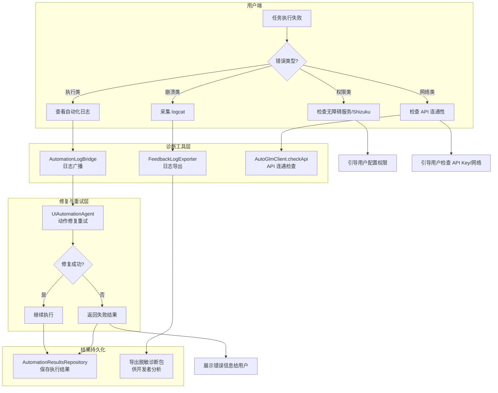
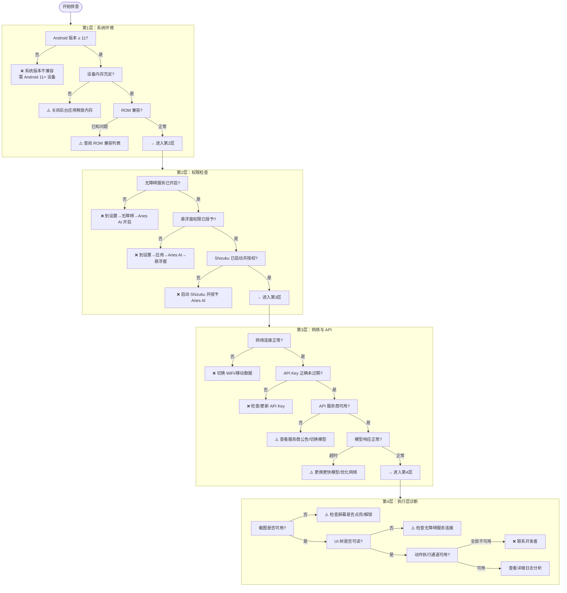
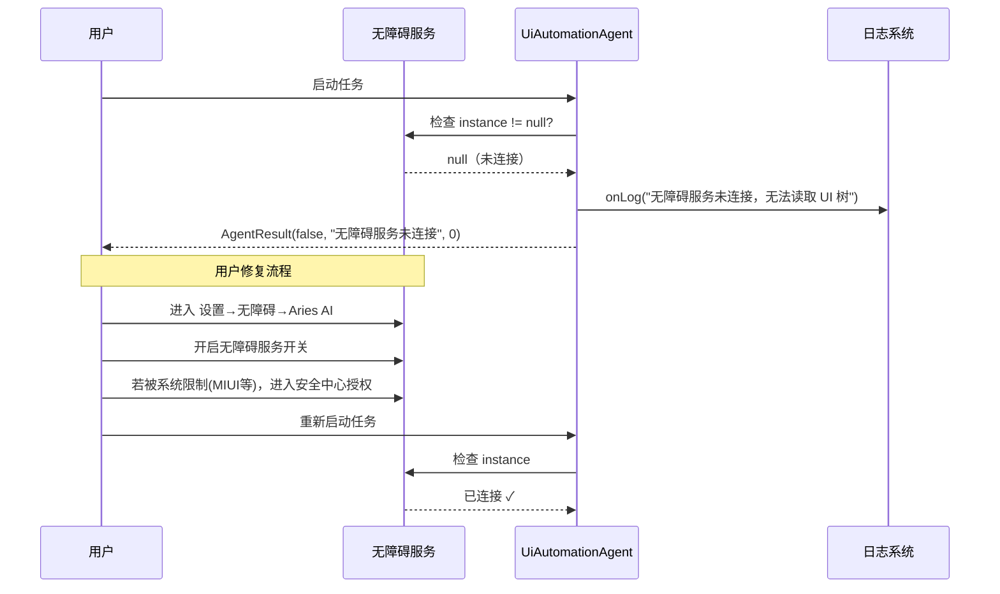
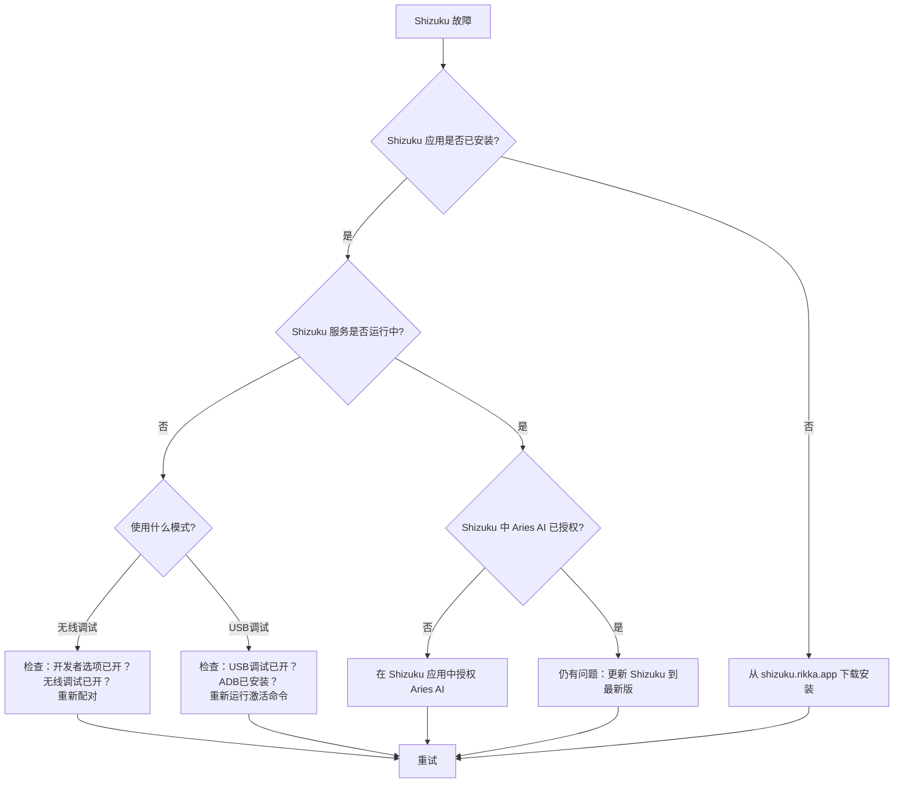
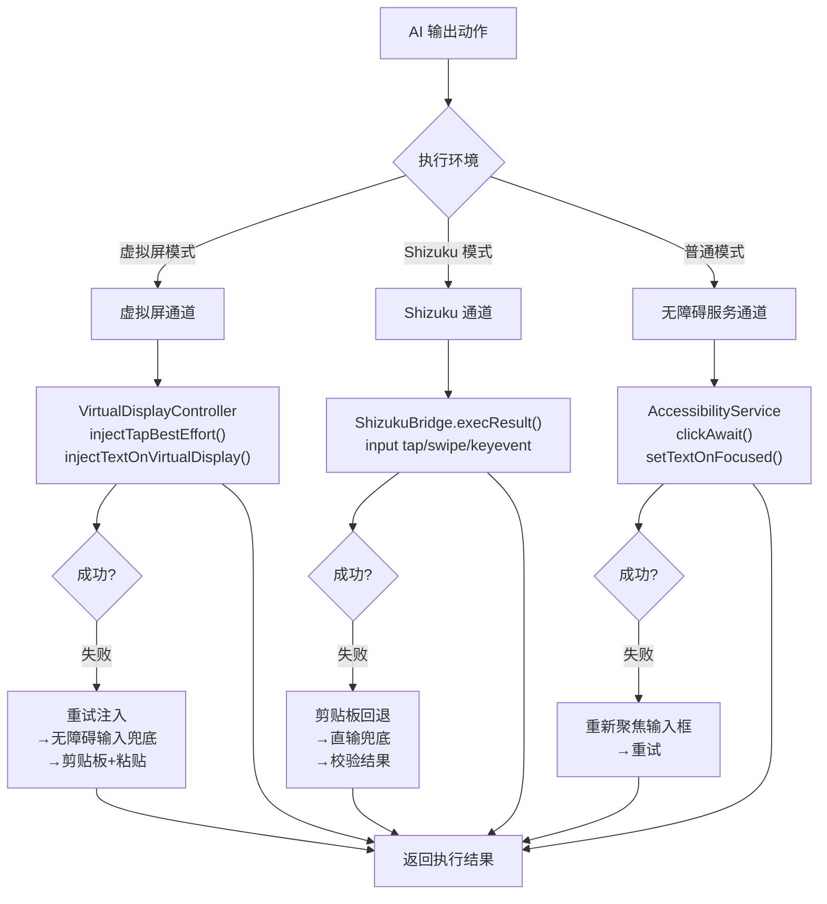
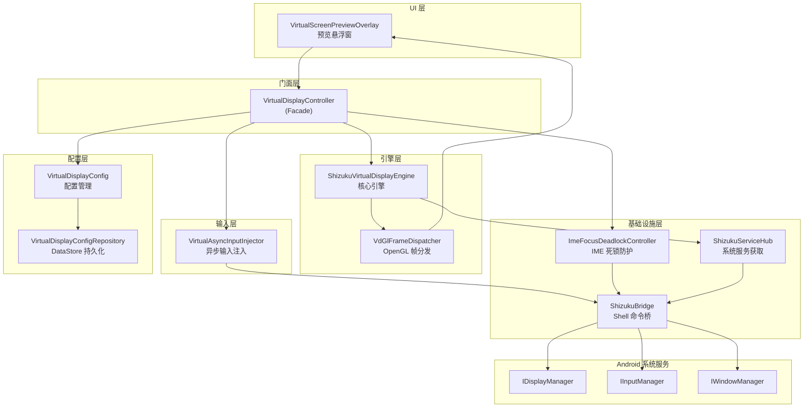
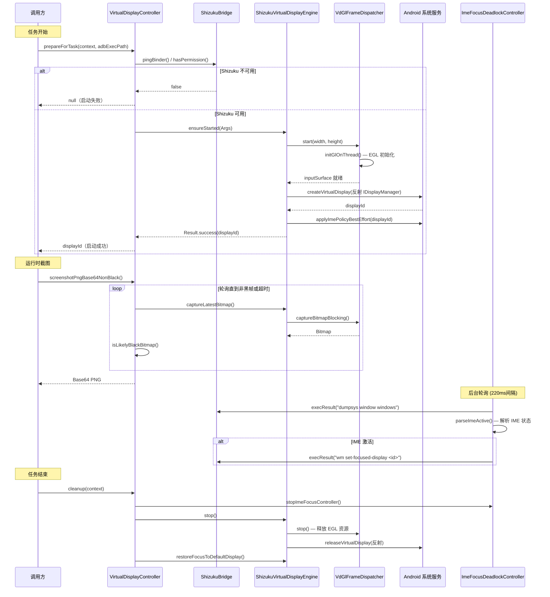
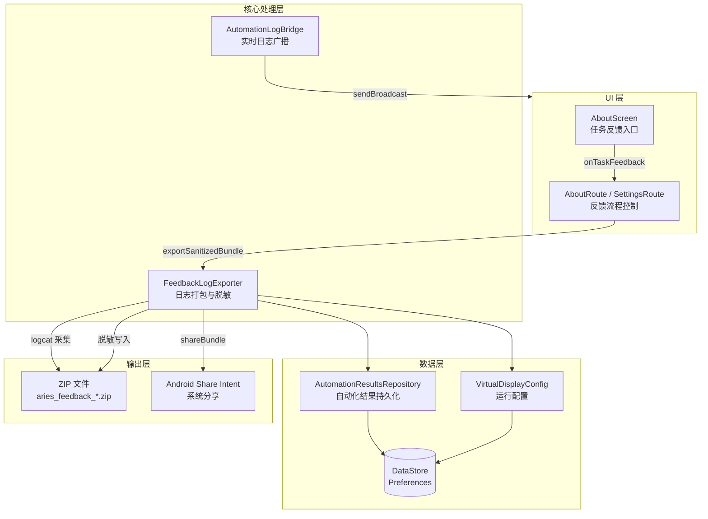
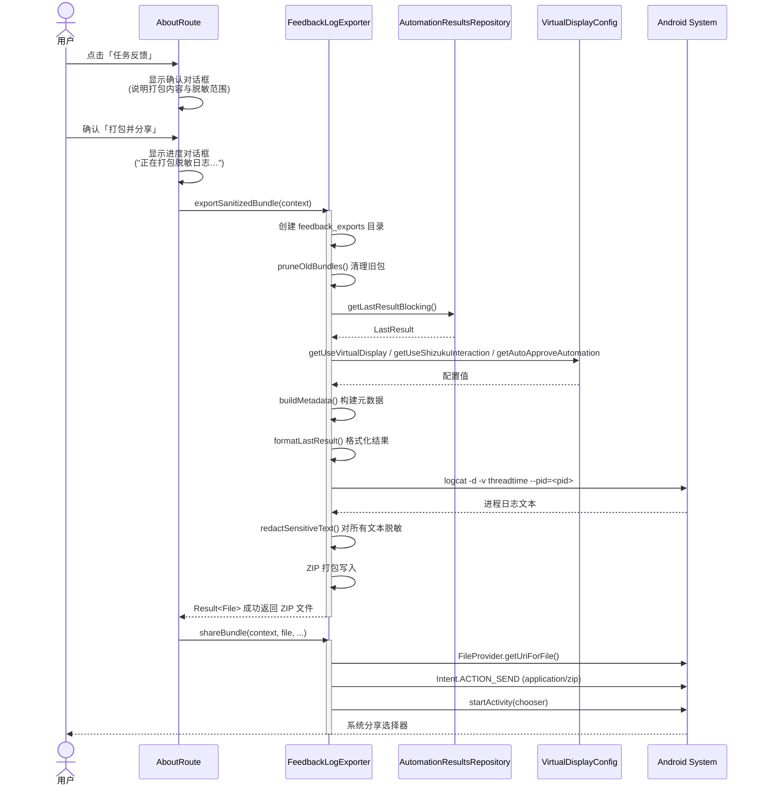

# 故障排查手册

本页按“先分层定位、再查看日志、最后验证修复”的顺序汇总无障碍、Shizuku、虚拟屏、模型 API、动作执行和反馈日志导出问题。

> 当前实现说明：`FloatingChatService` 已不在当前源码中；本文涉及它的示例与悬浮聊天链路属于历史实现。当前主界面入口为 `MainActivity`，悬浮聊天偏好类仍保留，不能据此推断悬浮聊天服务仍可用。

> 本文档为 Aries AI 用户和开发者提供系统化的故障排查流程、诊断工具使用说明，以及常见问题的深度解决方案。当你遇到任务执行失败、应用闪退、虚拟屏黑屏等问题时，请参考本指南。

---

## 概述

Aries AI 是一个多层架构的 Android AI 自动化引擎，其正常运转依赖于多个组件协同工作：**无障碍服务**（UI 树读取与截图）、**Shizuku**（系统级权限与虚拟屏）、**大模型 API**（决策推理）、**ActionExecutor**（动作执行）。当任一环节出现异常时，会导致任务失败。

本指南从以下维度组织故障排查内容：

- **诊断工具**：日志导出、API 健康检查、执行结果回溯
- **分层排查**：按系统层 → 权限层 → 网络层 → 执行层的顺序逐级排查
- **核心组件故障**：针对无障碍服务、Shizuku、虚拟屏、API、动作执行等组件的专项排查
- **常见问题速查**：快速定位典型症状的解决方案

---

## 故障排查架构

Aries AI 在架构上提供了多层诊断能力。下图展示了故障发生后，从日志采集到用户反馈的完整排查链路：



### 诊断工具说明

| 工具/组件 | 用途 | 关键文件 |
|-----------|------|----------|
| **AutomationLogBridge** | 将自动化执行日志通过广播发送到主界面，实时展示每步操作 | [AutomationLogBridge.kt](https://github.com/ZG0704666/Aries-AI/blob/main/app/src/main/java/com/ai/phoneagent/core/automation/AutomationLogBridge.kt) |
| **FeedbackLogExporter** | 导出脱敏后的诊断包（含 metadata、最近执行结果、进程 logcat），自动脱敏邮箱/手机号/Token | [FeedbackLogExporter.kt](https://github.com/ZG0704666/Aries-AI/blob/main/app/src/main/java/com/ai/phoneagent/helper/FeedbackLogExporter.kt) |
| **AutomationResultsRepository** | 持久化最近一次任务的结果（成功/失败、步数、日志），供诊断和导出使用 | [AutomationResultsRepository.kt](https://github.com/ZG0704666/Aries-AI/blob/main/app/src/main/java/com/ai/phoneagent/data/preferences/AutomationResultsRepository.kt) |
| **AutoGlmClient.checkApi** | API 连通性快速检查，返回详细错误信息 | [AutoGlmClient.kt](https://github.com/ZG0704666/Aries-AI/blob/main/app/src/main/java/com/ai/phoneagent/net/AutoGlmClient.kt) |

---

## 分层排查流程

当任务执行出现问题时，请按照以下顺序逐层排查。每一层都可能包含多个检查点。这个流程的设计意图是：**从底层系统能力向上逐级验证，确保排查的高效性和准确性**。



---

## 核心组件故障排查

### 1. 无障碍服务故障

无障碍服务是 Aries AI 的核心依赖，负责屏幕截图和 UI 树读取。

**常见症状：**
- 任务无法启动，提示"无障碍服务未连接"
- 截图获取失败
- UI 树返回为空

**排查步骤：**



**关键代码——Agent 中的无障碍服务检查：**

```kotlin
// 无障碍服务断开时，Agent 会立即抛出异常终止任务
val rawUiDump = if (config.useBackgroundVirtualDisplay && ...) {
    "[虚拟屏模式-纯视觉驱动]"
} else if (config.useShizukuInteraction) {
    // Shizuku 模式走不同通道
} else {
    service?.dumpUiTreeWithRetry(maxNodes = config.uiTreeMaxNodes)
        ?: throw IllegalStateException("无障碍服务未连接，无法读取 UI 树")
}
```

> Source: [UiAutomationAgent.kt](https://github.com/ZG0704666/Aries-AI/blob/main/app/src/main/java/com/ai/phoneagent/UiAutomationAgent.kt#L260-L274)

**解决方案：**

1. **检查系统权限**：进入 `设置 → 无障碍 → 已下载的应用 → Aries AI`，确保开关已打开
2. **ROM 特殊处理**：MIUI 用户需进入 `安全中心 → 权限管理 → 允许 Aries AI 自启动和后台运行`；ColorOS/OneUI 用户类似
3. **强制重启**：在 `设置 → 应用管理 → Aries AI` 中先强制停止，再重新打开授权
4. **重启设备**：如果以上均无效，重启设备后重试

---

### 2. Shizuku 故障

Shizuku 为虚拟屏功能提供系统级权限，是后台自动化的基础。

**常见症状：**
- 虚拟屏无法创建（`displayId = null`）
- 日志提示 "Shizuku binder not ready"
- 日志提示 "Shizuku permission not granted"

**核心代码——Shizuku 状态检查与错误处理：**

```kotlin
// VirtualDisplayController 中的 Shizuku 可用性检查
if (!ShizukuBridge.pingBinder()) {
    Log.e(TAG, "Shizuku binder not ready - please start Shizuku app first")
    activeDisplayId = null
    return null
}
if (!ShizukuBridge.hasPermission()) {
    Log.e(TAG, "Shizuku permission not granted - please grant permission in Shizuku app")
    activeDisplayId = null
    return null
}
```

> Source: [VirtualDisplayController.kt](https://github.com/ZG0704666/Aries-AI/blob/main/app/src/main/java/com/ai/phoneagent/VirtualDisplayController.kt#L106-L114)

**Shizuku 故障排查流程：**



---

### 3. 虚拟屏故障

虚拟屏技术是 Aries AI 的核心差异化能力。虚拟屏黑屏或创建失败是最常见的深度故障。

**故障分类与诊断：**

| 故障类型 | 日志关键词 | 根因 | 解决方案 |
|----------|-----------|------|----------|
| Shizuku 未就绪 | `Shizuku binder not ready` | Shizuku 未启动 | 启动 Shizuku 应用 |
| 权限未授予 | `Shizuku permission not granted` | 未在 Shizuku 中授权 | 在 Shizuku 中授权 Aries AI |
| 虚拟屏创建失败 | `ensureStarted failed` | 系统/ROM 兼容性 | 尝试主屏模式 |
| 截图不可用 | `虚拟屏截图不可用` | 目标应用未正确启动 | 重启任务 |
| 虚拟屏黑屏 | 无明确错误日志 | 应用启动慢或焦点丢失 | 等待3-5秒或重启任务 |

**虚拟屏创建失败的完整处理链路：**

```kotlin
// UiAutomationAgent.run() 中的虚拟屏处理逻辑
if (config.useBackgroundVirtualDisplay) {
    onLog("【虚拟屏模式】正在准备后台虚拟屏...")
    val displayId = VirtualDisplayController.prepareForTask(context, "")
    if (displayId != null && displayId > 0) {
        onLog("【虚拟屏模式】虚拟屏已准备就绪，displayId=$displayId")
        // 成功：更新屏幕尺寸
    } else {
        // 虚拟屏创建失败，直接报错退出，不降级到主屏幕
        onLog("【虚拟屏模式】虚拟屏准备失败：Shizuku 未授权或创建失败")
        return AgentResult(false, "虚拟屏模式启动失败：请确保已安装 Shizuku 并授予权限", 0)
    }
}
```

> Source: [UiAutomationAgent.kt](https://github.com/ZG0704666/Aries-AI/blob/main/app/src/main/java/com/ai/phoneagent/UiAutomationAgent.kt#L131-L148)

**设计意图**：虚拟屏创建失败时，Agent 选择**直接报错退出**而非降级到主屏模式。这是有意为之——如果用户明确选择了后台虚拟屏模式但虚拟屏不可用，在主屏继续执行会占用用户前台屏幕，造成意外干扰。

---

### 4. API 调用故障

API 调用是连接大模型的关键环节。Aries AI 内置了完善的错误分类和重试机制。

**错误分类与重试策略：**

```kotlin
// ActionUtils 中的错误可重试性判断
fun isRetryableModelError(t: Throwable?): Boolean {
    if (t == null) return false
    if (t is CancellationException) return false           // 用户取消，不重试
    if (t is AutoGlmClient.ApiException) {
        if (t.code == 429) return true                     // 限流，可重试
        if (t.code in 500..599) return true                // 服务端错误，可重试
        return false                                        // 4xx 客户端错误，不重试
    }
    return t is IOException                                 // 网络 IO 错误，可重试
}
```

> Source: [ActionUtils.kt](https://github.com/ZG0704666/Aries-AI/blob/main/app/src/main/java/com/ai/phoneagent/core/utils/ActionUtils.kt#L115-L124)

**模型请求重试机制：**

```kotlin
// UiAutomationAgent 中的带重试模型请求
private suspend fun requestModelWithRetry(...): Result<String> {
    val maxAttempts = (config.maxModelRetries + 1).coerceAtLeast(1)
    var lastErr: Throwable? = null

    for (attempt in 0 until maxAttempts) {
        val result = withContext(Dispatchers.IO) {
            AutoGlmClient.sendChatResult(apiKey, baseUrl, messages, model, ...)
        }
        if (result.isSuccess) return result

        val err = result.exceptionOrNull()
        if (err is CancellationException) throw err
        lastErr = err

        val retryable = ActionUtils.isRetryableModelError(err)
        if (!retryable || attempt >= maxAttempts - 1) break

        val waitMs = ActionUtils.computeModelRetryDelayMs(attempt, config.modelRetryBaseDelayMs)
        onLog("[Step $step] $purpose 失败：${err?.message}（${attempt+1}/$maxAttempts），${waitMs}ms 后重试…")
        delay(waitMs)
    }
    return Result.failure(lastErr ?: IOException("Unknown model error"))
}
```

> Source: [UiAutomationAgent.kt](https://github.com/ZG0704666/Aries-AI/blob/main/app/src/main/java/com/ai/phoneagent/UiAutomationAgent.kt#L1136-L1196)

**API 故障排查速查表：**

| HTTP 状态码 | 含义 | 是否重试 | 用户操作 |
|-------------|------|----------|----------|
| 401 | API Key 无效 | 否 | 检查/更新 API Key |
| 403 | 无权访问模型 | 否 | 检查 API Key 权限范围 |
| 429 | 速率限制 | 是（指数退避） | 稍等后重试，或降低任务频率 |
| 5xx | 服务端错误 | 是（指数退避） | 等待服务恢复，或切换服务商 |
| 超时 | 网络/服务端慢 | 是 | 切换更快模型或优化网络 |

**重试延迟计算——指数退避策略：**

```kotlin
fun computeModelRetryDelayMs(attempt: Int, baseDelayMs: Long): Long {
    val base = baseDelayMs.coerceAtLeast(0L)
    val mult = 1L shl attempt.coerceIn(0, 6)  // 指数增长：1, 2, 4, 8...
    return (base * mult).coerceAtMost(6000L)    // 上限 6s
}
```

> Source: [ActionUtils.kt](https://github.com/ZG0704666/Aries-AI/blob/main/app/src/main/java/com/ai/phoneagent/core/utils/ActionUtils.kt#L38-L42)

---

### 5. 动作执行故障

动作执行器（ActionExecutor）采用多通道策略，确保在各类环境下都能最大可能完成操作。

**三通道执行策略：**



**设计意图**：ActionExecutor 的"通道 + 兜底"策略保证了在虚拟屏、Shizuku、无障碍服务三种差异化环境中都能尽力完成操作。例如，虚拟屏下文本输入失败的兜底链路为：`injectTextOnVirtualDisplay → 重试注入 → 无障碍输入兜底 → 提示模型改用 Tap 键盘逐字输入`。

**执行失败时的动作修复机制：**

Agent 在动作执行失败后，不会立即终止任务，而是会触发模型修复流程。修复流程会构造专门的修复提示（repair prompt），让模型基于失败上下文重新规划动作：

```kotlin
// 动作执行失败 → 修复流程
if (execOk) break  // 成功则跳出

if (repairAttempt >= config.maxActionRepairs) {
    return AgentResult(false, "动作执行失败：${currentAction.raw}", step)
}

repairAttempt++
onLog("[Step $step] 动作执行失败，尝试让模型修复（$repairAttempt/${config.maxActionRepairs})…")

// 构建修复消息并重新请求模型
val failMsg = PromptTemplates.buildActionRepairPrompt(currentAction.raw, enforceDesc)
history += ChatRequestMessage(role = "user", content = failMsg)
val fixResult = requestModelWithRetry(apiKey, baseUrl, model, messages = history, ...)
```

> Source: [UiAutomationAgent.kt](https://github.com/ZG0704666/Aries-AI/blob/main/app/src/main/java/com/ai/phoneagent/UiAutomationAgent.kt#L543-L627)

---

## 诊断工具使用指南

### 日志导出（FeedbackLogExporter）

当需要向开发者反馈问题时，使用内置的日志导出功能可以生成包含关键诊断信息的脱敏压缩包。

**导出内容：**
| 文件 | 内容 |
|------|------|
| `metadata.txt` | 设备型号、Android 版本、应用版本、配置项（虚拟屏/Shizuku/自动审批开关状态） |
| `automation_last_result.txt` | 最近一次任务的成功/失败状态、步数、完整日志 |
| `logcat_current_process.txt` | 当前进程的 logcat 输出（自动过滤敏感信息） |

**敏感信息自动脱敏：**
导出功能会自动识别并脱敏以下内容，确保安全分享：
- 邮箱地址 → `j***e@example.com`
- 手机号码 → `138****1234`
- API Token/Bearer → `abc***xy`
- Authorization/Cookie 等 Header 密钥 → `***`

```kotlin
// FeedbackLogExporter 的敏感信息脱敏正则
private val bearerRegex = Regex("""(?i)(bearer\s+)([A-Za-z0-9._\-+/=]+)""")
private val headerSecretRegex = Regex(
    """(?im)\b(authorization|cookie|set-cookie|x-api-key|api-key|token|
        access-token|refresh-token|password|secret)\b\s*[:=]\s*([^\r\n]+)""",
)
private val querySecretRegex = Regex(
    """(?i)([?&](?:token|access_token|refresh_token|api_key|apikey|
        secret|password)=)([^&\s]+)""",
)
```

> Source: [FeedbackLogExporter.kt](https://github.com/ZG0704666/Aries-AI/blob/main/app/src/main/java/com/ai/phoneagent/helper/FeedbackLogExporter.kt#L23-L34)

### 实时日志监控

Agent 执行过程中，每一步都会产生详细的日志输出，通过 `AutomationLogBridge` 广播到主界面：

```kotlin
object AutomationLogBridge {
    const val ACTION_AUTOMATION_LOG = "com.ai.phoneagent.action.AUTOMATION_LOG"

    fun publish(context: Context, line: String) {
        val normalized = line.trim()
        if (normalized.isBlank()) return
        val intent = Intent(ACTION_AUTOMATION_LOG).apply {
            setPackage(context.packageName)
            putExtra("automation_log_line", normalized)
        }
        context.sendBroadcast(intent)
    }
}
```

> Source: [AutomationLogBridge.kt](https://github.com/ZG0704666/Aries-AI/blob/main/app/src/main/java/com/ai/phoneagent/core/automation/AutomationLogBridge.kt#L6-L24)

**关键日志模式对照：**

| 日志模式 | 含义 | 处理建议 |
|----------|------|----------|
| `【虚拟屏模式】正在准备后台虚拟屏...` | 虚拟屏创建流程开始 | 正常 |
| `Shizuku binder not ready` | Shizuku 未启动 | 启动 Shizuku 应用 |
| `Shizuku permission not granted` | 权限未授予 | 在 Shizuku 中授权 |
| `[Step N] 请求模型…` | 向大模型发起 API 请求 | 正常 |
| `[Step N] 执行操作: 点击(N,M)` | 执行点击动作 | 正常 |
| `Shizuku 点击失败: exitCode=X` | Shizuku 点击命令失败 | 检查 Shizuku 状态 |
| `虚拟屏输入失败` | 虚拟屏文本注入未成功 | 会自动触发重试/兜底 |
| `动作执行失败，尝试让模型修复` | 触发动作修复流程 | 自动处理 |
| `达到最大步数限制` | 任务步数超出上限 | 简化任务或增大 maxSteps |

---

## 常见问题速查

### 问题一：应用闪退

**症状**：Aries AI 在使用过程中突然崩溃退出。

**排查步骤**：

1. **获取崩溃日志**：
   ```bash
   adb logcat -d | grep -E "AndroidRuntime|FATAL|AriesAgentApp|FloatingChatService"
   ```
2. **清除缓存**：进入 `设置 → 应用管理 → Aries AI` → 清除缓存和数据
3. **重新安装**：卸载后从 [GitHub Releases](https://github.com/ZG0704666/Aries-AI/releases) 下载最新版本
4. **检查兼容性**：确保 Android ≥ 11，建议 Android 12+；确保设备 RAM ≥ 4GB

### 问题二：虚拟屏黑屏

**症状**：虚拟屏预览窗口一直显示黑屏，没有应用画面。

**排查要点**（按优先级排序）：

1. 等待 3-5 秒——应用启动需要时间
2. 检查 Shizuku 状态是否正常
3. 如果是特定应用黑屏，可能是该应用不支持虚拟屏（某些银行/支付类应用有反虚拟屏检测）
4. 尝试切换到主屏模式执行

### 问题三：API 调用持续失败

**症状**：每次模型请求都返回错误。

**排查步骤**：

1. 验证 API Key 是否正确且未过期
2. 使用 `adb logcat -s AriesAgentApp` 查看具体错误码
   - `HTTP 401`：API Key 无效
   - `HTTP 429`：请求过于频繁，稍后重试
   - `HTTP 5xx`：服务商故障，等待恢复或切换
3. 检查 API 配额是否已用完
4. 尝试切换网络（WiFi ↔ 移动数据）

### 问题四：键盘输入失败

**症状**：AI 尝试在应用中输入文字但失败，或输入框中没有出现文字。

**设计背景**：虚拟屏下文本输入采用"剪贴板 + 粘贴"策略，而非直接键盘模拟。这是因为虚拟屏禁用了 IME 渲染以防止键盘焦点死锁。

**排查点**：
- 日志中 `[Type][Shizuku]` 相关行会详细展示输入策略的每一步（`clipboard_first → paste → direct_input → fallback`）
- 如果日志出现 `Type中文失败：下一步不要再输出Type，请直接Tap软键盘上的目标字键`，说明当前模型应改为逐键点击方式输入

---

## 配置选项参考

以下是与故障排查相关的关键配置参数，适当调整这些参数可以提升稳定性或改变重试行为：

| 参数 | 类型 | 默认值 | 说明 | 故障排查用途 |
|------|------|--------|------|-------------|
| `maxSteps` | Int | 100 | 最大执行步数 | 如果任务总是超步数失败，检查是否陷入循环 |
| `maxModelRetries` | Int | 3 | 模型请求最大重试次数 | 网络不稳定时可增大 |
| `modelRetryBaseDelayMs` | Long | 700 | 重试基础延迟(ms)，支持指数退避 | 配合 maxModelRetries 使用 |
| `maxParseRepairs` | Int | 2 | 输出解析修复最大次数 | 模型输出格式不稳定时可增大 |
| `maxActionRepairs` | Int | 1 | 动作执行修复最大次数 | 可增大来提升执行成功率，但会增加耗时 |
| `stepDelayMs` | Long | 160 | 每步之间基础延迟(ms) | 增加可减少因 UI 未刷新导致的误判 |
| `screenshotCompressionQuality` | Int | 85 | 截图压缩质量(0-100) | 降低可减少 API 数据传输量 |
| `enableScreenshotCache` | Boolean | true | 是否启用截图缓存 | 开启可减少重复截图 |
| `useStreamingWithEarlyStop` | Boolean | true | 流式输出+早停 | 开启可降低延迟 |

> Source: [AgentConfiguration.kt](https://github.com/ZG0704666/Aries-AI/blob/main/app/src/main/java/com/ai/phoneagent/core/config/AgentConfiguration.kt)

---

## API 连通性检查

Aries AI 提供了 API 连通性检查接口，可以在设置界面或通过代码快速验证 API 是否可用：

```kotlin
// AutoGlmClient 的 API 检查方法
suspend fun checkApiDetailed(
    apiKey: String,
    baseUrl: String = DEFAULT_BASE_URL,
    model: String = DEFAULT_MODEL,
): ApiCheckResult

data class ApiCheckResult(
    val ok: Boolean,
    val statusCode: Int? = null,
    val message: String? = null,
)
```

> Source: [AutoGlmClient.kt](https://github.com/ZG0704666/Aries-AI/blob/main/app/src/main/java/com/ai/phoneagent/net/AutoGlmClient.kt#L361-L451)

当 `ok = false` 时，`message` 会包含具体的错误原因，如：
- `HTTP 401`：API Key 无效
- `"Insufficient quota"`：配额不足
- `"Invalid model"`：模型名称错误
- `"Network request failed"`：网络不通

---

## 反馈问题模板

向开发者反馈问题时，请通过 **FeedbackLogExporter** 导出诊断包，并附上以下信息：

```markdown
### 设备信息
- 设备型号：例如 Xiaomi 14
- Android 版本：例如 Android 14 (SDK 34)
- ROM 版本：例如 HyperOS 1.0.5.0

### 应用信息
- Aries AI 版本：例如 v1.4.3-beta
- Shizuku 版本：例如 13.5.4

### 问题描述
- 详细描述问题现象
- 复现步骤
- 预期行为 vs 实际行为

### 附加信息
- 使用的模型：例如 glm-4.6v-flash
- 任务描述：例如"在美团搜索附近的火锅店"
- 已尝试的解决方案
```

---

---

## 虚拟屏调试专题

虚拟屏（VirtualDisplay）是 Aries AI 的核心隔离技术。本文档汇总了虚拟屏模块的调试方法、日志体系、常见故障排查步骤及诊断技巧，帮助开发者和用户在遇到虚拟屏相关问题时快速定位根因。

---

### 概述

Aries AI 的虚拟屏系统通过 Shizuku 获取系统级权限，利用 Android 隐藏 API 创建独立的 `VirtualDisplay`，实现主屏与自动化操作的完全隔离。虚拟屏的调试涉及以下层面：

| 层级 | 组件 | 职责 |
|------|------|------|
| 统一入口 | `VirtualDisplayController` | 虚拟屏生命周期管理、模式切换 |
| 核心引擎 | `ShizukuVirtualDisplayEngine` | 反射调用 IDisplayManager 创建/销毁 VirtualDisplay |
| OpenGL 分发 | `VdGlFrameDispatcher` | GL 线程接收帧并同时分发到截图与预览通道 |
| 输入注入 | `VirtualAsyncInputInjector` | 通过 IInputManager 向指定 display 注入触摸和按键事件 |
| 焦点防护 | `ImeFocusDeadlockController` | 轮询检测 IME 死锁并自动恢复 |
| 预览浮窗 | `VirtualScreenPreviewOverlay` | TextureView 直出预览 + 触摸注入 |
| 系统服务 | `ShizukuServiceHub` | 通过 Shizuku 代理获取 DisplayManager/InputManager/WindowManager |
| 配置持久化 | `VirtualDisplayConfig` / `VirtualDisplayConfigRepository` | 分辨率预设、DPI 等持久化存储 |

---

### 架构图

以下 Mermaid 图展示了虚拟屏系统的整体架构与组件依赖关系：



**架构说明**：

- `VirtualDisplayController` 作为统一门面（Facade），所有外部调用（UI、Python 侧）均通过它进行，避免直接操作底层引擎。
- `ShizukuVirtualDisplayEngine` 通过 `ShizukuServiceHub` 获取经过 Shizuku 提权的系统服务代理，进而反射调用 Android 隐藏 API。
- `VdGlFrameDispatcher` 在独立 GL 线程中运行，将 VirtualDisplay 输出到 `SurfaceTexture`（中转），然后同时渲染到离屏 `ImageReader`（截图）和可选预览 `Surface`（悬浮窗）。
- `VirtualAsyncInputInjector` 通过 `ShizukuBinderWrapper` 包装 input service binder，以系统权限向指定 display 注入事件。
- `ImeFocusDeadlockController` 独立轮询 `dumpsys window windows`，检测 IME 是否激活并触发强制锁焦。

---

### 日志调试

#### 日志 TAG 速查表

虚拟屏系统使用以下 TAG 输出日志，可通过 `adb logcat` 按 TAG 过滤：

| TAG | 源文件 | 用途 |
|-----|--------|------|
| `AriesVirtualDisplay` | `VirtualDisplayController.kt` | 虚拟屏生命周期、截图、输入注入入口 |
| `AriesVdIsoEngine` | `ShizukuVirtualDisplayEngine.kt` | 引擎启停、VirtualDisplay 创建/销毁、Surface 切换 |
| `AriesVdIsoServices` | `ShizukuServiceHub.kt` | 系统服务获取 |
| `AriesImeFocusLock` | `ImeFocusDeadlockController.kt` | IME 死锁检测、强制锁焦 |
| `AriesInputInject` | `VirtualAsyncInputInjector.kt` | 输入注入方法签名匹配 |
| `AriesVdGl` | `VdGlFrameDispatcher.kt` | OpenGL 初始化、帧渲染 |
| `AriesShizuku` | `ShizukuBridge.kt`（core 模块） | Shizuku shell 命令执行 |
| `VdPreview` | `VirtualScreenPreviewOverlay.kt` | 预览浮窗绑定/解绑 |

#### 基础 logcat 命令

```bash
# 过滤所有虚拟屏相关日志
adb logcat -s AriesVirtualDisplay AriesVdIsoEngine AriesVdIsoServices AriesImeFocusLock AriesInputInject AriesVdGl AriesShizuku VdPreview

# 仅查看错误和警告
adb logcat -s AriesVirtualDisplay:* AriesVdIsoEngine:* AriesVdGl:* AriesShizuku:*

# 实时过滤并保存到文件
adb logcat -s AriesVirtualDisplay AriesVdIsoEngine AriesVdIsoServices AriesImeFocusLock AriesInputInject AriesVdGl AriesShizuku VdPreview > vd_debug.log
```

#### 关键日志示例与解读

**1. Shizuku 权限检查（`prepareForTask` 入口）**

当虚拟屏启动失败时，首先关注以下日志：

```
AriesVirtualDisplay: prepareForTask: start, pingBinder=true, hasPermission=true
AriesVirtualDisplay: Shizuku permission OK, checking existing display...
```

> Source: [VirtualDisplayController.kt](https://github.com/ZG0704666/Aries-AI/blob/main/app/src/main/java/com/ai/phoneagent/VirtualDisplayController.kt#L100-L118)

如果看到：
```
AriesVirtualDisplay: Shizuku binder not ready - please start Shizuku app first
```
说明 Shizuku 服务未启动，需要打开 Shizuku App 启动服务。

如果看到：
```
AriesVirtualDisplay: Shizuku permission not granted - please grant permission in Shizuku app
```
说明 Aries AI 未获得 Shizuku 授权，需要在 Shizuku App 中授予权限。

**2. 虚拟屏创建过程**

```
AriesVdIsoEngine: Starting VdGlFrameDispatcher...
AriesVdGl: initGlOnThread: starting EGL init...
AriesVdGl: EGL display obtained: <addr>
AriesVdIsoEngine: GL input surface ready: <Surface>
AriesVdIsoEngine: Found N createVirtualDisplay methods:
AriesVdIsoEngine: Using createVirtualDisplay: <signature>
AriesVdIsoEngine: createVirtualDisplay ok: displayId=<id> flags=<flags>
AriesVirtualDisplay: VirtualDisplay created successfully: displayId=<id>
```

> Source: [ShizukuVirtualDisplayEngine.kt](https://github.com/ZG0704666/Aries-AI/blob/main/app/src/main/java/com/ai/phoneagent/vdiso/ShizukuVirtualDisplayEngine.kt#L146-L198) 和 [VirtualDisplayController.kt](https://github.com/ZG0704666/Aries-AI/blob/main/app/src/main/java/com/ai/phoneagent/VirtualDisplayController.kt#L130-L155)

**3. GL 初始化失败**

如果看到以下日志，表示 OpenGL 初始化失败，通常与设备 GPU 驱动或 EGL 实现有关：
```
AriesVdGl: EGL_NO_DISPLAY
AriesVdGl: initGlOnThread failed
AriesVdGl: GL init error: <exception>
```

> Source: [VdGlFrameDispatcher.kt](https://github.com/ZG0704666/Aries-AI/blob/main/app/src/main/java/com/ai/phoneagent/vdiso/VdGlFrameDispatcher.kt#L179-L186)

**4. IME 死锁检测**

```
AriesImeFocusLock: IME detected → FORCE_LOCK did=<id> cost=<ms> detail=...
AriesImeFocusLock: forceLock: did=<id> n=<count> exit=0
AriesImeFocusLock: IME gone → exit FORCE_LOCK did=<id> cost=<ms>
```

> Source: [ImeFocusDeadlockController.kt](https://github.com/ZG0704666/Aries-AI/blob/main/app/src/main/java/com/ai/phoneagent/vdiso/ImeFocusDeadlockController.kt#L97-L107)

**5. 输入注入方法签名**

系统启动时会打印可用的 `injectInputEvent` 方法签名：
```
AriesInputInject: injectInputEvent candidates: <method signatures>
AriesInputInject: Using <chosen method>
```

> Source: [VirtualAsyncInputInjector.kt](https://github.com/ZG0704666/Aries-AI/blob/main/app/src/main/java/com/ai/phoneagent/input/VirtualAsyncInputInjector.kt#L93-L112)

---

### 核心执行流程

以下时序图展示了虚拟屏从准备到截图再到清理的完整生命周期：



---

### 常见问题排查

#### 问题 1：虚拟屏无法启动（displayId 为 null）

**诊断步骤**：

1. **检查 Shizuku 状态**（最常见原因）：
   ```bash
   adb logcat -s AriesVirtualDisplay | grep -E "pingBinder|hasPermission|binder not ready|permission not granted"
   ```
   正常日志应显示 `pingBinder=true, hasPermission=true`。
   - 若 `pingBinder=false`：打开 Shizuku App → 点击"启动"
   - 若 `hasPermission=false`：在 Shizuku App → 已授权应用 → 开启 Aries AI

2. **检查 GL 初始化是否成功**：
   ```bash
   adb logcat -s AriesVdGl | grep -E "initGlOnThread|EGL_NO_DISPLAY|GL init error"
   ```
   若出现 `EGL_NO_DISPLAY` 或 `GL init error`，说明设备 GPU/EGL 驱动不支持。尝试：
   - 重启设备
   - 检查是否在模拟器上运行（部分模拟器 EGL 实现不完整）

3. **检查 VirtualDisplay 创建是否成功**：
   ```bash
   adb logcat -s AriesVdIsoEngine | grep "createVirtualDisplay"
   ```
   引擎会自动打印所有可用的 `createVirtualDisplay` 方法签名，并尝试匹配 → 这是多 ROM 兼容的核心。

4. **验证 Shizuku 版本**：确保 Shizuku ≥ 13.1.5（`app/build.gradle.kts` 中定义的版本）。

#### 问题 2：虚拟屏持续黑屏

**诊断步骤**：

1. **检查截图是否返回空字符串**：
   ```bash
   adb logcat -s AriesVirtualDisplay | grep "screenshot"
   ```
   若日志中无异常但截图始终返回空，可能是 `ImageReader` 未获取到帧。

2. **检查黑帧检测逻辑**：
   `VirtualDisplayController.screenshotPngBase64NonBlack()` 采用轮询策略，最长等待 1.5s、间隔 80ms，直到获取到非黑帧。

   关键源码：
   > Source: [VirtualDisplayController.kt](https://github.com/ZG0704666/Aries-AI/blob/main/app/src/main/java/com/ai/phoneagent/VirtualDisplayController.kt#L197-L233)

   黑帧判定通过 32×32 采样网格进行，阈值 ≥ 20 个非黑像素即认为非黑帧：
   > Source: [VirtualDisplayController.kt](https://github.com/ZG0704666/Aries-AI/blob/main/app/src/main/java/com/ai/phoneagent/VirtualDisplayController.kt#L494-L529)

3. **检查是否使用了 `OWN_CONTENT_ONLY` flag**：
   引擎在 `buildFlags()` 中刻意不使用 `VIRTUAL_DISPLAY_FLAG_OWN_CONTENT_ONLY`，因为该 flag 会导致只显示本应用自己的窗口，第三方 App（如 Chrome）的内容将无法渲染从而出现黑帧。详见注释：
   > Source: [ShizukuVirtualDisplayEngine.kt](https://github.com/ZG0704666/Aries-AI/blob/main/app/src/main/java/com/ai/phoneagent/vdiso/ShizukuVirtualDisplayEngine.kt#L557-L558)

#### 问题 3：IME 焦点死锁（键盘弹出后虚拟屏卡死）

**现象**：虚拟屏上某应用调起输入法后，画面卡死、触摸无响应。

**机制**：`ImeFocusDeadlockController` 在后台以 220ms 间隔轮询 `dumpsys window windows`，解析目标 display 上 IME 是否激活。一旦检测到 IME 激活，立即进入 FORCE_LOCK 状态，以 90ms 间隔执行 `wm set-focused-display <displayId>` 强制锁定焦点。

**诊断命令**：
```bash
# 查看 IME 死锁检测状态
adb logcat -s AriesImeFocusLock

# 手动检查 IME 状态
adb shell dumpsys window windows | grep -A5 -i "inputmethod"
```

**策略说明**：完全隔离模式下，虚拟屏通过 `setShouldShowIme(displayId, false)` 和 `setDisplayImePolicy(displayId, HIDE)` 彻底禁用 IME 渲染。文本输入走 clipboard + Ctrl+V 粘贴路径（参见 `injectPasteBestEffort`）。

> Source: [ShizukuVirtualDisplayEngine.kt](https://github.com/ZG0704666/Aries-AI/blob/main/app/src/main/java/com/ai/phoneagent/vdiso/ShizukuVirtualDisplayEngine.kt#L469-L540) 和 [ImeFocusDeadlockController.kt](https://github.com/ZG0704666/Aries-AI/blob/main/app/src/main/java/com/ai/phoneagent/vdiso/ImeFocusDeadlockController.kt#L78-L117)

#### 问题 4：输入注入无效（点击无反应）

**诊断步骤**：

1. **检查 displayId 是否有效**：所有 `inject*` 方法在 `displayId <= 0` 时直接 return：
   > Source: [VirtualDisplayController.kt](https://github.com/ZG0704666/Aries-AI/blob/main/app/src/main/java/com/ai/phoneagent/VirtualDisplayController.kt#L256-L258)

2. **检查 Shizuku 是否在线**：注入前会检查 `pingBinder()` 和 `hasPermission()`。

3. **检查注入方法签名匹配**：
   ```bash
   adb logcat -s AriesInputInject
   ```
   确认引擎找到了正确的 `injectInputEvent` 方法。不同 Android 版本/ROM 的方法签名不同（2 参数 vs 3 参数），引擎自动适配。

4. **注意 best-effort 设计**：所有注入方法均为 best-effort，失败时静默吞掉异常。这是设计意图——避免注入失败导致整个自动化流程中断。

#### 问题 5：预览窗口不显示或画面撕裂

**诊断步骤**：

1. **检查预览绑定状态**：
   ```bash
   adb logcat -s VdPreview | grep -E "bound|bind|surface"
   ```

2. **预览帧率控制**：`VdGlFrameDispatcher` 限制预览渲染频率为 120ms 间隔（约 8fps），避免过度消耗 GPU。如需调整，修改 `PREVIEW_FRAME_INTERVAL_MS`：
   > Source: [VdGlFrameDispatcher.kt](https://github.com/ZG0704666/Aries-AI/blob/main/app/src/main/java/com/ai/phoneagent/vdiso/VdGlFrameDispatcher.kt#L592)

3. **OpenGL 分发架构**：VirtualDisplay 输出固定到中转 `SurfaceTexture`，GL 线程同时渲染到 `previewSurface`（悬浮窗）和 `captureSurface`（ImageReader），两者互不干扰。预览 Surface 可能随 UI 生命周期变化（悬浮窗收起/展开）。

---

### 代码级别的诊断 API

以下代码片段展示了如何在代码中诊断虚拟屏状态。

#### 检查虚拟屏状态

```kotlin
// 检查虚拟屏是否已启动
val isStarted = VirtualDisplayController.isVirtualDisplayStarted()
val displayId = VirtualDisplayController.getDisplayId()
Log.d("Debug", "VD started=$isStarted, displayId=$displayId")

// 获取当前内容尺寸
val (width, height) = VirtualDisplayController.getContentSizeBestEffort(context)
Log.d("Debug", "VD content size: ${width}x${height}")

// 检查 Shizuku 可用性
val shizukuReady = ShizukuBridge.pingBinder() && ShizukuBridge.hasPermission()
Log.d("Debug", "Shizuku ready=$shizukuReady")
```

> Source: [VirtualDisplayController.kt](https://github.com/ZG0704666/Aries-AI/blob/main/app/src/main/java/com/ai/phoneagent/VirtualDisplayController.kt#L71-L86)

#### 获取配置摘要

```kotlin
// 打印当前虚拟屏配置
val summary = VirtualDisplayConfig.summary(context)
Log.d("Debug", "VirtualDisplay config: $summary")
// 输出示例: "1080P (1088×1920) DPI=480"
```

> Source: [VirtualDisplayConfig.kt](https://github.com/ZG0704666/Aries-AI/blob/main/app/src/main/java/com/ai/phoneagent/VirtualDisplayConfig.kt#L156-L161)

#### 手动截图诊断

```kotlin
// 尝试截图并检查是否黑帧
val base64 = VirtualDisplayController.screenshotPngBase64NonBlack(
    maxWaitMs = 3000L,  // 延长等待时间用于调试
    pollIntervalMs = 100L
)
if (base64.isEmpty()) {
    Log.e("Debug", "Screenshot failed or still black after timeout")
} else {
    Log.d("Debug", "Screenshot captured: ${base64.length} chars")
}
```

> Source: [VirtualDisplayController.kt](https://github.com/ZG0704666/Aries-AI/blob/main/app/src/main/java/com/ai/phoneagent/VirtualDisplayController.kt#L197-L233)

---

### 配置验证

虚拟屏配置持久化在 Jetpack DataStore 中（文件名为 `virtual_display_config`）。可通过以下方式验证：

| 配置项 | 键名 | 默认值 | 有效范围 |
|--------|------|--------|----------|
| 分辨率预设 | `resolution_preset` | `1080P` | `480P` / `720P` / `1080P` |
| DPI | `virtual_display_dpi` | `480` | 72–640 |
| 宽度（缓存） | `virtual_display_width` | 由预设计算 | 16 对齐 |
| 高度（缓存） | `virtual_display_height` | 由预设计算 | 16 对齐 |
| 启用虚拟屏 | `use_virtual_display` | `false` | true/false |
| Shizuku 交互 | `use_shizuku_interaction` | `false` | true/false |
| 自动批准 | `auto_approve_automation` | `true` | true/false |

> Source: [VirtualDisplayConfigRepository.kt](https://github.com/ZG0704666/Aries-AI/blob/main/app/src/main/java/com/ai/phoneagent/data/preferences/VirtualDisplayConfigRepository.kt#L19-L27)

**分辨率与 16 像素对齐**：GPU/MediaCodec 编码器要求 16 对齐，否则可能出现黑边或崩溃。1080P 预设经 `align16` 后实际为 1088×1920。

> Source: [VirtualDisplayConfig.kt](https://github.com/ZG0704666/Aries-AI/blob/main/app/src/main/java/com/ai/phoneagent/VirtualDisplayConfig.kt#L51-L75)

---

### 系统要求与前置条件

在调试虚拟屏问题前，请确认以下前置条件全部满足：

| 条件 | 验证方法 |
|------|----------|
| Android ≥ 11 (API 30) | 设置 → 关于手机 → Android 版本 |
| Shizuku 已安装并运行 | Shizuku App 首页显示"Shizuku 正在运行" |
| Shizuku 权限已授予 | Shizuku App → 已授权应用 → Aries AI 已勾选 |
| 无障碍服务已开启 | 设置 → 无障碍 → Aries AI 已开启 |
| HiddenApiBypass 依赖正常 | 应用可正常启动（依赖 `org.lsposed.hiddenapibypass:hiddenapibypass:4.3`） |

相关依赖配置：
> Source: [app/build.gradle.kts](https://github.com/ZG0704666/Aries-AI/blob/main/app/build.gradle.kts#L147-L152)

---

---

## 反馈日志与导出专题

Aries AI 提供了一套完整的反馈日志打包、脱敏与分享机制，以及面向开发者和用户的问题排查路径，帮助快速定位和解决自动化执行、模型请求及运行时相关问题。

### 概述

反馈日志系统是 Aries AI 问题排查的核心工具。当自动化任务执行异常、模型请求失败（如 429 限流）、权限缺失或出现其他运行时问题时，用户可通过「关于」页面一键打包当前进程日志、最近一次自动化执行结果和设备元数据，并自动对邮箱、手机号、Token、API Key、Cookie、密码等敏感字段进行脱敏处理，然后通过系统分享渠道发送给开发者。

**设计意图**：该系统采用"最小数据收集 + 自动脱敏"的设计思路——仅采集当前进程的 logcat 和最近一次自动化结果，避免过度收集用户数据；在写入 ZIP 之前对所有文本内容执行多层正则脱敏，确保敏感信息不会泄露。

### 架构



**架构说明**：

- **UI 层**：`AboutScreen` 提供「任务反馈」入口（Bug 图标）；`AboutRoute` 和 `SettingsRoute` 负责确认对话框流程、导出进度状态管理和分享调用
- **核心处理层**：`FeedbackLogExporter` 是单例工具类，负责 ZIP 打包、敏感数据脱敏、logcat 采集和旧包清理；`AutomationLogBridge` 通过 Android Broadcast 机制实时推送自动化执行日志
- **数据层**：`AutomationResultsRepository` 基于 DataStore 持久化最近一次自动化执行的成功/失败状态、步骤数、消息和完整日志；`VirtualDisplayConfig` 提供后台执行/Shizuku 交互/自动审批等运行配置
- **输出层**：生成带时间戳的 ZIP 包，通过 Android `FileProvider` + `Intent.ACTION_SEND` 分享给目标应用

### 核心组件

#### FeedbackLogExporter — 日志打包与脱敏导出器

`FeedbackLogExporter` 是整个反馈系统的核心，负责将应用状态打包为可分享的 ZIP 文件。

> Source: [FeedbackLogExporter.kt](https://github.com/ZG0704666/Aries-AI/blob/main/app/src/main/java/com/ai/phoneagent/helper/FeedbackLogExporter.kt)

##### 打包内容

导出的 ZIP 包（命名为 `aries_feedback_yyyyMMdd_HHmmss.zip`）包含三个文件：

| 文件 | 内容 | 说明 |
|------|------|------|
| `metadata.txt` | 设备信息、应用版本、运行配置 | 包名、版本、设备厂商/型号、Android 版本、后台执行模式、Shizuku 交互状态、自动审批状态 |
| `automation_last_result.txt` | 最近一次自动化结果 | 时间、成功/失败状态、执行步骤数、消息、完整日志 |
| `logcat_current_process.txt` | 当前进程 logcat | 通过 `logcat -d -v threadtime --pid=<pid>` 采集的详细日志 |

##### 脱敏机制

系统内置 6 类正则脱敏规则，在写入 ZIP 前对所有文本执行：

| 模式 | 正则变量 | 脱敏策略 |
|------|---------|---------|
| Bearer Token | `bearerRegex` | `Bearer xxx` → `Bearer abc***yz` |
| HTTP Headers | `headerSecretRegex` | `authorization/cookie/x-api-key/token/password` 等敏感 header 值脱敏 |
| URL 查询参数 | `querySecretRegex` | `?token=abc123&...` → `?token=abc***23&...` |
| JSON 字段 | `jsonSecretRegex` | JSON 中的 `apiKey/token/password` 等字段值脱敏 |
| 邮箱 | `emailRegex` | `user@example.com` → `u***r@example.com` |
| 手机号 | `phoneRegex` | `13812345678` → `138****5678` |

脱敏辅助函数 `maskSecret()` 对于 ≤6 字符的值替换为 `***`，否则保留前 3 位和后 2 位（如 `abcdefgh` → `abc***gh`）。

> Source: [FeedbackLogExporter.kt#L23-L34](https://github.com/ZG0704666/Aries-AI/blob/main/app/src/main/java/com/ai/phoneagent/helper/FeedbackLogExporter.kt#L23-L34)
> Source: [FeedbackLogExporter.kt#L170-L216](https://github.com/ZG0704666/Aries-AI/blob/main/app/src/main/java/com/ai/phoneagent/helper/FeedbackLogExporter.kt#L170-L216)

##### 旧包清理

每次导出前，`pruneOldBundles()` 会按最后修改时间降序排列 `feedback_exports` 目录中的文件，仅保留最近的 5 个 ZIP 包，删除更早的文件。这避免了缓存目录无限膨胀。

> Source: [FeedbackLogExporter.kt#L163-L168](https://github.com/ZG0704666/Aries-AI/blob/main/app/src/main/java/com/ai/phoneagent/helper/FeedbackLogExporter.kt#L163-L168)

#### AutomationLogBridge — 实时日志广播

`AutomationLogBridge` 是一个轻量级的进程内广播工具，用于在自动化执行过程中实时推送日志行。

> Source: [AutomationLogBridge.kt](https://github.com/ZG0704666/Aries-AI/blob/main/app/src/main/java/com/ai/phoneagent/core/automation/AutomationLogBridge.kt)

- **发布端**：`publish(context, line)` 通过 `sendBroadcast` 发送指定 Action 的 Intent，携带日志行
- **消费端**：`extract(intent)` 从 Intent 中提取日志文本
- **设计意图**：使用进程内广播而非直接回调，支持多组件解耦消费（如控制台 UI、日志持久化等），且空行会被自动过滤

#### AutomationResultsRepository — 自动化结果持久化

基于 DataStore 的自动化结果存储，提供 Flow 响应式读取和阻塞式快照两种访问方式。

> Source: [AutomationResultsRepository.kt](https://github.com/ZG0704666/Aries-AI/blob/main/app/src/main/java/com/ai/phoneagent/data/preferences/AutomationResultsRepository.kt)

**存储字段**：

| 字段 | 类型 | 说明 |
|------|------|------|
| `last_result_success` | Boolean | 最近一次执行是否成功 |
| `last_result_message` | String | 最近一次执行的消息 |
| `last_result_steps` | Int | 最近一次执行的步骤数 |
| `last_result_time` | Long | 最近一次执行的时间戳 |
| `last_log` | String | 最近一次执行的完整日志 |

`LastResult` 数据类通过 `getLastResultBlocking()` 提供同步快照，供 `FeedbackLogExporter` 在打包时使用。

### 核心流程



**流程说明**：

1. **入口触发**：用户在「关于」页面点击「任务反馈」项，触发 `onTaskFeedback` 回调
2. **确认阶段**：弹出确认对话框，告知用户将打包的内容（当前应用日志 + 最近一次自动化结果）和脱敏范围（邮箱、手机号、Token、API Key、Cookie 等）
3. **导出阶段**：在 IO 协程中异步执行打包——采集 metadata、最近结果、进程 logcat，全部脱敏后写入 ZIP
4. **分享阶段**：通过 `FileProvider` 生成 content URI，构造 `ACTION_SEND` Intent 启动系统分享选择器
5. **错误处理**：导出失败时显示具体错误信息；分享失败时同样给出 Toast 提示

### 使用示例

#### 在 AboutRoute 中触发反馈流程

> Source: [AboutRoute.kt#L110-L179](https://github.com/ZG0704666/Aries-AI/blob/main/app/src/main/java/com/ai/phoneagent/ui/settings/AboutRoute.kt#L110-L179)

```kotlin
// AboutScreen 中传递 onTaskFeedback 回调
onTaskFeedback = {
    vibrateLight()
    showFeedbackConfirmDialog = true
}

// 确认对话框
if (showFeedbackConfirmDialog) {
    AlertDialog(
        onDismissRequest = { showFeedbackConfirmDialog = false },
        title = { Text(stringResource(R.string.about_feedback_confirm_title)) },
        text = { Text(stringResource(R.string.about_feedback_confirm_message)) },
        confirmButton = {
            TextButton(
                onClick = {
                    showFeedbackConfirmDialog = false
                    isExportingFeedbackBundle = true
                    scope.launch {
                        val result = FeedbackLogExporter.exportSanitizedBundle(context)
                        isExportingFeedbackBundle = false
                        result.onSuccess { bundleFile ->
                            FeedbackLogExporter.shareBundle(
                                context = context,
                                file = bundleFile,
                                chooserTitle = context.getString(R.string.about_feedback_share_chooser),
                                subject = context.getString(R.string.about_feedback_share_subject),
                            ).onFailure {
                                Toast.makeText(context, /* 错误信息 */, Toast.LENGTH_LONG).show()
                            }
                        }.onFailure {
                            Toast.makeText(context, /* 错误信息 */, Toast.LENGTH_LONG).show()
                        }
                    }
                },
            ) {
                Text(stringResource(R.string.about_feedback_confirm_action))
            }
        },
        dismissButton = {
            TextButton(onClick = { showFeedbackConfirmDialog = false }) {
                Text(stringResource(R.string.action_cancel))
            }
        },
    )
}
```

#### 直接调用 FeedbackLogExporter

> Source: [FeedbackLogExporter.kt#L36-L81](https://github.com/ZG0704666/Aries-AI/blob/main/app/src/main/java/com/ai/phoneagent/helper/FeedbackLogExporter.kt#L36-L81)

```kotlin
// 在协程中导出脱敏日志包
scope.launch(Dispatchers.IO) {
    val result = FeedbackLogExporter.exportSanitizedBundle(context)
    result.onSuccess { bundleFile ->
        // bundleFile 为 aries_feedback_20260518_143052.zip
        FeedbackLogExporter.shareBundle(
            context = context,
            file = bundleFile,
            chooserTitle = "发送日志包",
            subject = "Aries AI 任务反馈日志包",
        )
    }.onFailure { error ->
        // 处理导出失败
        Log.e("Feedback", "导出失败", error)
    }
}
```

#### 发布自动化日志

> Source: [AutomationLogBridge.kt](https://github.com/ZG0704666/Aries-AI/blob/main/app/src/main/java/com/ai/phoneagent/core/automation/AutomationLogBridge.kt)

```kotlin
// 发布日志行（自动化执行过程中）
AutomationLogBridge.publish(context, "步骤 3/5: 点击「设置」按钮完成")

// 消费日志行（在 BroadcastReceiver 中）
val line = AutomationLogBridge.extract(intent)
if (line != null) {
    // 追加到控制台 UI
    logViewModel.appendLine(line)
}
```

### 配置选项

#### FeedbackLogExporter 内部常量

| 常量 | 值 | 说明 |
|------|-----|------|
| `exportDir` | `{cacheDir}/feedback_exports` | ZIP 包导出目录 |
| `bundleFile 命名` | `aries_feedback_yyyyMMdd_HHmmss.zip` | 文件名格式，使用导出时间戳 |
| `maxBundles` | 5 | 保留的最大 ZIP 包数量（`drop(4)` 保留 5 个） |

#### ZIP 包内 metadata 字段

> Source: [FeedbackLogExporter.kt#L83-L116](https://github.com/ZG0704666/Aries-AI/blob/main/app/src/main/java/com/ai/phoneagent/helper/FeedbackLogExporter.kt#L83-L116)

| 字段 | 来源 | 说明 |
|------|------|------|
| `exported_at` | `Date()` | 导出时间 |
| `package_name` | `context.packageName` | 应用包名 |
| `app_version` | `PackageInfo.versionName` | 应用版本 |
| `device` | `Build.MANUFACTURER + Build.MODEL` | 设备制造商和型号 |
| `android` | `Build.VERSION.RELEASE + SDK_INT` | Android 版本和 SDK 级别 |
| `background_execution` | `VirtualDisplayConfig.getUseVirtualDisplay()` | 是否启用后台执行 |
| `shizuku_interaction` | `VirtualDisplayConfig.getUseShizukuInteraction()` | 是否使用 Shizuku 交互 |
| `auto_approve` | `VirtualDisplayConfig.getAutoApproveAutomation()` | 是否自动审批自动化操作 |
| `last_result_time` | `AutomationResultsRepository` | 最近一次自动化执行时间 |
| `redaction` | 固定值 | 说明已执行的脱敏字段列表 |

### API 参考

#### `FeedbackLogExporter`

##### `exportSanitizedBundle(context: Context): Result<File>`

挂起函数，在 IO 线程中导出脱敏日志包。

**参数：**
- `context` (Context)：Android 上下文，用于获取 cache 目录、包信息、DataStore 和运行进程 logcat

**返回：** `Result<File>` — 成功时包含 ZIP 文件，失败时包含异常信息

**流程：**
1. 创建 `feedback_exports` 目录
2. 清理旧包（保留最近 5 个）
3. 收集自动化结果、设备元数据、进程 logcat
4. 对所有文本脱敏
5. 打包为 ZIP 并返回

> Source: [FeedbackLogExporter.kt#L36-L60](https://github.com/ZG0704666/Aries-AI/blob/main/app/src/main/java/com/ai/phoneagent/helper/FeedbackLogExporter.kt#L36-L60)

##### `shareBundle(context: Context, file: File, chooserTitle: String, subject: String): Result<Unit>`

通过系统分享 Intent 发送 ZIP 文件。

**参数：**
- `context` (Context)：Android 上下文
- `file` (File)：要分享的 ZIP 文件
- `chooserTitle` (String)：分享选择器标题
- `subject` (String)：分享主题（邮件标题等）

**返回：** `Result<Unit>` — 成功或失败

**实现细节：** 使用 `FileProvider` 获取 content URI（authority = `{packageName}.fileprovider`），构造 `ACTION_SEND` Intent（MIME type = `application/zip`），并通过 `Intent.createChooser` 启动选择器。

> Source: [FeedbackLogExporter.kt#L62-L81](https://github.com/ZG0704666/Aries-AI/blob/main/app/src/main/java/com/ai/phoneagent/helper/FeedbackLogExporter.kt#L62-L81)

#### `AutomationLogBridge`

##### `publish(context: Context, line: String)`

发布自动化日志行（进程内广播）。

**参数：**
- `context` (Context)：Android 上下文
- `line` (String)：日志行内容，空行会被过滤

> Source: [AutomationLogBridge.kt#L11-L19](https://github.com/ZG0704666/Aries-AI/blob/main/app/src/main/java/com/ai/phoneagent/core/automation/AutomationLogBridge.kt#L11-L19)

##### `extract(intent: Intent?): String?`

从广播 Intent 中提取日志行。

**参数：**
- `intent` (Intent?)：收到的广播 Intent

**返回：** `String?` — 日志文本，或 null（如果 Intent 为空或日志行为空白）

> Source: [AutomationLogBridge.kt#L21-L24](https://github.com/ZG0704666/Aries-AI/blob/main/app/src/main/java/com/ai/phoneagent/core/automation/AutomationLogBridge.kt#L21-L24)

#### `AutomationResultsRepository`

##### `saveResult(success: Boolean, message: String, steps: Int, time: Long, log: String)`

保存自动化执行结果。

##### `getLastResultBlocking(): LastResult`

同步获取最近一次自动化结果快照（`LastResult` 数据类）。

##### `clearAll()`

清除所有已保存的自动化结果。

> Source: [AutomationResultsRepository.kt#L108-L148](https://github.com/ZG0704666/Aries-AI/blob/main/app/src/main/java/com/ai/phoneagent/data/preferences/AutomationResultsRepository.kt#L108-L148)

### 常见问题排查

#### 运行时问题

| 问题类型 | 排查路径 | 首选材料 |
|---------|---------|---------|
| 模型请求失败 (HTTP 429 / 超时) | 检查代理/VPN 配置、API Key 有效性、服务商配额 | 反馈日志包中的 `logcat` 查看 HTTP 响应 |
| 权限问题（无障碍/Shizuku/悬浮窗） | 设置页中权限入口保持可见可恢复 | `metadata.txt` 中的执行模式配置 |
| 自动化执行异常 | 查看控制台实时日志输出、最近一次结果 | `automation_last_result.txt` 中的步骤日志 |
| 应用崩溃 | 通过 `adb logcat` 或打包日志查看 | 反馈日志包中 `logcat_current_process.txt` |

#### 构建与编译问题

详细排查指南请参见 [BUILDING.md - 七、常见问题排查](https://github.com/ZG0704666/Aries-AI/blob/main/Aries-site/docs/BUILDING.md#七常见问题排查)，涵盖：
- Gradle 同步失败（网络/镜像配置）
- 依赖下载失败（`FAIL_ON_PROJECT_REPOS` 模式注意事项）
- 编译错误（符号找不到、清理重编译）
- 设备连接问题（adb 服务重启、USB 调试授权）
- 内存不足错误（Gradle JVM / Android Studio 内存调整）

#### 反馈问题时需提供的信息

建议用户在反馈问题时提供以下信息（大部分已包含在自动打包的日志中）：

1. **设备信息**：设备型号、Android 版本、ROM 版本
2. **应用信息**：Aries AI 版本、Shizuku 版本
3. **问题描述**：详细描述、复现步骤、预期 vs 实际行为
4. **日志信息**：通过「任务反馈」功能导出的脱敏日志包
5. **其他信息**：使用的模型、任务描述

### 字符串资源参考

反馈流程中使用的 UI 文本全部来自字符串资源：

> Source: [strings.xml](https://github.com/ZG0704666/Aries-AI/blob/main/feature/settings/src/main/res/values/strings.xml)

| 资源 ID | 中文文本 |
|---------|---------|
| `about_feedback` | 任务反馈 |
| `about_feedback_desc` | 确认后打包并分享脱敏日志 |
| `about_feedback_confirm_title` | 打包日志包 |
| `about_feedback_confirm_message` | 将打包当前应用日志与最近一次自动化结果，并对邮箱、手机号、Token、API Key、Cookie 等敏感字段做脱敏处理。是否继续？ |
| `about_feedback_confirm_action` | 打包并分享 |
| `about_feedback_exporting` | 正在打包脱敏日志… |
| `about_feedback_export_failed` | 打包日志包失败：%1$s |
| `about_feedback_share_subject` | Aries AI 任务反馈日志包 |
| `about_feedback_share_chooser` | 发送日志包 |
