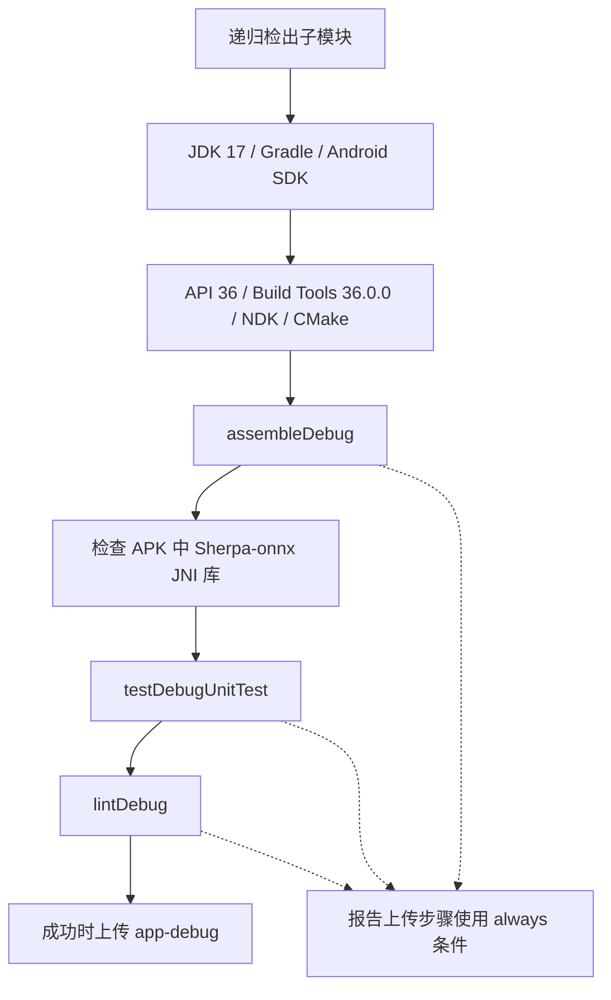

# CI 流水线与测试

依据 DeepWiki 的 CI Pipeline & Testing 整理，以 `.github/workflows/ci.yml` 和现有测试目录为准（2026-10-14）。

## 工作流

Android CI 在推送 `main`、`develop` 或向这两个分支提交 PR 时触发。构建任务运行于 `ubuntu-24.04`，超时为 60 分钟；同一工作流和 PR／ref 的新运行会取消旧运行。

安装的 NDK 为 `28.2.13676358`，CMake 为 `3.22.1`。Gradle 执行使用 `--no-daemon --stacktrace`。native 检查打开构建 APK，验证 `lib/arm64-v8a/libsherpa-onnx-jni.so` 与 `libonnxruntime.so` 存在且非空；它不证明所有设备上的语音识别运行正常。

`android-reports` 收集报告、测试结果和日志，使用 `always()` 条件，保留 7 天；APK 仅在成功时上传，同样保留 7 天。不能把上传构建产物等同于发布 GitHub Release。

## 测试分层

| 层级 | 路径／命令 | 代表范围 |
| --- | --- | --- |
| JVM 单元测试 | `app/src/test`、`core/common/src/test`；`./gradlew testDebugUnitTest` | 动作解析、执行器、导航、流式转录、工具行为、DI 和存储 |
| Android 设备测试 | `app/src/androidTest`；`./gradlew connectedAndroidTest` | Android 上下文、引导流程等，需要设备或模拟器 |
| 静态检查 | `./gradlew lintDebug` | Android 资源与实现问题 |

`CoreModuleTest` 只覆盖其中一部分。当前还有 `SseParsingTest`、`TaskNavigationTest`、`ConversationEntryTest`、`MarkdownPipelineTest`、`DependencyInjectionContractTest`、文件／网络工具行为测试及安全辅助类测试。评估变更时应选择对应测试，而非只运行一个总览测试类。

当前工作流没有执行 `connectedAndroidTest`，也没有可据此声称的覆盖率百分比门槛。虚拟屏焦点、输入法、录音设备和不同 ROM 的行为仍需设备验证。

## 本地使用

从仓库根目录运行 Wrapper：Windows 使用 `./gradlew.bat assembleDebug`、`./gradlew.bat testDebugUnitTest`、`./gradlew.bat lintDebug`。先准备 JDK、SDK 和 native 子模块；Java/Kotlin 的 JVM 目标 11 不等于 Gradle 运行时应使用 JDK 11。

纯文档更新应检查路由、Markdown 链接和 Mermaid 渲染；不应把未运行的 Android 测试记录为通过。

源码：[ci.yml](https://github.com/ZG0704666/Aries-AI/blob/main/.github/workflows/ci.yml)、[测试目录](https://github.com/ZG0704666/Aries-AI/tree/main/app/src/test)、[设备测试](https://github.com/ZG0704666/Aries-AI/tree/main/app/src/androidTest)。

相关阅读：[构建脚本与工具链](./构建脚本与工具链.md)、[Git 工作流](./Git%20工作流.md)。来源：[DeepWiki](https://deepwiki.com/ZG0704666/Aries-AI)。
