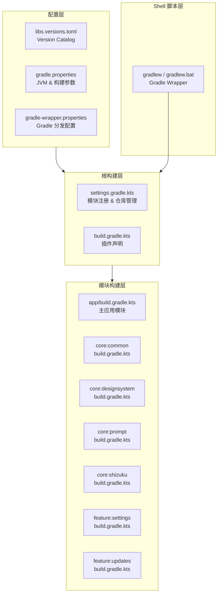
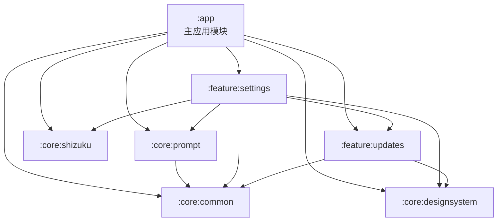
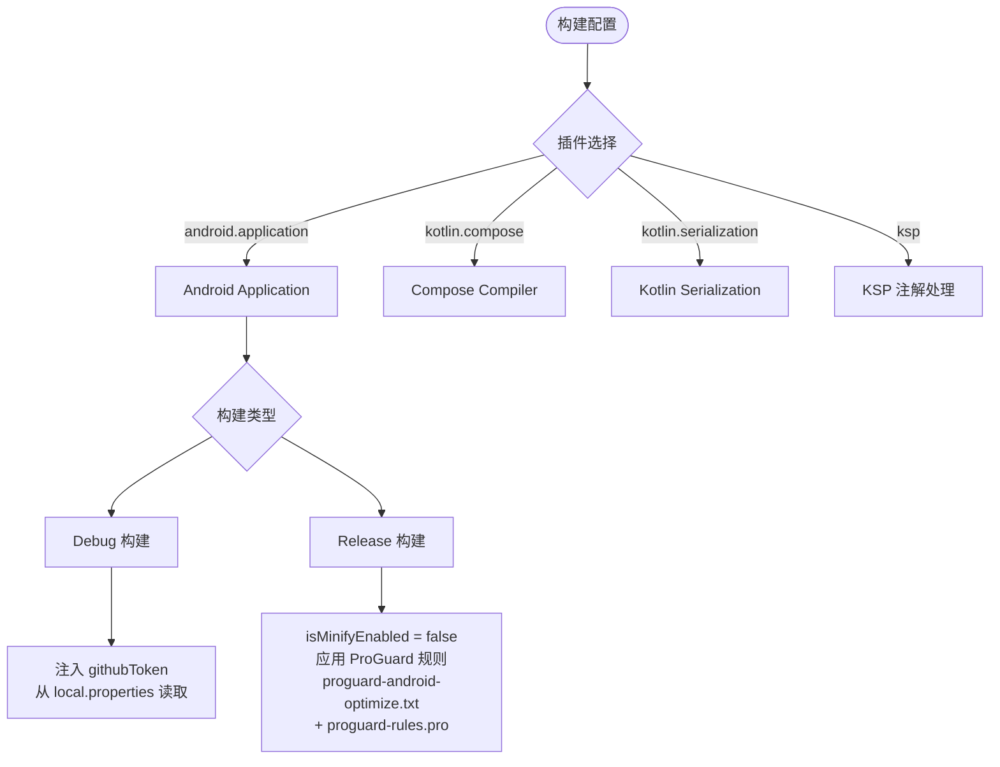

# 构建、工具链与 CI

本页说明 Gradle 模块、版本目录、构建变体、常用命令和 GitHub Actions CI 流水线。

> ⚠️ **状态更新（2026-10-31）**：语音引擎已迁移至 **sherpa-onnx**，预编译 `.so` 位于 `app/src/main/jniLibs/`，模型由 CI 下载。项目已移除 CMake/NDK 与 Git submodule，当前构建为纯 Kotlin/JVM 工具链。

本文档详述 Phone Agent (Aries-AI) 项目的构建系统架构、构建脚本配置、编译工具链及自动化流程。

---

## 概述

Phone Agent 是一个基于 Kotlin 的 Android 应用项目，采用 **Gradle 9.4.1 + AGP 9.2.1 + Kotlin 2.4.10** 的现代化构建工具链。项目构建系统支持多模块分层架构、版本目录（Version Catalog）依赖管理，并提供跨平台的命令行构建脚本与环境配置。

构建工具链的核心设计目标是：
- **依赖版本集中管理**：通过 `gradle/libs.versions.toml` 统一管控所有核心依赖版本，减少版本冲突风险
- **多模块构建**：项目包含 `:app`、四个 `:core:*` 和两个 `:feature:*`，共七个模块，支持增量构建
- **预编译语音库**：sherpa-onnx 的 `.so` 直接放在 `app/src/main/jniLibs/{arm64-v8a,x86_64}/`，不再从源码编译
- **构建类型差异化**：Debug 与 Release 使用不同的签名、混淆策略和 BuildConfig 字段注入
- **仓库策略严格管控**：启用 `FAIL_ON_PROJECT_REPOS` 模式，所有仓库只能在 `settings.gradle.kts` 中声明

---

## 架构总览

### 构建系统层次结构



**架构说明：**

| 层次 | 职责 | 核心文件 |
|------|------|----------|
| 配置层 | 统一管理所有依赖版本、JVM 参数、Gradle 分发版本 | `libs.versions.toml`, `gradle.properties`, `gradle-wrapper.properties` |
| 根构建层 | 注册所有子模块、声明顶层插件、管控仓库策略 | `settings.gradle.kts`, `build.gradle.kts` |
| 模块构建层 | 各模块独立配置编译选项、依赖声明 | 各模块的 `build.gradle.kts` |
| 预编译库 | sherpa-onnx 等 `.so` 直接随 APK 打包 | `app/src/main/jniLibs/` |
| Wrapper 层 | 提供跨平台构建入口并锁定 Gradle 版本 | `gradlew`, `gradlew.bat` |

---

## 模块依赖关系



> 依赖关系来源：各模块 `build.gradle.kts` 中的 `implementation(project(...))` 声明。

---

## 核心构建文件详解

### 1. Gradle Wrapper 配置

Gradle Wrapper 是项目的构建入口，确保所有开发者使用**完全一致的 Gradle 版本**，无需手动安装 Gradle。

> Source: [gradle/wrapper/gradle-wrapper.properties](https://github.com/ZG0704666/Aries-AI/blob/main/gradle/wrapper/gradle-wrapper.properties)

```properties
distributionBase=GRADLE_USER_HOME
distributionPath=wrapper/dists
distributionUrl=https\://services.gradle.org/distributions/gradle-9.4.1-bin.zip
networkTimeout=10000
validateDistributionUrl=true
zipStoreBase=GRADLE_USER_HOME
zipStorePath=wrapper/dists
```

关键配置说明：
- **`distributionUrl`**：锁定 Gradle 版本为 **9.4.1**，所有开发者自动使用该版本
- **`networkTimeout`**：下载超时设置为 10 秒，避免网络不畅时无限等待
- **`validateDistributionUrl`**：启用 URL 校验，防止分发包被篡改

### 2. 版本目录（Version Catalog）

项目使用 Gradle 原生 Version Catalog 集中管理核心依赖版本，定义在 `gradle/libs.versions.toml` 中。

> Source: [gradle/libs.versions.toml](https://github.com/ZG0704666/Aries-AI/blob/main/gradle/libs.versions.toml)

```toml
[versions]
agp = "9.2.1"
kotlin = "2.4.10"
coreKtx = "1.17.0"
composeBom = "2026.09.00"
room = "2.7.2"
koin = "3.5.6"
coil = "2.6.0"
coil3 = "3.1.0"

[plugins]
android-application = { id = "com.android.application", version.ref = "agp" }
android-library = { id = "com.android.library", version.ref = "agp" }
kotlin-compose = { id = "org.jetbrains.kotlin.plugin.compose", version.ref = "kotlin" }
kotlin-serialization = { id = "org.jetbrains.kotlin.plugin.serialization", version.ref = "kotlin" }
ksp = { id = "com.google.devtools.ksp", version = "2.3.12" }
```

**设计意图**：将分散在各模块 `build.gradle.kts` 中的版本号提升到单一文件管理。当需要升级某个依赖时，只需修改 `libs.versions.toml` 中的版本号即可全局生效，极大地降低了版本管理的心智负担和冲突风险。

**核心依赖版本一览**：

| 组件 | 版本 | 用途 |
|------|------|------|
| AGP (Android Gradle Plugin) | 9.2.1 | Android 构建核心 |
| Kotlin | 2.4.10 | 项目编程语言 |
| Compose BOM | 2026.09.00 | Jetpack Compose UI 框架 |
| Koin | 3.5.6 | 依赖注入框架 |
| Room | 2.7.2 | 本地数据库 |
| DataStore | 1.1.7 | 键值存储 |
| Coil 3 | 3.1.0 | 新一代图片加载 |

### 3. Gradle 属性配置

> Source: [gradle.properties](https://github.com/ZG0704666/Aries-AI/blob/main/gradle.properties)

```properties
# JVM 内存配置（处理 iText PDF 等大型依赖）
org.gradle.jvmargs=-Xmx2048m -Xms512m -Dfile.encoding=UTF-8

# AndroidX 迁移
android.useAndroidX=true

# Kotlin 代码风格
kotlin.code.style=official

# 非传递 R 类（减小库的 R 类体积）
android.nonTransitiveRClass=true

# 启用 Gradle Daemon 加速
org.gradle.daemon=true

# 资源优化
android.enableResourceOptimizations=true

# 允许中文路径
android.overridePathCheck=true
```

**设计意图**：
- `Xmx2048m`：为 JVM 分配 2GB 堆内存，确保处理 iText PDF、Apache POI 等大型依赖时有足够内存
- `android.nonTransitiveRClass=true`：启用非传递 R 类，每个库模块的 R 类只包含自身资源，减小 APK 体积并提升编译速度
- `android.overridePathCheck=true`：因为项目路径可能包含中文字符，此选项跳过路径 ASCII 检查

### 4. 根构建文件

> Source: [build.gradle.kts](https://github.com/ZG0704666/Aries-AI/blob/main/build.gradle.kts)

```kotlin
plugins {
    alias(libs.plugins.android.application) apply false
    alias(libs.plugins.android.library) apply false
    alias(libs.plugins.kotlin.compose) apply false
    alias(libs.plugins.kotlin.serialization) apply false
    alias(libs.plugins.ksp) apply false
}
```

根构建文件的职责非常精简：仅声明顶层插件（使用 `apply false` 表示不下发到子模块，各子模块按需引用）。所有子模块和仓库配置交由 `settings.gradle.kts` 管理。

### 5. 项目模块注册

> Source: [settings.gradle.kts](https://github.com/ZG0704666/Aries-AI/blob/main/settings.gradle.kts)

```kotlin
pluginManagement {
    repositories {
        google()
        mavenCentral()
        gradlePluginPortal()
    }
}
dependencyResolutionManagement {
    repositoriesMode.set(RepositoriesMode.FAIL_ON_PROJECT_REPOS)
    repositories {
        google()
        mavenCentral()
    }
}

rootProject.name = "Phone Agent"
include(":app")
include(":core:common")
include(":core:designsystem")
include(":core:prompt")
include(":core:shizuku")
include(":feature:settings")
include(":feature:updates")
```

**关键设计决策**：

1. **`repositoriesMode.FAIL_ON_PROJECT_REPOS`**：这是一个重要的仓库策略约束。启用后，如果在任何子模块的 `build.gradle.kts` 中声明 `repositories {}`，构建将**直接失败**。这强制所有仓库声明集中在 `settings.gradle.kts`，防止子模块引入不可控的外部仓库，确保依赖来源的可审计性。

2. **插件与依赖仓库集中声明**：`pluginManagement` 使用 `google()`、`mavenCentral()`、`gradlePluginPortal()`，普通依赖使用 `google()` 与 `mavenCentral()`；模块内不得另行声明仓库。

3. **模块命名约定**：`core:*` 为核心基础库，`feature:*` 为功能模块，`app` 为主应用入口。分层清晰，职责明确。

---

## 主应用模块构建配置

> Source: [app/build.gradle.kts](https://github.com/ZG0704666/Aries-AI/blob/main/app/build.gradle.kts)

### 构建类型差异化



### 关键配置区段

#### 版本与 SDK 配置

```kotlin
android {
    namespace = "com.ai.phoneagent"
    compileSdk = 37

    defaultConfig {
        applicationId = "com.ai.phoneagent"
        minSdk = 30          // Android 11
        targetSdk = 36       // Android 16
        versionCode = 21
        versionName = "2.0.0 Alpha"
    }
}
```

> Source: [app/build.gradle.kts](https://github.com/ZG0704666/Aries-AI/blob/main/app/build.gradle.kts#L47-L62)

**设计意图**：`minSdk = 30` 意味着应用仅支持 Android 11 及以上设备。虚拟显示和 Shizuku 的可用能力仍取决于设备系统和授权情况。

#### 动态属性读取

项目通过 `local.properties` 文件读取敏感配置（如 GitHub Token、遥测心跳端点），避免将密钥硬编码在版本控制中：

```kotlin
fun localProperty(name: String): String {
    val f = rootProject.file("local.properties")
    if (!f.exists()) return ""
    val line = f.readLines()
        .asSequence()
        .map { it.trim() }
        .firstOrNull { it.isNotBlank() && !it.startsWith("#") && it.startsWith(name) }
        ?: return ""
    val eqIdx = line.indexOf('=')
    if (eqIdx < 0) return ""
    return line.substring(eqIdx + 1).trim()
}
```

> Source: [app/build.gradle.kts](https://github.com/ZG0704666/Aries-AI/blob/main/app/build.gradle.kts#L25-L39)

此函数读取 `local.properties` 中以指定属性名开头的非注释行，提取 `=` 后的值。用于注入遥测心跳端点等运行时配置到 BuildConfig。

#### 依赖冲突排除

```kotlin
configurations.all {
    exclude(group = "org.intellij", module = "annotations")
    exclude(group = "org.jetbrains", module = "annotations-java5")
}
```

> Source: [app/build.gradle.kts](https://github.com/ZG0704666/Aries-AI/blob/main/app/build.gradle.kts#L132-L137)

排除 `org.intellij:annotations` 和 `org.jetbrains:annotations-java5`，避免与项目使用的 `org.jetbrains:annotations`（最新版）产生重复类冲突。

#### 打包资源排除

```kotlin
packaging {
    jniLibs { useLegacyPackaging = true }
    resources {
        excludes += "/META-INF/{AL2.0,LGPL2.1}"
        excludes += "META-INF/versions/9/OSGI-INF/MANIFEST.MF"
        pickFirsts += "META-INF/INDEX.LIST"
        pickFirsts += "META-INF/io.netty.versions.properties"
    }
}
```

> Source: [app/build.gradle.kts](https://github.com/ZG0704666/Aries-AI/blob/main/app/build.gradle.kts#L119-L129)

处理多个依赖库引入相同 META-INF 文件时的冲突：排除重复的许可证文件，对 `INDEX.LIST` 和 Netty 版本属性使用 `pickFirsts`（取第一个遇到的）。

#### ProGuard 混淆配置

> Source: [app/proguard-rules.pro](https://github.com/ZG0704666/Aries-AI/blob/main/app/proguard-rules.pro)

当前 Release 构建中 `isMinifyEnabled = false`，ProGuard 规则文件保留为模板状态。这意味着 Release 版本当前不进行代码混淆和压缩。

```kotlin
release {
    isMinifyEnabled = false
    proguardFiles(
        getDefaultProguardFile("proguard-android-optimize.txt"),
        "proguard-rules.pro"
    )
}
```

---

## 子模块构建配置

### 模块配置对比

| 模块 | 类型 | compileSdk | Compose | BuildConfig | 关键依赖 |
|------|------|------------|---------|-------------|----------|
| `:app` | application | 36 | ✅ | ✅ | 全部模块 + Shizuku + HiddenApiBypass |
| `:core:common` | library | 36 | ❌ | ❌ | kotlinx.serialization |
| `:core:designsystem` | library | 36 | ✅ | ❌ | Compose BOM + Koin |
| `:core:prompt` | library | 36 | ❌ | ❌ | core:common + Coroutines |
| `:core:shizuku` | library | 36 | ❌ | ❌ | Shizuku API 13.1.5 |
| `:feature:settings` | library | 36 | ✅ | ❌ | 全部 core + feature:updates |
| `:feature:updates` | library | 36 | ❌ | ✅ | core:common + core:designsystem |

所有模块统一使用 `JavaVersion.VERSION_11` 和 `jvmTarget = "11"`，确保字节码兼容性一致。

---

## 构建命令与脚本

### gradlew（Gradle Wrapper 脚本）

项目提供标准的 Gradle Wrapper 脚本：

- **Windows**：`gradlew.bat`
- **Linux/macOS**：`gradlew`（POSIX shell 脚本）

Gradle Wrapper 自动下载并缓存指定版本的 Gradle（9.4.1），开发者无需手动安装。

项目仓库没有维护独立的 `build.sh`；请直接调用 Gradle Wrapper。按本机环境设置 `JAVA_HOME` 与 `ANDROID_SDK_ROOT`，不要复制其他开发者的绝对路径。

### 常用构建命令

```bash
# Debug 版本编译
./gradlew assembleDebug

# Release 版本编译
./gradlew assembleRelease

# 清理构建产物
./gradlew clean

# 运行单元测试
./gradlew testDebugUnitTest

# 查看完整依赖树
./gradlew :app:dependencies

# 安装到已连接设备
./gradlew installDebug
```

---

## 环境要求

| 软件 | 版本要求 | 说明 |
|------|----------|------|
| JDK | 17 | CI 使用 Temurin 17；Java/Kotlin 字节码目标为 11 |
| Android SDK | API 37 | compileSdk 37 需要对应 Platform |
| Build Tools | 37.0.0 | CI 与本地构建使用 |
| Gradle | 9.4.1 | 由 Wrapper 自动管理 |
| Kotlin | 2.4.10 | 由项目配置 |
| AGP | 9.2.1 | 由项目配置 |
| Git | 2.30+ | 不再需要初始化 submodule |

---

## CI 流水线（.github/workflows/ci.yml）

仓库的 GitHub Actions 工作流 `Android CI` 在 push 与 PR 针对 `main`、`develop` 分支时触发；同一 PR/分支的新运行会取消旧的进行中运行（`concurrency.cancel-in-progress: true`），工作流仅持有 `contents: read` 权限。

关键阶段（与 `ci.yml` 一一对应）：

| 步骤 | 内容 |
|------|------|
| 运行环境 | `ubuntu-24.04`，`timeout-minutes: 60` |
| Checkout | `actions/checkout`，`persist-credentials: false`；不再递归检出 submodule |
| 工具链 | Temurin JDK 17；`setup-gradle`（basic 缓存）；`setup-android` |
| SDK 组件 | `sdkmanager "platforms;android-37.0" "build-tools;37.0.0"` |
| 构建 | `./gradlew assembleDebug --no-daemon --stacktrace` |
| 预编译库校验 | 用 Python `ZipFile` 检查 APK 内 `lib/arm64-v8a/libsherpa-onnx-jni.so` 与 `libonnxruntime.so` 存在且非空 |
| 测试 | `./gradlew testDebugUnitTest --no-daemon --stacktrace` |
| Lint | `./gradlew lintDebug --no-daemon --stacktrace` |
| 产物 | 测试/Lint 报告（`android-reports`）与 `app-debug` APK 作为 artifact 上传，保留 7 天；报告上传 `if: always()`，APK 上传仅成功时 |

### 测试分层

| 层级 | 路径／命令 | 代表范围 |
| --- | --- | --- |
| JVM 单元测试 | `app/src/test`、`core/common/src/test`；`./gradlew testDebugUnitTest` | 动作解析、执行器、导航、流式转录、工具行为、DI 和存储 |
| Android 设备测试 | `app/src/androidTest`；`./gradlew connectedAndroidTest` | Android 上下文、引导流程等，需要设备或模拟器 |
| 静态检查 | `./gradlew lintDebug` | Android 资源与实现问题 |

`CoreModuleTest` 只覆盖其中一部分。当前还有 `SseParsingTest`、`TaskNavigationTest`、`ConversationEntryTest`、`MarkdownPipelineTest`、`DependencyInjectionContractTest`、文件／网络工具行为测试及安全辅助类测试。评估变更时应选择对应测试，而非只运行一个总览测试类。

当前工作流没有执行 `connectedAndroidTest`，也没有可据此声称的覆盖率百分比门槛。虚拟屏焦点、输入法、录音设备和不同 ROM 的行为仍需设备验证。

### 本地使用

从仓库根目录运行 Wrapper：Windows 使用 `./gradlew.bat assembleDebug`、`./gradlew.bat testDebugUnitTest`、`./gradlew.bat lintDebug`。先准备 JDK 17、Android SDK 37 与 Build Tools 37.0.0；Java/Kotlin 的 JVM 目标 11 不等于 Gradle 运行时应使用 JDK 11。

纯文档更新应检查路由、Markdown 链接和 Mermaid 渲染；不应把未运行的 Android 测试记录为通过。

源码：[ci.yml](https://github.com/ZG0704666/Aries-AI/blob/main/.github/workflows/ci.yml)、[测试目录](https://github.com/ZG0704666/Aries-AI/tree/main/app/src/test)、[设备测试](https://github.com/ZG0704666/Aries-AI/tree/main/app/src/androidTest)。

相关阅读：[Git 工作流](./Git%20工作流.md)。来源：[DeepWiki](https://deepwiki.com/ZG0704666/Aries-AI)。
