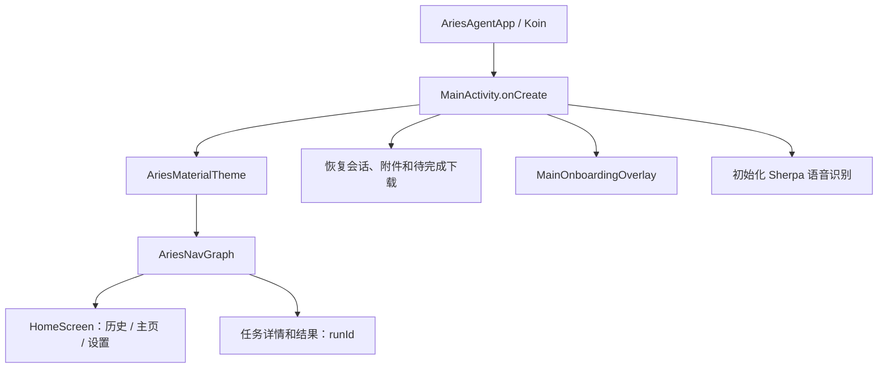

# 应用入口与生命周期

本文依据 DeepWiki 的 Android Application Core、MainActivity & App Lifecycle 章节整理，并于 2026-10-14 对照当前源码核对。

## 从进程到界面

`AriesAgentApp.onCreate()` 初始化应用级依赖和 Koin，并启动 `TelemetryHeartbeatManager` 的 Activity 生命周期监听。`MainActivity` 承载 Compose、会话状态、附件、语音输入与自动化入口；不能将它简单描述为只负责导航的壳。

## 创建与恢复

`onCreate()` 从 `savedInstanceState` 恢复 `aries_main_page`，默认页为 1（主页）。`setContent` 内从偏好 Flow 观察主题、字体、代码块和 API 模式，因此在设置页修改 API 配置后无需等待 `onResume()` 才生效。

会话恢复通过 `tryRestoreConversations(restoreActive = savedInstanceState != null)` 区分新启动和 Activity 重建。新进入应用以空白对话开始；重建时可恢复选中的会话。这与“每次启动都自动打开上次对话”不同。

创建阶段还会恢复 Qwen 下载 ID、注册下载完成和自动化日志接收器、检查用户协议、初始化语音、触发静默更新检查以及主聊天 Prompt 更新。下载恢复与模型实际可用性检查是不同步骤。

## 导航与生命周期边界

`DisposableEffect(automationVm)` 将宿主 Activity 交给 `AutomationViewModel`，离开组合时解除绑定。另一个 `DisposableEffect(navController)` 注册目的地监听，并在释放时移除监听器和导航回调。

`onResume()` 更新运行状态及引导权限状态；`onNewIntent()` 处理重新进入应用的 Intent。自动化启动指令通过专门的处理入口检查，不能把任意外部 Intent 等同于已授权任务。

历史、主页和设置属于 HomeScreen 的 Pager；`task/{runId}` 与 `task/{runId}/result` 属于外层导航图。`FloatingChatService` 已不在当前源码中，自动化悬浮提示和进度覆盖层不是悬浮聊天服务。

## 代码与相关阅读

- [AriesAgentApp.kt](https://github.com/ZG0704666/Aries-AI/blob/main/app/src/main/java/com/ai/phoneagent/AriesAgentApp.kt)
- [MainActivity.kt](https://github.com/ZG0704666/Aries-AI/blob/main/app/src/main/java/com/ai/phoneagent/MainActivity.kt)
- [主对话界面](../对话系统/主对话界面%20(HomeScreen).md)
- [导航与路由系统](./导航与路由系统.md)
- [无障碍服务与悬浮层](../系统服务与权限/无障碍服务与悬浮层.md)

来源：[DeepWiki](https://deepwiki.com/ZG0704666/Aries-AI)。函数和生命周期描述以本仓库源码为准，未将 Wiki 中的示意调用名当作真实接口。
