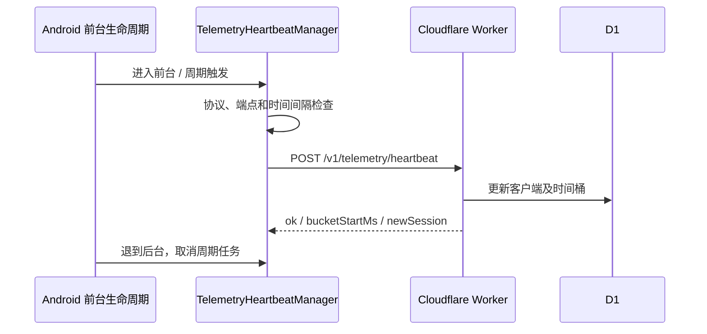

# 遥测心跳与 Cloudflare Worker

本文参考 DeepWiki 的 Telemetry Worker (Cloudflare)，并于 2026-10-14 对照 Android 客户端、Worker 和 SQL migration 重写接口说明。DeepWiki 中的 `installId`、`heartbeats` 表及 `wrangler.toml` 示例不对应当前实现。

## 客户端发送条件

`AriesAgentApp` 启动 `TelemetryHeartbeatManager`，后者注册 `Application.ActivityLifecycleCallbacks`。从无已启动 Activity 转入前台时创建新的 `sessionId` 并尝试发送；前台期间每 15 分钟发送，退到后台时取消周期 Job。这是前台协程，不是 WorkManager 后台定时任务。

发送前要求用户协议已接受、`BuildConfig.TELEMETRY_HEARTBEAT_ENDPOINT` 非空。非强制发送距上次成功心跳不足 60 秒时跳过；成功后才记录时间。安装 ID 在 `telemetry_prefs` 中生成和持久化，上传的是 SHA-256 哈希。



## 心跳接口

路径为 `POST /v1/telemetry/heartbeat`，Content-Type 为 `application/json`。请求示例中哈希仅为占位值：

```json
{
  "installIdHash": "0123456789abcdef0123456789abcdef0123456789abcdef0123456789abcdef",
  "sessionId": "example-session-id",
  "platform": "android",
  "appVersion": "2.0.0 Alpha",
  "versionCode": 21,
  "locale": "zh-CN",
  "eventTimeMs": 1791979200000,
  "source": "foreground"
}
```

Worker 要求有效的 `installIdHash` 和非空 `sessionId`，其余字段按类型规范化。客户端发送的 `eventTimeMs` 不参与当前 Worker 计时；记录和分桶使用服务端 `Date.now()`，国家信息来自 `request.cf.country`。

成功响应包含 `ok: true`、`bucketStartMs` 和 `newSession`。无效 JSON 返回 400 `invalid_json`；必要字段无效返回 400 `invalid_payload`；未匹配路径为 404，异常为 500。

## 数据表与统计口径

`migrations/0001_init.sql` 创建两张表：

| 表 | 键与用途 |
| --- | --- |
| `telemetry_clients` | `install_id_hash` 主键；首次／最近出现、会话累计、版本、语言、国家等 |
| `telemetry_heartbeat_buckets` | `(install_id_hash, bucket_5m)` 联合主键；时间桶内去重和活跃趋势 |

当前统计路径为 `GET /v1/telemetry/stats/summary`，返回总安装量、当前窗口活跃、1 小时／24 小时／7 天活跃、24 小时新增、版本／国家分布和最近趋势。当前窗口默认 5 分钟，但客户端周期为 15 分钟，因此 `currentUsers` 不能作为精确在线人数。

`/dashboard` 和统计 API 支持 `STATS_API_TOKEN` 的 Bearer 鉴权或 Basic 鉴权（用户名 `admin`，密码为该 token）；未配置 token 时拒绝访问。不能声称当前实现已接入 Cloudflare Access。

## 配置、清理与数据范围

配置文件是 `telemetry-worker/wrangler.jsonc`，D1 绑定名为 `DB`。默认 `CURRENT_WINDOW_MINUTES=5`、`HEARTBEAT_BUCKET_MINUTES=5`、`RETENTION_DAYS=30`；定时触发每 6 小时清理过期心跳桶。清理函数只删除桶表旧记录，不会按同一期限删除 `telemetry_clients`。

心跳请求不包含聊天正文、截图或 API Key，但安装哈希可关联同一安装的多次心跳，另含会话、语言、版本及国家信息。应按实际字段说明数据范围，避免“绝对匿名”“零可关联信息”等超出实现的承诺。

开发时在 `telemetry-worker` 执行 `npm ci`、`npx wrangler dev`；远端迁移、配置 secret 和部署会修改 Cloudflare 资源，应单独按发布流程操作。Android 端点可由 `local.properties` 的 `aries.telemetry.heartbeatEndpoint` 配置。

源码：[TelemetryHeartbeatManager.kt](https://github.com/ZG0704666/Aries-AI/blob/main/app/src/main/java/com/ai/phoneagent/telemetry/TelemetryHeartbeatManager.kt)、[Worker](https://github.com/ZG0704666/Aries-AI/blob/main/telemetry-worker/src/index.ts)、[SQL migration](https://github.com/ZG0704666/Aries-AI/blob/main/telemetry-worker/migrations/0001_init.sql)、[Wrangler 配置](https://github.com/ZG0704666/Aries-AI/blob/main/telemetry-worker/wrangler.jsonc)。来源：[DeepWiki](https://deepwiki.com/ZG0704666/Aries-AI)。
