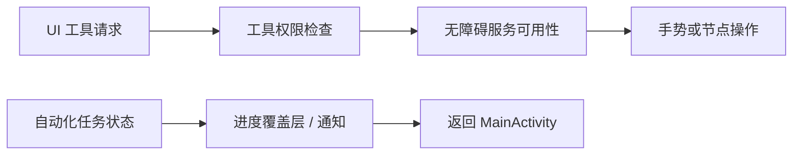

# 无障碍服务与悬浮层

本页依据 DeepWiki 的 Accessibility Service & Overlays，并对照当前服务、配置和覆盖层代码核对（2026-10-14）。

## 服务能力与生命周期

`PhoneAgentAccessibilityService` 是 Android 无障碍服务，负责节点观测、手势、截图等平台能力。配置文件 `phone_agent_accessibility_service.xml` 声明读取窗口、报告资源 ID、过滤按键、执行手势和截图的能力；声明能力不等于用户已启用服务。

`onServiceConnected()` 设置服务实例，销毁时清理。执行器调用前需检查服务可用性，避免持有失效实例。节点快照支持不同详细程度，输出文本还经过规范化处理。

虚拟屏模式下的按键和焦点处理用于尽力恢复主屏焦点；这不是 Android 系统对所有设备的绝对隔离保证，仍需在目标系统和应用上验证。

## 不同覆盖层的职责

| 组件 | 用途 |
| --- | --- |
| `AutomationOverlay` | 自动化悬浮提示与返回 MainActivity 的入口 |
| `UIAutomationProgressOverlay` | 步数、状态、暂停和取消控件；支持截图时临时隐藏 |
| `VirtualScreenPreviewOverlay` | 虚拟屏画面预览 |
| `AutomationLiveNotification` | 自动化运行的通知展示 |

这些组件不能等同于 `FloatingChatService`：后者已从当前源码移除。保留的浮窗偏好字段也不能证明悬浮聊天仍是可用功能。

## 权限与工具链

普通无障碍手势需要服务启用；系统悬浮窗需要对应授权；Shizuku 的 Binder 可用和授权状态独立判断。录音权限只在语音输入链路需要，不能混为自动化执行权限。

UI 工具经过工具注册和权限系统后才调用平台能力；服务未启用时应返回失败结果，不能把工具已注册理解成设备已经能够执行。

源码：[PhoneAgentAccessibilityService.kt](https://github.com/ZG0704666/Aries-AI/blob/main/app/src/main/java/com/ai/phoneagent/PhoneAgentAccessibilityService.kt)、[UIAutomationProgressOverlay.kt](https://github.com/ZG0704666/Aries-AI/blob/main/app/src/main/java/com/ai/phoneagent/ui/UIAutomationProgressOverlay.kt)、[服务配置](https://github.com/ZG0704666/Aries-AI/blob/main/app/src/main/res/xml/phone_agent_accessibility_service.xml)。

相关阅读：[环境与权限配置](../快速开始/环境与权限配置.md)、[工具注册与权限管理](../AI%20工具框架/工具注册与权限管理.md)。来源：[DeepWiki](https://deepwiki.com/ZG0704666/Aries-AI)。
