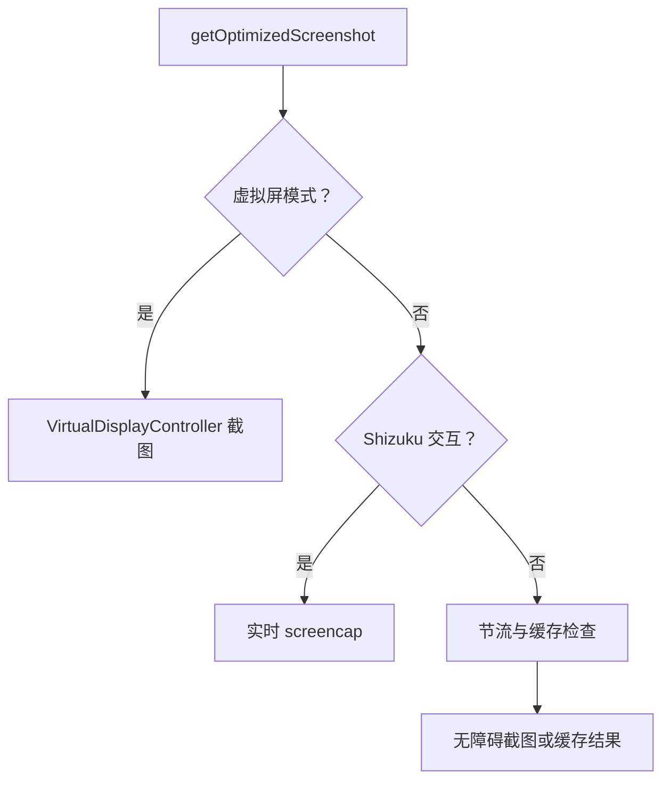

# 屏幕采集与 UI 树提取

根据 DeepWiki 的 Screen Capture & UI Tree Extraction 整理，并于 2026-10-14 对照 `ScreenshotManager` 和 `ShizukuUiTreeSummarizer` 核对。

## 截图通道优先级

`ScreenshotManager.getOptimizedScreenshot()` 按配置选择截图来源。截图和输入必须对应同一显示屏，尤其不能把主屏 UI 树解释为虚拟屏的真实状态。

| 通道 | 行为 | 失败处理要点 |
| --- | --- | --- |
| 虚拟屏 | 从虚拟显示帧链路获取画面 | 等待有效画面；不能静默改为主屏截图 |
| Shizuku | 实时执行截图，绕过普通缓存和节流 | 检查 Binder、授权与命令结果 |
| 无障碍 | 使用 `ScreenshotCache`、`ScreenshotThrottler` 和服务截图 | 节流且无可用缓存时可能返回 null |

返回的 `ScreenshotData` 包含图像和尺寸信息。`ScreenshotOverlayGuard` 协调覆盖层隐藏，避免把自动化进度卡片误识别成目标应用内容。尺寸必须与动作坐标换算使用的坐标系一致。

## UI 树摘要

Shizuku 的 uiautomator XML 经 `ShizukuUiTreeSummarizer.summarize(rawXml, maxNodes, maxChars, detail)` 精简。解析保留类名、文本、描述、资源 ID、包名、bounds 以及 clickable、editable、focused、scrollable 等状态。

摘要流程为解析节点、按重要性选择节点、生成摘要 XML，并限制节点数量和字符长度。`extractPackageName()` 用于快速提取包名。它是结构化观测的补充，不是对所有页面都可靠的视觉替代：自绘控件、受保护内容和系统限制可能导致信息缺失。

## 排查与关联

截图为空时先确认所选通道，再检查权限、帧就绪、缓存及节流；画面存在但点击偏移时检查宽高、方向和目标 displayId；UI 树与画面不一致时检查采集时机和显示屏来源。

- [截图缓存与节流](../数据持久化/截图缓存与节流.md)
- [虚拟屏完全隔离总览](../虚拟屏隔离系统/虚拟屏完全隔离总览.md)
- [ScreenshotManager.kt](https://github.com/ZG0704666/Aries-AI/blob/main/app/src/main/java/com/ai/phoneagent/core/cache/ScreenshotManager.kt)
- [ShizukuUiTreeSummarizer.kt](https://github.com/ZG0704666/Aries-AI/blob/main/app/src/main/java/com/ai/phoneagent/core/utils/ShizukuUiTreeSummarizer.kt)

来源：[DeepWiki](https://deepwiki.com/ZG0704666/Aries-AI)。
