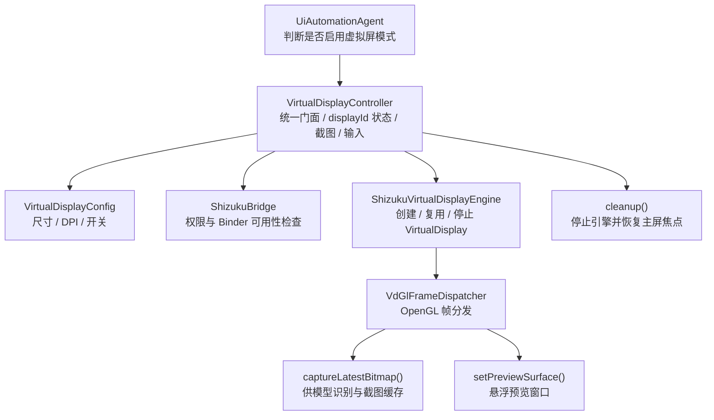
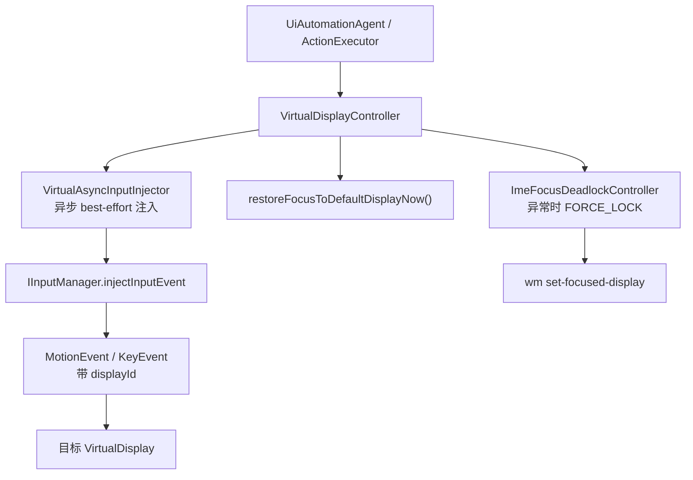

# 虚拟屏隔离与输入注入

虚拟屏隔离（vdiso）让自动化任务在独立显示空间中运行。本页覆盖虚拟屏的创建、帧调度、输入注入、焦点管理与 IME 死锁处理。

本文档说明 Aries AI 当前代码中的虚拟屏完全隔离实现，重点关注 VirtualDisplay 的创建、帧链路、截图策略、预览切换与资源清理，而不是停留在概念描述层。

---

## 概述

Aries AI 的虚拟屏方案并不是“把 App 投到第二块屏幕”这么简单，而是围绕下面几个目标展开：

- **完全隔离**：自动化操作尽量不干扰主屏的真实使用。
- **截图稳定**：模型看到的是持续产出的虚拟屏画面，而不是瞬时黑帧。
- **输入定向**：点击、滑动、按键通过 `displayId` 定向注入到目标虚拟屏。
- **生命周期可控**：任务开始时创建，任务结束后强制清理并恢复主屏焦点。

当前 Kotlin 侧的统一入口是 `VirtualDisplayController`，底层引擎是 `ShizukuVirtualDisplayEngine`。

## 架构总览

## 启动链路

当 `UiAutomationAgent` 检测到 `config.useBackgroundVirtualDisplay` 为真时，会先走一段显式的准备流程：

1. 记录日志，提示开始准备后台虚拟屏。
2. 调用 `VirtualDisplayController.prepareForTask(context, "")`。
3. 在控制器中检查 `ShizukuBridge.pingBinder()` 与 `hasPermission()`。
4. 读取 `VirtualDisplayConfig` 中缓存的宽、高、DPI。
5. 调用 `ShizukuVirtualDisplayEngine.ensureStarted(Args(...))` 创建或复用 VirtualDisplay。
6. 成功后保存 `activeDisplayId`，并把内容尺寸回传给 Agent。

一旦该步骤失败，当前实现会直接终止任务，而不是降级回主屏幕。原因很明确：

- 任务已经声明要在隔离模式下执行。
- 若静默降级到主屏，用户可能在不知情的情况下被前台操作打断。

## 尺寸与 DPI 配置（VirtualDisplayConfig）

`VirtualDisplayConfig` 集中管理虚拟屏的分辨率与 DPI 参数，主要特性包括：

- **分辨率预设**：`480P` / `720P` / `1080P` 三档，默认 `1080P`。映射到实际尺寸为 480×848、720×1280、1088×1920
- **16 像素对齐（`align16()`）**：所有宽高都会对齐到最近的 16 倍数（最小 16）。原因是 GPU / MediaCodec 编码器通常要求 16 对齐，否则可能出现黑边、显存浪费或崩溃（1080 对齐后即 1088）
- **DPI 范围校验**：取值限制在 72–640 之间，默认 `480`，越界值回退到默认值
- **持久化**：预设、宽高缓存、DPI、模式开关等均通过 `VirtualDisplayConfigRepository`（DataStore）持久化

> Source: [VirtualDisplayConfig.kt](https://github.com/ZG0704666/Aries-AI/blob/main/app/src/main/java/com/ai/phoneagent/VirtualDisplayConfig.kt#L23-L75)

## 应用启动代理与“诱饵”Activity

虚拟屏模式下应用启动涉及两个辅助组件：

- **`LaunchProxyActivity`**：透明跳板 Activity，用于在前台安全拉起目标应用，避免「后台启动应用」系统弹窗。虚拟屏模式下它通过 `ActivityOptions.setLaunchDisplayId()` 把目标 Intent 启动到指定 display；`ActionExecutor.executeLaunch()` 与 `UiAutomationAgent` 的智能启动路径在非 Shizuku 场景下都会经过它
- **`WelcomeActivity`**：位于虚拟屏侧的「诱饵」Activity（`taskAffinity` 为 `${applicationId}.virtual`，独立任务栈）。它给自己窗口设置 `FLAG_NOT_FOCUSABLE | FLAG_NOT_TOUCHABLE`，并在 `onKeyDown()` 中检测到进入虚拟屏的按键时立即通过 `VirtualDisplayController.restoreFocusToDefaultDisplayNow()` 恢复主屏焦点，同时在创建后延迟 500ms 再做一次兜底恢复

> Sources:
> - [LaunchProxyActivity.kt](https://github.com/ZG0704666/Aries-AI/blob/main/app/src/main/java/com/ai/phoneagent/LaunchProxyActivity.kt#L13-L147)
> - [WelcomeActivity.kt](https://github.com/ZG0704666/Aries-AI/blob/main/app/src/main/java/com/ai/phoneagent/WelcomeActivity.kt#L36-L114)

## `VirtualDisplayController` 的职责边界

`VirtualDisplayController` 不是底层引擎本体，而是一个面向上层的 Facade，负责：

- 持有当前 `activeDisplayId`
- 暴露 `prepareForTask()`、`cleanup()`、`getContentSizeBestEffort()`
- 对外提供截图、点击、滑动、按键、粘贴等 best-effort 接口
- 在必要时把焦点恢复到默认主屏

从上层看，自动化执行层不需要知道 VirtualDisplay 是如何通过反射创建的，只需要通过控制器拿到可用的 `displayId` 即可。

## `ShizukuVirtualDisplayEngine` 的职责

底层引擎主要处理三件事：

1. **调用系统隐藏服务创建 VirtualDisplay**
   - 通过 Shizuku 拿到系统级 binder 权限
   - 反射调用显示管理相关接口
2. **管理输出 Surface**
   - 启动时默认把输出接到内部离屏链路
   - 需要预览时再切到 UI 提供的预览 Surface
3. **提供最新帧读取能力**
   - 通过 `captureLatestBitmap()` 把最新一帧交给上层截图逻辑

这里的核心思想是：VirtualDisplay 本身只负责“把目标应用画出来”，而截图缓存、预览切换和内容尺寸管理则由引擎周边链路完成。

## OpenGL 帧分发链路

当前实现不是直接从一个 Surface 做一次性截图，而是通过 `VdGlFrameDispatcher` 做中转：

- VirtualDisplay 输出到内部的输入 Surface
- OpenGL 线程持续消费帧
- 同一条链路同时支持：
  - 模型识别所需的截图
  - 悬浮窗预览所需的实时画面

这样做的好处是：

- 不需要在“截图”和“预览”之间频繁切换 VirtualDisplay 输出目标
- 可以复用同一份最新内容尺寸信息
- 更容易在出现黑帧时做轮询等待与判空处理

## 截图策略：为什么要等待非黑帧

`VirtualDisplayController.screenshotPngBase64NonBlack()` 会在一个短时间窗口里轮询最新帧，直到满足“不是黑屏”的条件才返回。

它做了两层保护：

- 在超时前反复读取 `captureLatestBitmap()` 的结果
- 通过采样像素判断是否仍然是大面积黑帧

这对自动化链路很关键，因为模型一旦收到黑屏截图，后续动作规划基本都会失真。

## 内容尺寸与坐标系

Agent 执行并不直接假定屏幕始终是固定分辨率。虚拟屏准备完成后，会调用 `getContentSizeBestEffort()` 获取当前真实内容尺寸：

- 优先使用 `ShizukuVirtualDisplayEngine.getLatestContentSize()`
- 如果离屏链路还没拿到有效尺寸，再回退到 `VirtualDisplayConfig`

这样坐标规划就能与当前虚拟屏真实内容保持一致，而不是被历史缓存的分辨率误导。

## 预览窗口与任务生命周期

当虚拟屏创建成功且任务正式进入循环后，`UiAutomationAgent` 会调用 `VirtualScreenPreviewOverlay.show()` 启动预览悬浮窗。

这意味着当前模式并不是“只在后台默默运行”，而是给用户一条可观察但不强制切回前台的预览通路。

与此相对，任务结束或异常退出时会统一进入 `cleanupVirtualDisplay()` / `VirtualDisplayController.cleanup()`，执行：

- 停止虚拟屏引擎
- 恢复主屏焦点
- 清空 `activeDisplayId`
- 把 `shouldUseVirtualDisplay` 复位为 `false`

## 为什么说它是“完全隔离”

当前代码最关键的设计选择，是**不依赖系统焦点持续停留在虚拟屏**。相反，它采用的是：

- 主屏保持默认焦点
- 所有虚拟屏操作通过 `displayId` 注入到目标显示
- 截图过程不抢焦点
- 退出时明确恢复默认主屏状态

因此“完全隔离”的含义不是让虚拟屏永远抢占系统焦点，而是让虚拟屏在后台拥有独立的画面与输入通道，同时尽量不污染主屏交互。

## 失败路径与清理策略

当前实现对失败场景采用的是“快速失败 + 强清理”策略：

- Shizuku 未就绪：直接返回 `null`
- VirtualDisplay 创建失败：停止任务，不降级到主屏
- 截图不可用：在虚拟屏模式下直接报错结束
- 任务 finally：无论正常结束还是异常退出，都执行清理

对自动化系统来说，这比静默降级更可控，因为失败语义清晰，且不会把用户带到一个与预期不一致的执行环境。

## 相关文档

- [焦点管理与输入注入链路](./虚拟屏完全隔离总览.md)
- [技术架构 / 整体架构设计](../技术架构/整体架构设计.md)
- [自动化引擎 / 自动化 Agent 主循环](../自动化引擎/自动化%20Agent%20主循环.md)
- [系统服务与权限 / 设备控制器 (DeviceController)](../系统服务与权限/设备控制器%20(DeviceController).md)

---

## 焦点管理与输入注入

本文档聚焦 Aries AI 当前虚拟屏实现里最容易被误解的一段链路：系统焦点并不长期停留在虚拟屏，但触摸、按键和输入仍然能够稳定命中目标显示。这背后的关键，是 display 维度的输入注入和一条独立的焦点自愈兜底链路。

---

### 概述

在很多虚拟屏方案里，开发者会通过不断切换系统焦点来“让输入生效”。Aries AI 当前实现选择了另一条路线：

- **常态路径**：主屏保持默认焦点，虚拟屏通过 `displayId` 接收输入事件。
- **异常路径**：当 IME 等特殊情况造成焦点死锁时，再启用强制锁焦逻辑做短时自愈。

这意味着“焦点管理”与“输入注入”在代码中是解耦的，而不是绑成一个动作。

### 交互链路总览

### 常态策略：不主动把系统焦点切到虚拟屏

`VirtualDisplayController.ensureFocusedDisplayBestEffort()` 在当前实现中是一个显式的 NO-OP。注释写得很清楚：

- 完全隔离模式下，焦点始终驻留在主屏（display 0）。
- 虚拟屏上的操作全部通过 `displayId` 定向注入完成。
- 截图阶段也不抢焦点，避免主屏物理返回键、Home 键误作用到虚拟屏。

这是一种非常明确的架构选择：

- 焦点切换会影响系统级输入路由。
- 用户真实操作仍然发生在主屏。
- 自动化执行只需要把事件送到正确的 `displayId`，不需要修改整个系统的当前焦点归属。

### 触摸与按键：`VirtualDisplayController` 到 `VirtualAsyncInputInjector`

控制器层对上暴露的是一组 best-effort 方法，例如：

- `injectTapBestEffort()`
- `injectSwipeBestEffort()`
- `injectLongPressBestEffort()`
- `injectBackBestEffort()`
- `injectHomeBestEffort()`
- `injectPasteBestEffort()`

这些方法的共同点是：

1. 先检查 `displayId > 0`
2. 再检查 `ShizukuBridge` 是否可用且已授权
3. 最后把实际注入委托给 `VirtualAsyncInputInjector`

也就是说，`VirtualDisplayController` 负责暴露“领域语义”，真正的输入事件构造与系统服务调用则交给注入器完成。

### `VirtualAsyncInputInjector` 的核心机制

`VirtualAsyncInputInjector` 负责解决两个问题：

#### 1. 适配不同 Android / ROM 的注入签名

当前实现会反射寻找 `IInputManager.injectInputEvent` 的候选签名，并优先使用：

- `injectInputEvent(InputEvent, int mode)`
- 或兼容 `injectInputEvent(InputEvent, int displayId, int mode)`

这让它能够在不同 ROM 的隐藏 API 差异下继续工作，而不是假定所有系统都暴露完全一致的方法。

#### 2. 把 `displayId` 写到事件对象里

在构造 `MotionEvent` / `KeyEvent` 后，注入器会通过 `InputEvent.setDisplayId()`（若系统提供）把目标 display 写进事件对象。

这一步是整个“完全隔离输入”成立的关键：

- 事件本身携带目标显示信息。
- 即使系统默认焦点还在主屏，事件仍可以被投递到虚拟屏。
- 因此不必在每次点击前后反复切换焦点。

### 异步与 best-effort

`VirtualAsyncInputInjector` 的另一个特征，是它不等待每一次事件返回成功结果，而是采用异步 best-effort 策略：

- 触摸事件按 down / move / up 分段提交
- 组合键（如 Ctrl+V）也只负责发送，不阻塞主流程
- 方法内部用 `runCatching` 吞掉失败，避免因为某次注入异常拖垮整个任务

这并不是“对失败不敏感”，而是因为自动化主循环更关心整体任务能否继续推进，而不是每个单独输入调用的同步返回值。

### 滑动与长按为何在控制器层展开

`injectSwipeBestEffort()` 与 `injectLongPressBestEffort()` 在控制器层做了一部分时序控制：

- 滑动会基于时长持续生成中间 move 点
- 长按会明确维护 down 与 up 之间的停留时间

这样做的好处是：

- 上层执行器只描述“做一个滑动/长按”
- 控制器统一决定事件节奏
- 注入器专注于“把单个事件打出去”

两层职责清晰，调试起来也更容易。

### 另一条注入链：`InputHelper`

仓库中还保留了一个 `InputHelper`，同样基于 `IInputManager` 反射做 display 维度触摸注入，并通过名为 `AriesInputInjectionThread` 的 `HandlerThread` 串行处理事件。它的一个值得注意的细节是 **MOVE 事件合并去抖**：`ACTION_MOVE` 消息入队前会先 `removeMessages(MSG_MOVE)` 丢弃尚未处理的过期 MOVE，只保留最新坐标；`DOWN/UP` 事件则优先于队列中的 MOVE 处理，避免高频滑动拖垮注入链路。

> Source: [InputHelper.kt](https://github.com/ZG0704666/Aries-AI/blob/main/app/src/main/java/com/ai/phoneagent/input/InputHelper.kt#L95-L131)

从职责上看：

- `VirtualAsyncInputInjector` 更偏向控制器直接调用的轻量异步注入器
- `InputHelper` 更偏向需要队列化、去抖和统一线程处理的触摸辅助工具

它们共同说明了一点：当前虚拟屏体系的重点并不是“焦点怎么抢”，而是“如何稳定向指定 display 发事件”。

### 焦点自愈兜底：`ImeFocusDeadlockController`

虽然常态路径不抢焦点，但代码中仍保留了 `ImeFocusDeadlockController` 作为异常自愈机制，专门处理 IME 导致的焦点死锁：

- 周期性执行 `dumpsys window windows`（默认轮询间隔 `pollIntervalMs = 220ms`，当 displayId 无效或 Shizuku 未就绪时翻倍）
- 解析指定 `displayId` 上的输入法窗口状态（逐行匹配 `Window{` 头与 `inputmethod` 关键字，并校验 `displayId`/`mDisplayId` 字段）
- 一旦发现 IME 活跃且可能导致路由异常，进入 `FORCE_LOCK`
- 高频执行 `wm set-focused-display <displayId>`（默认间隔 `forceIntervalMs = 90ms`），直到 IME 消失

这是一条很典型的“异常路径专用控制器”：

- 不参与日常普通输入
- 只在 IME 干扰严重时短时接管
- 退出条件清晰，IMЕ 消失后立即停止

### 一个值得注意的实现细节

`VirtualDisplayController.prepareForTask()` 在当前严格隔离路径下会主动停止 IME 焦点控制器，而不是默认启动它。原因是：

- 严格隔离模式的主策略是“不让虚拟屏持续抢焦点”
- 若默认一直运行锁焦控制器，反而会把焦点重新拉回虚拟屏
- IME 控制器因此更适合作为“必要时启用的自愈能力”，而不是常驻机制

这体现了当前实现对“隔离性优先级”的明确取舍。

### 退出与主屏恢复

任务结束时，`VirtualDisplayController.cleanup()` 会执行：

- 停止 IME 焦点控制器
- 停止 `ShizukuVirtualDisplayEngine`
- 调用 `restoreFocusToDefaultDisplay()` 把系统状态拉回主屏
- 清空 `activeDisplayId` 与 `shouldUseVirtualDisplay`

这一步是为了保证虚拟屏任务不会在退出后留下悬挂焦点或无效 display 状态。

### 结论

当前 Aries AI 的虚拟屏输入链路可以概括为一句话：

**常态不抢焦点，事件靠 displayId 定向注入；异常再用 IME 锁焦兜底。**

这让系统既能维持后台自动化的隔离性，又不会在普通场景下持续污染主屏交互。

### 相关文档

- [虚拟屏完全隔离总览](./虚拟屏完全隔离总览.md)
- [自动化引擎 / 动作执行器 (ActionExecutor)](../自动化引擎/动作执行器%20(ActionExecutor).md)
- [技术架构 / 数据流与核心链路](../技术架构/数据流与核心链路.md)
- [常见问题与支持 / 虚拟屏调试提示](../常见问题与支持/故障排查指南.md)
